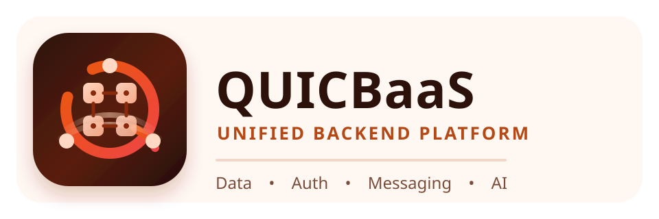

# QuicBaaS



[](https://www.gnu.org/licenses/agpl-3.0)
[](https://go.dev/)
[]()

**QuicBaaS** is a modern multi-model distributed database and Backend-as-a-Service built for the agentic cloud era.

## What Makes QuicBaaS Different

| Capability | QuicBaaS | Traditional DBs | Vector DBs |
|------------|----------|-----------------|------------|
| **Multi-Model** | KV + Vector + Time-series + Objects | Usually single model | Vector only |
| **AI-Native** | RAG pipelines, multi-provider embeddings, MCP tools | External integration required | Limited to search |
| **Agentic Ready** | 300+ MCP tools for AI agents | No agent support | Minimal |
| **Security** | IAM/ABAC/PEP, FIPS 140-3, per-tenant encryption | Varies | Basic |
| **BaaS Features** | IAM, KMS, Secrets, Scheduler, Service Discovery | Separate services required | None |
| **Auth** | WebAuthn, OAuth2/OIDC, SSO, MFA | Basic auth | API keys |
| **Multi-Protocol** | gRPC, REST, QUIC, MCP, Unix | Usually 1-2 protocols | REST/gRPC |
| **HA/Ops** | Multi-DC failover, zero-downtime ops | Manual | Limited |

## Key Features

### Core Database
- **Strong Consistency** - Linearizable reads/writes via Raft consensus
- **Multi-Raft Scaling** - Independent Raft groups for horizontal partitioning
- **High Performance** - 15,865 ops/sec with sub-12ms P99 latency
- **Modular Storage** - Pluggable backends: Memory, File, PebbleDB, or Raft-replicated
- **Smart Caching** - Multi-tier L1/L2 cache with sharding, TTL, and tag-based invalidation
- **Watch API** - Real-time change notifications with prefix watching

### AI-Native Capabilities
- **Vector Search** - HNSW/IVF indexing with similarity search, hybrid search, and metadata filtering
- **RAG Pipelines** - Embed -> search -> rerank -> build context with token-aware limits
- **Embedding Providers** - Ollama, OpenAI, LMStudio, Voyage AI with caching
- **MCP Protocol** - 297 tools for AI agent integration (Claude, Codex, Gemini, etc.)

### Security & Identity
- **IAM System** - Multi-tenant identity with users, groups, roles, policies, and sessions
- **ABAC/PEP Engine** - Sub-5us policy evaluation with distributed PEP cache sync
- **Policy Engine** - Time, network, and attribute conditions with bloom filter caching
- **WebAuthn/FIDO2** - Passwordless authentication with passkeys and hardware keys
- **MFA/TOTP** - Multi-factor authentication with backup codes
- **OAuth2/OIDC** - Full authorization server and federated identity provider
- **SSO** - Single Sign-On across applications
- **FIPS 140-3** - Compliant cryptography for regulated environments
- **GDPR Compliance** - Consent management, data export, and right-to-deletion

### Encryption & Key Management
- **KMS** - Multiple backends: AWS, GCP, Azure, HashiCorp Vault, PKCS#11 (HSM)
- **Secrets Engine** - Versioned secrets with soft delete, rotation, and watch API
- **Encryption at Rest** - Per-tenant encryption with AES-256-GCM and ChaCha20-Poly1305
- **Key Rotation** - Automatic rotation without downtime

### Storage Options
- **Key-Value** - Fast distributed KV with MVCC, transactions, and leases
- **Vector Store** - Multi-tenant namespaces with per-tenant encryption
- **Time-Series** - Metrics storage with aggregations and retention policies
- **Object Storage** - S3/GCS/Azure/MinIO with catalog, tiering, and ACLs
- **Parameter Store** - Configuration management with versioning and tags
- **Distributed Cache** - High-performance caching with cluster-wide invalidation

### High Availability & Operations
- **HA/Failover** - Automatic failover with multi-datacenter support
- **Multi-Protocol API** - gRPC, REST, QUIC, MCP, and Unix socket interfaces
- **Prometheus Metrics** - Comprehensive observability with Grafana dashboards
- **Container Secrets** - Works with Kubernetes, Docker, Podman
- **Backup/Restore** - Full and incremental backups to object storage
- **Node Replacement** - Zero-downtime node replacement and rebalancing

## Modular Build System

QuicBaaS uses Go build tags for modular compilation. Default builds include all features. Exclude features to reduce binary size or attack surface.

### Build Profiles

```bash
# Full-featured build (default)
make build

# Pre-configured profiles
make build-minimal     # Core KV + gRPC only (~60% smaller)
make build-embedded    # Single-node, no clustering
make build-standard    # Cluster mode, no AI features
make build-cluster     # All features, no cloud KMS
make build-enterprise  # All features + cloud KMS
make build-full        # Everything including HSM, quantum

# FIPS 140-3 compliant build
make build-fips
```

### Feature Control

Exclude specific features at build time:

```bash
# Without IAM (~96 commands excluded)
make build WITH_IAM=0

# Without time series (~7 commands excluded)
make build WITH_TIMESERIES=0

# Without AI features
make build WITH_VECTOR=0 WITH_RAG=0 WITH_MCP=0

# Without REST API (gRPC only)
make build WITH_REST=0

# Multiple exclusions
make build WITH_IAM=0 WITH_TIMESERIES=0 WITH_QUIC=0
```

### Build Tag Reference

| Tag | Default | Commands | Description |
|-----|---------|----------|-------------|
| `raft` | ON | - | Distributed consensus and clustering |
| `iam` | ON | ~96 | IAM/ABAC multi-tenant authorization |
| `timeseries` | ON | 7 | Time series metrics storage |
| `vector` | ON | - | Vector database (HNSW indexing) |
| `rag` | ON | - | RAG pipelines (requires vector) |
| `rest` | ON | - | REST/HTTP API server |
| `quic` | ON | - | QUIC protocol support |
| `mcp` | ON | - | MCP AI agent tools |
| `fips` | OFF | - | FIPS 140-3 cryptography |

See [docs/BUILD_TAGS.md](docs/BUILD_TAGS.md) for complete reference including KMS backends, codecs, and object storage tags.

## Storage Backend Configuration

QuicBaaS supports multiple storage backends, configurable per use case:

```yaml
storage:
  # Backend options: memory, file, pebble, raft
  backend: pebble

  # PebbleDB settings (production recommended)
  pebble:
    data_dir: /var/lib/quicbaas
    cache_size: 512MB
    wal_dir: /var/lib/quicbaas/wal

  # Memory backend (testing, ephemeral data)
  memory:
    max_size: 1GB

  # File backend (simple persistence)
  file:
    data_dir: /var/lib/quicbaas
    sync_writes: true
```

| Backend | Use Case | Persistence | Performance |
|---------|----------|-------------|-------------|
| `memory` | Testing, caches | No | Fastest |
| `file` | Simple deployments | Yes | Good |
| `pebble` | Production | Yes | Best |
| `raft` | Distributed | Yes + Replicated | Consistent |

## Quick Start

### Build

```bash
git clone https://github.com/jeremyhahn/go-quicbaas.git
cd go-quicbaas
make deps && make build
```

### Run Standalone Server

```bash
./bin/quicbaas start \
  --grpc-port 50051 \
  --http-port 8080 \
  --data-dir ./data
```

### Run 3-Node Cluster

```bash
make dev-start          # Start cluster
docker compose ps       # Check status
make dev-down           # Stop cluster
```

## Usage Examples

### Key-Value Operations

```go
import quicbaas "github.com/jeremyhahn/go-quicbaas/sdk/go"

client, _ := quicbaas.New(
    quicbaas.WithAddress("localhost:50051"),
    quicbaas.WithTransport(quicbaas.TransportGRPC),
)
defer client.Close()

// Basic operations
client.KV().Put(ctx, "user:1", []byte(`{"name":"Alice"}`))
value, _ := client.KV().Get(ctx, "user:1")

// Transactions
tx, _ := client.Transaction().Begin(ctx)
tx.Put("account:1", []byte(`{"balance":1000}`))
tx.Put("account:2", []byte(`{"balance":500}`))
tx.Commit()

// Watch for changes
watcher, _ := client.KV().WatchPrefix(ctx, "user:")
for event := range watcher.Events() {
    fmt.Printf("Key %s changed: %s\n", event.Key, event.Type)
}
```

### IAM & Access Control

```go
// Create a tenant
client.IAM().CreateTenant(ctx, &iam.CreateTenantRequest{
    TenantID: "acme-corp",
    Name:     "Acme Corporation",
    Settings: &iam.TenantSettings{
        MFARequired: true,
        MaxUsers:    1000,
    },
})

// Create a user
client.IAM().CreateUser(ctx, &iam.CreateUserRequest{
    TenantID: "acme-corp",
    Username: "alice",
    Email:    "alice@acme.com",
    Roles:    []string{"developer"},
})

// Create an ABAC policy
client.IAM().CreatePolicy(ctx, &iam.CreatePolicyRequest{
    TenantID: "acme-corp",
    Policy: &iam.Policy{
        Name:        "dev-read-staging",
        Description: "Developers can read staging resources",
        Effect:      iam.EffectAllow,
        Actions:     []string{"read", "list"},
        Resources:   []string{"staging:*"},
        Conditions: []*iam.Condition{
            {
                Type:     "time",
                Operator: "between",
                Values:   []string{"09:00", "18:00"},
            },
            {
                Type:     "network",
                Operator: "in_cidr",
                Values:   []string{"10.0.0.0/8"},
            },
        },
    },
})

// Check authorization
decision, _ := client.IAM().Check(ctx, &iam.CheckRequest{
    TenantID: "acme-corp",
    Subject:  "user:alice",
    Action:   "read",
    Resource: "staging:config/database",
})
fmt.Printf("Allowed: %v, Reason: %s\n", decision.Allowed, decision.Reason)
```

### Vector Search & RAG

```go
// Store vectors with metadata
client.Vector().Upsert(ctx, "knowledge-base", "doc-1", embedding, map[string]string{
    "title":    "QuicBaaS Architecture",
    "category": "documentation",
})

// Similarity search
results, _ := client.Vector().Search(ctx, "knowledge-base", queryVector, 10)

// Hybrid search (vector + metadata filter)
results, _ := client.Vector().HybridSearch(ctx, &vector.HybridSearchRequest{
    Namespace: "knowledge-base",
    Vector:    queryVector,
    Filters:   map[string]string{"category": "documentation"},
    Limit:     10,
})

// RAG pipeline (embed -> search -> build context)
ragResult, _ := client.RAG().Query(ctx, &rag.QueryRequest{
    Query:      "How does Raft consensus work?",
    Namespace:  "knowledge-base",
    MaxTokens:  4000,
    Model:      "nomic-embed-text",
})
fmt.Println(ragResult.Context) // Ready for LLM prompt
```

### Secrets & KMS

```go
// Store secrets with versioning
client.Secrets().Put(ctx, "apps/myapp/db-password", map[string][]byte{
    "username": []byte("admin"),
    "password": []byte("secret123"),
})

// Get current version
secret, _ := client.Secrets().Get(ctx, "apps/myapp/db-password")

// Get specific version
secret, _ := client.Secrets().GetVersion(ctx, "apps/myapp/db-password", 2)

// KMS encryption
ciphertext, _ := client.KMS().Encrypt(ctx, "my-key", plaintext)
plaintext, _ := client.KMS().Decrypt(ctx, "my-key", ciphertext)

// Key rotation
client.KMS().RotateKey(ctx, "my-key")
```

### Caching

```go
// Cache with TTL
client.Cache().Set(ctx, "session:abc123", sessionData, 30*time.Minute)
data, _ := client.Cache().Get(ctx, "session:abc123")

// Cache with tags for bulk invalidation
client.Cache().SetWithTags(ctx, "user:1:profile", profileData, []string{"user:1"}, 1*time.Hour)
client.Cache().SetWithTags(ctx, "user:1:settings", settingsData, []string{"user:1"}, 1*time.Hour)

// Invalidate all caches for a user
client.Cache().InvalidateByTag(ctx, "user:1")
```

### REST API

```bash
# Key-Value
curl -X PUT http://localhost:8080/api/v1/kv/user:1 \
  -H "Content-Type: application/json" \
  -d '{"value":"eyJuYW1lIjoiQWxpY2UifQ=="}'

# IAM - Create user
curl -X POST http://localhost:8080/api/v1/iam/tenants/acme/users \
  -H "Authorization: Bearer $TOKEN" \
  -d '{"username":"bob","email":"bob@acme.com","roles":["viewer"]}'

# IAM - Check authorization
curl -X POST http://localhost:8080/api/v1/iam/check \
  -H "Authorization: Bearer $TOKEN" \
  -d '{"tenant_id":"acme","subject":"user:bob","action":"read","resource":"docs:readme"}'

# Vector Search
curl -X POST http://localhost:8080/api/v1/vector/search \
  -H "Content-Type: application/json" \
  -d '{"namespace":"docs","vector":[0.1,0.2,...],"limit":10}'

# RAG Query
curl -X POST http://localhost:8080/api/v1/rag/query \
  -H "Content-Type: application/json" \
  -d '{"query":"What is QuicBaaS?","namespace":"docs","max_tokens":4000}'
```

### MCP Tools (AI Agents)

QuicBaaS exposes **297 MCP tools** across 24 categories for comprehensive AI agent integration:

| Category | Tools | Description |
|----------|-------|-------------|
| **Core KV/Cluster** | 35 | CRUD, batch, transactions, cluster ops, backup, health |
| **KMS** | 32 | Key generation, rotation, DEK management, encryption ops |
| **Secrets** | 11 | Versioned secrets, rotation, watch API |
| **Crypto** | 12 | Encrypt, decrypt, sign, verify, HMAC, hash |
| **IAM** | 62 | Tenants, users, groups, roles, policies, GDPR, admin |
| **Vector** | 22 | Upsert, search, namespace, stats, rebalancing |
| **Embedding** | 7 | Generation, batch ops, provider management |
| **RAG** | 2 | Query, context building |
| **Ollama** | 5 | Embedding and model operations |
| **Time-Series** | 7 | Write, query, retention, metrics |
| **Certificates** | 6 | Issue, sign, revoke, verify |
| **Dynamic Secrets** | 8 | Role management, credential generation |
| **Parameters** | 8 | Config CRUD, batch, search |
| **Object Storage** | 36 | Objects, admin, transfers, policies |
| **Scheduler** | 10 | Jobs CRUD, trigger, pause/resume, history |
| **Seal/Unseal** | 8 | Initialization, seal status, rekey |
| **Cluster DEK** | 9 | Node sync, re-encryption management |

```json
// Key-Value operations
{"tool": "quicbaas.kv.put", "arguments": {"key": "user:1", "value": "base64data"}}
{"tool": "quicbaas.kv.get", "arguments": {"key": "user:1"}}
{"tool": "quicbaas.batch.put", "arguments": {"items": [{"key": "k1", "value": "v1"}]}}

// Vector search
{"tool": "quicbaas.vector.upsert", "arguments": {"namespace": "docs", "id": "doc1", "vector": [0.1, 0.2]}}
{"tool": "quicbaas.vector.search", "arguments": {"namespace": "docs", "vector": [0.1, 0.2], "topK": 10}}

// RAG pipeline
{"tool": "quicbaas.rag.query", "arguments": {"query": "How does Raft work?", "namespace": "docs"}}

// KMS operations
{"tool": "quicbaas.kms.generateKey", "arguments": {"keyId": "my-key", "algorithm": "AES256"}}
{"tool": "quicbaas.crypto.encrypt", "arguments": {"keyId": "my-key", "plaintext": "base64data"}}

// Secrets management
{"tool": "quicbaas.secrets.store", "arguments": {"path": "apps/myapp/db", "data": {"password": "secret"}}}
{"tool": "quicbaas.secrets.get", "arguments": {"path": "apps/myapp/db"}}

// IAM operations
{"tool": "quicbaas.iam.createUser", "arguments": {"tenantId": "acme", "username": "alice"}}
{"tool": "quicbaas.iam.checkPermission", "arguments": {"subject": "user:alice", "action": "read", "resource": "docs:*"}}

// Scheduler
{"tool": "quicbaas.scheduler.createJob", "arguments": {"name": "backup", "schedule": "0 2 * * *"}}
```

## Performance

| Metric | Value |
|--------|-------|
| **Throughput** | 15,865 ops/sec |
| **P50 Latency** | 2.52 ms |
| **P99 Latency** | 11.64 ms |
| **ABAC Evaluation** | < 5 microseconds |
| **Cache Hit** | < 100 nanoseconds |
| **Vector Search** | HNSW O(log n) |

## Documentation

### Getting Started
- [Quickstart Guide](docs/getting-started/quickstart.md)
- [CLI Reference](docs/cli/README.md)
- [Configuration](docs/configuration/README.md)

### Core Features
- [Architecture Overview](docs/architecture/README.md)
- [Key-Value Store](docs/storage/README.md)
- [Transactions](docs/architecture/transactions.md)
- [Caching](docs/cache/README.md)

### AI & ML
- [Vector Search](docs/vector/README.md) - HNSW indexing, similarity search, multi-tenancy
- [RAG Context API](docs/rag/README.md) - Context building for LLMs
- [Ollama Integration](docs/ollama/README.md) - Embedding generation

### Security & Identity
- [IAM System](docs/iam/README.md) - Users, groups, roles, multi-tenancy
- [ABAC Policies](docs/iam/abac.md) - Attribute-based access control
- [Policy Syntax](docs/iam/abac-policy-syntax.md) - Policy language reference
- [WebAuthn/FIDO2](docs/iam/webauthn.md) - Passwordless authentication
- [KMS](docs/security/kms.md) - Key management service
- [Secrets Engine](docs/secrets/README.md) - Secret storage with versioning
- [Security Hardening](docs/security/hardening-guide.md)
- [FIPS Compliance](docs/security/fips.md)

### Build & Deploy
- [Build Tags Reference](docs/BUILD_TAGS.md) - Modular compilation options

### Storage
- [Storage Backends](docs/storage/backends.md) - Memory, File, PebbleDB, Raft
- [Object Storage](docs/storage/object/README.md) - Multi-backend with catalog and tiering
- [Parameter Store](docs/parameters/README.md) - Configuration management

### APIs & SDKs
- [Go SDK](docs/sdk/go/README.md) - Unified client library
- [gRPC API](docs/api/grpc.md)
- [REST API](docs/api/rest.md)
- [MCP Protocol](docs/api/mcp.md) - AI agent integration

### Operations
- [Container Secrets](docs/kubernetes/README.md) - Kubernetes, Docker, Podman
- [Monitoring](docs/operations/monitoring.md)
- [Backup & Restore](docs/operations/backup.md)
- [Cluster Operations](docs/cluster/README.md)
- [Production Checklist](docs/deployment/production-checklist.md)

## Architecture

```
+--------------------------------------------------------------+
|                    Client Layer                              |
|     Go SDK | gRPC | REST | QUIC | MCP (AI Agents) | Unix    |
+--------------------------------------------------------------+
|                    API Layer                                 |
|   Authentication | Authorization (RBAC/ABAC) | Rate Limit   |
+--------------------------------------------------------------+
|                    Service Layer                             |
|  KV | Vector | IAM | KMS | Secrets | Objects | RAG | Cache  |
+--------------------------------------------------------------+
|                    Raft Consensus Layer                      |
|         Multi-Raft Groups | Leader Election | Replication   |
+--------------------------------------------------------------+
|                    Storage Layer                             |
|   Memory | File | PebbleDB | HNSW Indexes | Object Backends |
+--------------------------------------------------------------+
```

## Testing

```bash
make test              # Unit tests
make integration-test  # Integration tests
make perf-test         # Performance benchmarks
make coverage          # Coverage report
```

## Deployment

### Docker

```bash
make docker-build
docker run -p 50051:50051 -p 8080:8080 quicbaas:latest
```

### Kubernetes

```bash
kubectl apply -f deployments/kubernetes/
helm install quicbaas ./deployments/helm/quicbaas
```

## Contributing

Contributions welcome! See [docs/development/testing-guide.md](docs/development/testing-guide.md) for guidelines.

## License

QuicBaaS is dual-licensed:

1. **GNU Affero General Public License v3.0 (AGPL-3.0)** - [LICENSE](LICENSE)
2. **Commercial License** - Contact licensing@automatethethings.com

## Acknowledgments

- [QuicRaft](https://github.com/jeremyhahn/go-quicraft) - Multi-group Raft library with QUIC transport
- [PebbleDB](https://github.com/cockroachdb/pebble) - LSM-tree storage engine
- [HNSW](https://github.com/nmslib/hnswlib) - Approximate nearest neighbor search

---

**QuicBaaS** - The AI-native database for the agentic era.
