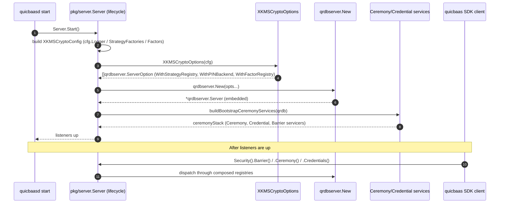

# Server Composition: Wiring qrdb + xkms into quicbaasd

## Scope

QuicBaaS is a 4-level composition stack: **go-quicraft(L1)** →
**go-qrdb(L2)** → **go-xkms(L3)** → **go-quicbaas(L4)**.
Each layer owns specific primitives.

QuicBaaS does not contain its own sealing strategies, PIN backend,
authentication factor implementations, or distributed key-value store
primitives. It composes those from two upstream libraries at server
startup:

- **go-qrdb(L2)** — software StorageBarrier (Software + None + Shamir
  strategies), PIN hashing, the `FactorRegistry` contract, and the source
  of truth for tenant-safe barrier-encrypted distributed primitives
  (vector storage + k-NN search via persistent HNSW, embedding provider
  proxy for Ollama/OpenAI/LMStudio/Voyage).
- **go-xkms(L3)** — every hardware-backed backend (TPM2, PKCS#11, AWS KMS,
  GCP KMS, Azure Key Vault, HashiCorp Vault) and every hardware Factor
  (FIDO2, PIV, PKCS#11).

The composition contract is the locked architecture rule **"qrdb(L2) =
software only + distributed encryption + tenant-safe primitives; xkms(L3)
= all hardware; quicbaas(L4) = RAG orchestration + LLM generation + API
facade; composition via `With*`"**.
This page documents how `pkg/server/compose.go` enforces that rule and
how `cmd/quicbaasd` consumes the result.

## Why composition (not inheritance)

The earlier design embedded a hardcoded `seal.StrategyRegistry` inside
qrdb and a parallel `authfactors.Factor` set inside qrdbjust to satisfy
unit tests. That violated three rules at once:

1. Hardware code lived in two repos (qrdb + xkms), drifting out of
   sync.
2. qrdb shipped factor adapters it could not actually exercise without
   a TPM/PIV reader/HSM at the test bench.
3. quicbaas had no single, testable seam where an operator could
   inject a custom strategy or factor.

Phase 4 of the unification plan resolved this by making qrdb expose
four `With*` options on its embedded server constructor —
`WithStrategyRegistry`, `WithPINBackend`, `WithFactorRegistry`, and
`WithCeremonyCA` — and pushing all hardware construction up to
quicbaas, where the xkms SDK already lives.

## The composition seam

The entry point is
[`pkg/server/compose.go`](../../pkg/server/compose.go):

```go
// pkg/server/compose.go:88
func XKMSCryptoOptions(cfg *XKMSCryptoConfig) ([]qrdbserver.ServerOption, error)
```

It returns the canonical set of `qrdbserver.ServerOption` values for
an embedded qrdb server configured according to `cfg`. The returned
slice is independent of the input and safe to pass directly to
`qrdbserver.New(...)`.

### XKMSCryptoConfig

`XKMSCryptoConfig` describes the hardware backends and Factor
implementations quicbaas composes into the embedded qrdb server.
Every field is optional: a nil/empty config yields qrdb's software-only
defaults.

| Field | Type | Default | Purpose |
|-------|------|---------|---------|
| `Logger` | `*slog.Logger` | `slog.Default()` | Composition-time log sink |
| `PINStorage` | `pin.Storage` | in-memory map | Backing store for the default SoftwareBackend |
| `PINBackend` | `pin.PINBackend` | constructed from `PINStorage` | Override the default with a hardware PIN backend (TPM2 / PKCS#11) |
| `StrategyFactories` | `map[seal.StrategyID]seal.StrategyFactory` | empty | Hardware-backed sealing strategies registered alongside the software defaults |
| `Factors` | `[]authfactors.Factor` | empty | xkms-backed authentication factors (FIDO2 / PIV / PKCS#11) |

Source: [`pkg/server/compose.go:33-61`](../../pkg/server/compose.go).

### Composition algorithm

```mermaid
flowchart TD
    Start[XKMSCryptoOptions cfg] --> NilCheck{cfg == nil?}
    NilCheck -->|yes| EmptyCfg[cfg = &XKMSCryptoConfig{}]
    NilCheck -->|no| HasCfg[use caller cfg]
    EmptyCfg --> LogCheck
    HasCfg --> LogCheck

    LogCheck{Logger nil?} -->|yes| DefaultLog[logger = slog.Default]
    LogCheck -->|no| KeepLog[keep cfg.Logger]
    DefaultLog --> Strategy
    KeepLog --> Strategy

    Strategy[strategyReg = seal.NewDefaultStrategyRegistry] --> StrategyLoop[for each cfg.StrategyFactories]
    StrategyLoop --> Register[strategyReg.Register name, factory]
    Register --> RegisterErr{err?}
    RegisterErr -->|yes| FailReg[return ComposeError stage='register strategy']
    RegisterErr -->|no| StrategyLoop
    StrategyLoop --> PinCheck

    PinCheck{cfg.PINBackend nil?} -->|no| UseCustom[pinBackend = cfg.PINBackend]
    PinCheck -->|yes| MakeSoftware[pinBackend = pin.NewSoftwareBackend cfg.PINStorage, pin.AutoDetectHashConfig]
    MakeSoftware --> SoftErr{err?}
    SoftErr -->|yes| FailPin[return ComposeError stage='construct default pin.SoftwareBackend']
    SoftErr -->|no| Factors
    UseCustom --> Factors

    Factors[factorReg = authfactors.NewFactorRegistry] --> FactorLoop[for each cfg.Factors]
    FactorLoop --> RegFactor[factorReg.Register factor]
    RegFactor --> FactorErr{err?}
    FactorErr -->|yes| FailFactor[return ComposeError stage='register factor']
    FactorErr -->|no| FactorLoop
    FactorLoop --> Return

    Return[return WithStrategyRegistry, WithPINBackend, WithFactorRegistry]
```

The algorithm is intentionally additive: software defaults are
created first, hardware overrides are layered on top, and every
register call surfaces a typed `ComposeError` that names the failing
stage.

```go
// pkg/server/compose.go:99
return nil, &ComposeError{Stage: "register strategy " + string(name), Cause: err}
```

`*ComposeError` implements `Error()` and `Unwrap()` so callers can
`errors.As(err, &ce)` to inspect the failing stage.

## Defaults (cfg nil)

When `cfg == nil` (the test path and the "software-only" production
deployment):

| Component | Concrete type | Strategies | Notes |
|-----------|---------------|------------|-------|
| `StrategyRegistry` | `seal.NewDefaultStrategyRegistry()` | `Software`, `None` | Provided by qrdb |
| `PINBackend` | `pin.NewSoftwareBackend(nil, pin.AutoDetectHashConfig())` | n/a | PBKDF2 in FIPS mode, Argon2id otherwise |
| `FactorRegistry` | `authfactors.NewFactorRegistry()` | empty | Caller adds factors via `cfg.Factors` |
| `CeremonyCA` | (unset) | n/a | Ceremony falls back to its software CA |

## Hardware deployments

When `cfg.StrategyFactories` carries entries, they are registered into
the same registry as the software defaults so a single registry
advertises every active strategy. The same is true for `cfg.Factors`.

A typical hardware-enabled composition looks like:

```go
// quicbaasd / lifecycle wiring
cfg := &server.XKMSCryptoConfig{
    Logger:     slogger,
    PINStorage: pinStore,            // PebbleDB-backed, scoped to the data dir
    StrategyFactories: map[seal.StrategyID]seal.StrategyFactory{
        seal.StrategyTPM2:    xkms.NewTPM2StrategyFactory(tpmDevice),
        seal.StrategyPKCS11:  xkms.NewPKCS11StrategyFactory(p11Module),
        seal.StrategyAWSKMS:  xkms.NewAWSKMSStrategyFactory(awsCfg),
    },
    Factors: []authfactors.Factor{
        xkms.NewFIDO2Factor(fido2Authenticator),
        xkms.NewPIVFactor(pivReader),
    },
}
opts, err := server.XKMSCryptoOptions(cfg)
if err != nil {
    return err
}
qrdbServer, err := qrdbserver.New(opts...)
```

`PINBackend` is left nil so the SoftwareBackend with persistent
storage is constructed automatically; a TPM2-backed PIN would be
supplied by setting `cfg.PINBackend` directly.

## How CeremonyCA fits in

The ceremony layer needs a CA to mint officer and share certificates
during initialisation. Software-only deployments use a self-issued CA
constructed by the bootstrap flow; hardware deployments inject an
xkms-backed CA (typically rooted in TPM2 or PKCS#11) via the
`WithCeremonyCA` option on the qrdb embedded server.

`XKMSCryptoOptions` does not own the CeremonyCA; that wiring
lives alongside the bootstrap services in
[`pkg/server/ceremony_wiring.go`](../../pkg/server/ceremony_wiring.go).
The CA is built once per data dir, persists across daemon restarts,
and is the source of truth for officer issuance + ceremony share
distribution.

## Phase B: standalone mode embeds the real qrdb engine

Since Phase B of the unified-engine refactor, **standalone mode** (the
default `server.mode` when no Raft cluster is configured) no longer runs a
no-op Raft node backed by quicbaas's own per-shard `baasTransport` stores.
Instead it calls `qrdbnode.NewStandaloneNode` to embed the real qrdb engine
in-process.

### What changes

| Before Phase B | After Phase B |
|----------------|---------------|
| `standaloneRaftNode` (no-op) + `baasTransport` per-shard Pebble stores | `qrdbnode.NewStandaloneNode` — real qrdb engine, no Raft SM |
| quicbaas built its own `dataPlaneBarrier` + `atrest.Encryptor` (duplicate) | qrdb node owns the barrier + at-rest encryptor end-to-end |
| `XKMSCryptoOptions` result was built but never passed anywhere | Result is passed as `serverOpts` to `NewStandaloneNode` — hardware crypto is live |
| Per-shard `ShardedClient.ForShard` created new `baasTransport` clients | `ForShard` returns `node.Client()` — the same in-process embedded transport client for every shard ID |

### How it works

`Server.initialize()` in `pkg/server/server.go` calls
`s.initStandaloneQRDBNode()` (defined in `pkg/server/qrdb_node.go`) for the
standalone branch, which:

1. Calls `buildQRDBConfig` to map quicbaas `Storage/Seal/Raft` config fields
   to a `*qrdbconfig.Config`.
2. Calls `buildQRDBComposeOpts` which invokes `XKMSCryptoOptions` with
   hardware strategy factories from `seal_factories.go` populated for the
   configured strategy.
3. Calls `qrdbnode.NewStandaloneNode(ctx, qcfg, serverOpts, ...)` — the
   returned `*Node` owns a `LocalBackend` (no Raft SM), the StorageBarrier, the
   at-rest `Encryptor`, and all service instances (KV/MVCC/TS/Vector/Barrier/
   Ceremony/Credential/Tenant).
4. Stores the node on `s.qrdbNode`.

`startService()` in `lifecycle.go` detects `s.qrdbNode != nil` and creates a
`nodeBackedShardedClient` (via `newNodeBackedShardedClient`) that wraps
`node.Client()`. `ShardedClient.ForShard` short-circuits to return that single
client for every shard ID; the qrdb engine handles all routing internally.

### quicbaas → qrdb config mapping

| quicbaas field | qrdb field | Notes |
|----------------|------------|-------|
| `cfg.Storage.DataDir` | `qcfg.Raft.DataDir` | Primary data root; qrdb uses `Raft.DataDir` for pebble + seal sub-stores |
| `cfg.Seal.BarrierDir` | `qcfg.Raft.DataDir` (fallback) | Used when `Storage.DataDir` is empty |
| `cfg.Storage.Backend` | `qcfg.Databases[0].Backend` | `"memory"` / `"file"` / `"pebble"` (identical names) |
| `cfg.Seal.Enabled` | `qcfg.Seal.Enabled` | Direct copy |
| `cfg.Seal.Strategy` | `qcfg.Seal.Strategy` | Defaults to `"passphrase"` when empty |
| `cfg.Seal.Threshold` | `qcfg.Seal.ShamirThreshold` | Shamir M-of-N threshold |
| `cfg.Seal.TotalShares` | `qcfg.Seal.ShamirTotal` | Shamir total shares |

### Hardware crypto injection

`buildQRDBComposeOpts` wraps each entry in `hardwareStrategyFactories`
(populated at `init()` time by `seal_factories.go` and the tagged
`seal_factory_*.go` files) as a `qrdbsdk.StrategyFactory` closure that
captures the quicbaas `*config.Config`. The resulting `[]qrdbsdk.ServerOption`
is passed verbatim to `NewStandaloneNode` → `server.New` — this is the first
time hardware crypto (TPM2/PKCS#11/cloud KMS) + at-rest encryption +
per-tenant barriers actually apply to the quicbaas data plane.

## Phase C: clustered mode embeds the real qrdb Raft host

Since Phase C, **clustered mode** (`server.mode = "cluster"`) no longer runs
a no-op `standaloneRaftNode` + `baasTransport` stack. It calls
`qrdbnode.NewClusteredNode` to embed a real quicraft Raft host in-process.

### What changes (Phase C)

| Before Phase C | After Phase C |
|----------------|---------------|
| `standaloneRaftNode` (no-op) + legacy `baasTransport` per-shard stores | `qrdbnode.NewClusteredNode` — real quicraft host, MVCC SM factory |
| quicbaas built its own barrier + at-rest encryptor for cluster mode | qrdb node owns barrier + at-rest end-to-end |
| No real Raft consensus | Full quicraft Raft consensus (multi-node or single-node-clustered) |
| Ceremony/credential built separately via `buildBootstrapCeremonyServices` | Node's `Services().Ceremony` / `.Credential` wired for both modes |

### How it works (cluster)

`Server.initialize()` calls `s.initClusteredQRDBNode()` for the cluster
branch, which:

1. Calls `buildQRDBConfig(cfg, true)` — populates Raft address, shard/replica
   IDs, deployment ID, peer list, and discovery method.
2. Calls `buildClusterMembers(cfg)` — parses `cfg.Raft.JoinAddresses` into
   `map[replicaID]raftAddress`. Falls back to single-node map when no
   `id=`-prefixed peers are configured.
3. Calls `buildRaftMTLSConfig(cfg)` — loads PEM bytes from
   `cfg.Raft.TLSCertFile` / `TLSKeyFile` / `TLSCAFile`. Returns nil for
   single-node clusters (no transport = no mTLS needed).
4. Calls `qrdbnode.NewClusteredNode(ctx, qcfg, members, serverOpts, nodeOpts...)`
   with `WithRaftMTLS(mtls)` when mtls is non-nil.
5. Stores the node on `s.qrdbNode`.

`startService()` detects `s.qrdbNode != nil` (same path for both standalone
and clustered), creates a `nodeBackedShardedClient`, and populates
`s.ceremonyServices` from the node's `Services().Barrier` / `.Ceremony` /
`.Credential` when the seal barrier is enabled.

### quicbaas → qrdb config mapping (cluster additions)

| quicbaas field | qrdb field | Notes |
|----------------|------------|-------|
| `cfg.Raft.RaftAddress` | `qcfg.Raft.RaftAddress` | Raft peer address |
| `cfg.Raft.ListenAddress` | `qcfg.Raft.ListenAddress` | Bind address |
| `cfg.Raft.NodeID` | `qcfg.Raft.ReplicaID` + `DeploymentID` | ReplicaID = NodeID; DeploymentID = NodeID (min 1) |
| `cfg.Raft.JoinAddresses` (id= prefix) | `qcfg.Raft.Peers` | Comma-separated `id=addr` peer list |
| `cfg.Discovery.Type` | `qcfg.Discovery.Method` | `static`/`multicast`/`dns`/`token`; k8s/consul → `static` |
| `cfg.Discovery.Multicast.ClusterSecret` | `qcfg.Discovery.MulticastSecret` | HMAC secret for multicast |
| `cfg.Raft.TLSCertFile` / `TLSKeyFile` / `TLSCAFile` | `quicraftconfig.MTLSConfig` | Loaded and passed via `WithRaftMTLS` |

### `baasTransport` (legacy, unreachable in cluster mode)

`baasTransport*.go` still compiles but is unreachable in cluster mode since
Phase C. It will be deleted in Phase E once Phase D confirms no references remain.

## Wire path: composer → qrdb server → SDK consumer



## Failure modes

`ComposeError` carries the wiring stage that failed:

| Stage prefix | Cause |
|--------------|-------|
| `register strategy <id>` | A `StrategyFactory` returned a non-nil error from `Register` (usually a duplicate-name collision with the software defaults) |
| `construct default pin.SoftwareBackend` | `pin.NewSoftwareBackend` failed (typically out-of-memory or invalid `pin.AutoDetectHashConfig` in a sandboxed FIPS environment) |
| `register factor <name>` | A `Factor` returned a non-nil error from `Register` (usually a duplicate-name collision) |

All three are recoverable: the operator can prune the duplicate, fix
the hash config, and rerun `quicbaasd start`. `XKMSCryptoOptions`
is idempotent — calling it twice with the same `cfg` produces two
independent registries, so a retry is safe.

## Test coverage

- [`pkg/server/compose_test.go`](../../pkg/server/compose_test.go)
  exercises every branch: nil cfg, software-only cfg, duplicate
  strategy registration, duplicate factor registration, custom
  PINBackend override, and `ComposeError.Unwrap` traversal.
- The same harness runs against an xkms `StrategyFactory` test double
  to confirm hardware factories integrate without panic.

## Relationship to the rest of the platform

| Layer | Repo | Role | Composition seam |
|-------|------|------|------------------|
| L2 | go-qrdb | Software StorageBarrier + canonical first-boot + named credentials + **tenant-safe vector storage + persistent HNSW + embedding provider proxy** | `WithStrategyRegistry`, `WithPINBackend`, `WithFactorRegistry`, `WithCeremonyCA` |
| L3 | go-xkms | All hardware backends + all hardware factors | Producers of `StrategyFactory` and `authfactors.Factor` |
| **L4** | **go-quicbaas** | **Composer + multi-protocol facade + SDK frontage + RAG orchestration + LLM text generation + chunking + ranking + context assembly** | `XKMSCryptoOptions` is the single point where qrdb(L2) and xkms(L3) meet; go-quicbaas owns RAG pipeline logic and delegates vector ops to qrdb via SDK |
| L5 | go-trusted-platform | Downstream consumer | Imports `sdk/go` only — never touches qrdb or xkms directly |

## Passphrase barrier auto-unseal (Phase F addition)

A passphrase-strategy qrdb node boots **sealed** by default — `node.Client()`
returns nil until the operator supplies the passphrase via the barrier API.
For the `quicbaasd init` path and for operators who want the daemon to self-unseal
at boot, the passphrase can be injected at construction time:

```go
srv, err := server.NewServer(cfg,
    server.WithSealPassphrase([]byte("admin-passphrase")),
)
```

`WithSealPassphrase` is a `server.ServerOption`. Internally it forwards the
passphrase to `qrdbnode.WithSealPassphrase` inside `initStandaloneQRDBNode` /
`initClusteredQRDBNode`. Without it the node is returned sealed and
`GetKVStore` will panic on first call (the "vector storage init: barrier is
sealed" failure). For daemons that require explicit operator unsealing, omit
the option and use the REST/gRPC barrier-unseal endpoint after boot.

## Cluster DeploymentID (Phase F addition)

All nodes in a Raft cluster must share the same `deployment_id`.
quicbaas `RaftConfig` now exposes an explicit `deployment_id` field:

```yaml
raft:
  node_id: 1
  deployment_id: 42      # must match on every node
  raft_address: "node1:63101"
  join_addresses:
    - "1=node1:63101"
    - "2=node2:63101"
    - "3=node3:63101"
```

Resolution order inside `buildQRDBConfig`:
1. `cfg.Raft.DeploymentID` if non-zero — production multi-node (all nodes
   must set the same value).
2. `cfg.Raft.NodeID` when `DeploymentID` is unset — backward-compatible
   single-node dev/test fallback. **Not suitable for multi-node clusters.**
3. Literal `1` — last-resort non-zero fallback.

## See also

- [`docs/architecture/embedded-mode.md`](embedded-mode.md) — how the
  composed server is exposed through the in-process SDK transport.
- [`docs/sdk/security.md`](../sdk/security.md) — the SDK surface that
  end users hit on top of the composed server.
- [`docs/architecture/barrier.md`](barrier.md) — the
  StorageBarrier contract that the composed `StrategyRegistry` serves.
- [`docs/testing/phase-f-integration-guide.md`](../testing/phase-f-integration-guide.md) —
  Phase F end-to-end integration test guide (standalone, cluster, seal/hardware).
- [Locked architecture spec](../../../automatethethings/software/docs/08-bootstrap-auth-architecture.md)
  §4 — "Composition over inheritance" rule.
