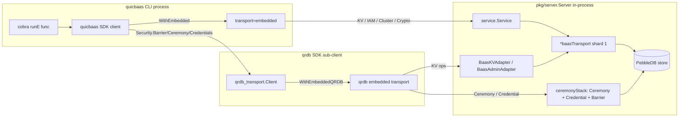

# Embedded Mode: In-Process qrdb Routing

## Scope

QuicBaaS exposes six transports — REST, gRPC, QUIC, MCP, Unix, and
**embedded**. The first five reach the server through a network
listener. Embedded mode does not: the SDK client lives in the same
process as `*server.Server`, and every method call resolves directly to
in-memory state.

Embedded mode is the foundation of:

- `quicbaasd init` (no listener is up while the inline ceremony runs)
- The CLI's `--transport embedded` flag for single-host operator
  workflows
- Integration tests that exercise the full lifecycle without binding
  ports
- Library use of the SDK from inside larger programs (e.g.
  `go-trusted-platform`)

This page documents the Phase 10 gap-1 fix that wired the qrdb
sub-client through the same in-process transport that the QuicBaaS
facade uses, so `Security().Barrier()`, `Security().Ceremony()`, and
`Security().Credentials()` work in embedded mode with zero special
casing.

## The problem before gap-1

The SDK's `WithEmbedded(svc)` option installs a transport that calls
into `pkg/service.Service` directly. That covers KV, Batch,
Transaction, Vector, TimeSeries, IAM, Cluster, Operations, Cache,
Auth, Crypto, KMS, Secrets, Certificate, and ObjectStorage.

It did **not** cover the qrdb sub-client surface (Barrier, Ceremony,
Credential, Tenant, Share, CustodianGroup, AuthFactor). The reason:
those services live behind a separate `qrdb_transport.Client` —
created lazily on first call — that expects to dial a network
endpoint. In embedded mode there is no network endpoint to dial, so
the qrdb sub-client returned a transport-level error on every call.

Gap-1 closes that loop by adding a second SDK option,
`WithEmbeddedQRDB(servicers)`, that installs a qrdb-side embedded
transport pointing at the same in-process state the QuicBaaS facade
already owns.

## QRDBEmbeddedServicers

The payload is
[`QRDBEmbeddedServicers`](../../sdk/go/qrdb_embedded.go):

```go
type QRDBEmbeddedServicers struct {
    KV             QRDBKVServicer            // REQUIRED — positional ctor arg
    Admin          QRDBAdminServicer         // REQUIRED — positional ctor arg

    Barrier        QRDBBarrierServicer       // optional — gates Security().Barrier()
    Ceremony       QRDBCeremonyServicer      // optional — gates Security().Ceremony()
    CeremonyCA     QRDBCeremonyCA            // optional — needed for ceremony.Initialize CSR issuance
    Credential     QRDBCredentialServicer    // optional — gates Security().Credentials()

    Tenant         QRDBTenantServicer        // optional — per-tenant barrier ops
    CustodianGroup QRDBCustodianGroupServicer // optional — Shamir group management
    Share          QRDBShareServicer         // optional — Shamir share submit/track
    AuthFactor     QRDBAuthFactorServicer    // optional — factor enrol/verify
    UserAuthFactor QRDBUserAuthFactorServicer // optional — per-user MFA
}
```

Every field is a type alias for the corresponding `go-qrdb/pkg/...`
servicer interface, re-exported through
[`sdk/go/qrdb_embedded.go`](../../sdk/go/qrdb_embedded.go) so SDK
consumers never need a direct `go-qrdb/pkg/service` import.

Rationale for the required/optional split: the qrdb embedded transport
constructor (`go-qrdb/sdk/go/transport/embedded.New`) takes KV and
Admin as positional arguments because they back the most common
operations and must be present for the transport to function at all.
Every other servicer is wired via a functional option and is
therefore opt-in — calling an absent servicer returns a typed
`NilServiceError` from the qrdb embedded transport so consumers see
a clean diagnostic instead of a nil pointer panic.

## WithEmbeddedQRDB

The matching SDK option lives at
[`sdk/go/options.go`](../../sdk/go/options.go):

```go
// Pair with WithEmbedded(svc) to install an in-process QuicBaaS facade
// AND an in-process qrdb sub-client backed by `servicers`.
func WithEmbeddedQRDB(servicers QRDBEmbeddedServicers) Option
```

Without `WithEmbeddedQRDB`, calls to `Security().Barrier()`,
`Security().Ceremony()`, `Security().Credentials()`, and the other
qrdb-backed accessors return an explicit configuration error rather
than falling through to the network transport — making the missing
wiring obvious instead of silent.

## baas_kv_admin_adapter: bridging service and transport interfaces

The qrdb embedded transport constructor wants `service.KVServicer +
service.AdminServicer`. QuicBaaS already has a `*baasTransport` that
implements the full qrdb `transport.Client` surface (KV, Admin,
Barrier, Ceremony, Credential, ...) against the in-process KV store.

The two interface families overlap conceptually but are not identical:

- `transport.KVClient` methods take varargs `WriteOption / ReadOption`
  that control wire-level behaviour (linearizability hints, etc.).
- `service.KVServicer` methods take an explicit
  `consistency.ReadOptions` value or a `writemode.Mode` enum, and
  expose extra methods (`PutEntity`, `GetEntity`, `DeleteEntity`,
  `ListEntities`, `*Stale`, `*WithConsistency`, `*WithMode`) that have
  no `transport.*` counterpart.

Rather than re-architect `baasTransport` to satisfy both interface
families (which would push service-layer semantics into a transport
type),
[`pkg/server/baas_kv_admin_adapter.go`](../../pkg/server/baas_kv_admin_adapter.go)
ships two thin adapter types that wrap a `*baasTransport`:

| Adapter | Wraps | Satisfies | Operations |
|---------|-------|-----------|------------|
| `BaasKVAdapter` | `*baasTransport` | `service.KVServicer` | KV CRUD, scans, `*Stale`/`*WithConsistency`/`*WithMode` variants funnel to the same in-process store. Entity ops return `BaasTransportNotSupportedError`. |
| `BaasAdminAdapter` | `*baasTransport` | `service.AdminServicer` | Health, Status, Peers (synthetic single-node responses), Capabilities. Raft-layer ops (AddMember, RemoveMember, RequestSnapshot, Drain, StartShard, StopShard) return `BaasTransportNotSupportedError`. |

The semantic mapping is honest about what the embedded transport is:
there is no Raft layer in single-process mode, so:

- All `*Stale` variants delegate to the strong-read methods (the store
  has exactly one revision — every read sees the latest committed
  value by construction).
- All `*WithMode`/`*WithConsistency` variants ignore the hint and
  delegate to the base method.
- Single-node admin responses report `IsLeader: true`,
  `ShardCount: 1`, no peers.

Both adapters return `nil` if their wrapped transport is `nil`, which
lets the CLI detect missing wiring cheaply.

## CLI embedded mode wiring

The CLI's wiring path lives at
[`cmd/quicbaas/embedded_qrdb.go`](../../cmd/quicbaas/embedded_qrdb.go):

```go
// 1) Pull the per-shard *baasTransport from the embedded server.
sharded := es.server.GetQRDBClient()
transport, err := sharded.EmbeddedTransportForShard(embeddedKVAdminShardID)

// 2) Wrap it in the service-layer adapters.
kv := server.NewBaasKVAdapter(transport)
admin := server.NewBaasAdminAdapter(transport)

// 3) Build the servicer payload.
servicers := quicbaas.QRDBEmbeddedServicers{
    KV:    kv,
    Admin: admin,
}

// 4) Layer in the bootstrap ceremony stack if it exists.
if ceremonyStack := es.server.GetCeremonyServices(); ceremonyStack != nil {
    servicers.Ceremony   = ceremonyStack.Ceremony
    servicers.Credential = ceremonyStack.Credential
}

// 5) Hand the SDK its WithEmbeddedQRDB option.
return quicbaas.WithEmbeddedQRDB(servicers), nil
```

`embeddedKVAdminShardID = 1` — single-shard is the CLI embedded-mode
convention (matching `pkg/service/quicbaas.go`'s admin dispatch).

The CLI surfaces wiring failures as
`*EmbeddedQRDBWiringError`:

```go
type EmbeddedQRDBWiringError struct {
    Stage string // "embedded server" | "sharded client" | "shard transport" | "adapter construction"
    Cause error
}
```

Each stage maps to a precise failure mode the operator can diagnose
without reading source. `Unwrap()` exposes the cause for
`errors.As`/`errors.Is` traversal.

## Routing diagram



The QuicBaaS facade and the qrdb sub-client end up calling the same
in-process state — there is no double-buffering, no extra
serialisation, no network roundtrip.

## Servicer availability matrix

| Servicer | Required? | Wired by CLI? | Operations enabled |
|----------|-----------|---------------|--------------------|
| `KV` | Yes | Yes | All KV ops via `Security()`-adjacent qrdb paths |
| `Admin` | Yes | Yes | `Cluster()` and `Operations()` admin reads |
| `Barrier` | No | **No (today)** | `Security().Barrier()` returns transport NilServiceError. The bootstrap ceremony uses its own internal barrier that is not user-visible; exposing it requires plumbing `server.bootstrap.StorageBarrier` up to the wiring layer. |
| `Ceremony` | No | Yes (when ceremonyStack present) | `Security().Ceremony()` |
| `Credential` | No | Yes (when ceremonyStack present) | `Security().Credentials()` |
| `Tenant`, `CustodianGroup`, `Share`, `AuthFactor`, `UserAuthFactor` | No | Not yet | Reserved for forthcoming embedded-mode work |

The "today" note for `Barrier` is the only acknowledged limitation:
embedded ceremony + credential are fully wired, but the human-driven
barrier verbs (`quicbaas barrier status / unseal / seal / rekey`)
require a network listener until the bootstrap barrier is hoisted.
The CLI prints a precise error pointing at `embedded server` as the
unsupported stage when this case is hit.

## Caller contract

The CLI is the canonical reference, but any program embedding the SDK
follows the same pattern:

```go
// 1) Build the in-process *server.Server (transport=embedded, no listeners).
srv, err := server.NewServer(cfg)
// ... srv.Start() ...

// 2) Assemble the QRDBEmbeddedServicers payload.
sharded := srv.GetQRDBClient()
t, err := sharded.EmbeddedTransportForShard(1)
servicers := quicbaas.QRDBEmbeddedServicers{
    KV:    server.NewBaasKVAdapter(t),
    Admin: server.NewBaasAdminAdapter(t),
}
if cs := srv.GetCeremonyServices(); cs != nil {
    servicers.Ceremony   = cs.Ceremony
    servicers.Credential = cs.Credential
}

// 3) Construct the SDK client with both options.
sdk, err := quicbaas.NewClient(
    quicbaas.WithEmbedded(srv.Service()),
    quicbaas.WithEmbeddedQRDB(servicers),
)
defer sdk.Close()

// 4) All Security() accessors now route in-process.
credCli, err := sdk.Security().Credentials()
```

Omitting `WithEmbeddedQRDB` is a configuration error, not a silent
fall-through: the qrdb sub-client refuses to initialise without an
embedded transport to dispatch to. This is intentional — there is no
sensible "default" network endpoint for the in-process case, and
silent fall-through hid bugs during gap-1 development.

## Comparison to network transports

| Concern | Embedded | gRPC / REST / QUIC / MCP / Unix |
|---------|----------|----------------------------------|
| Latency | direct function call | full RTT through listener |
| Auth | bypassed (caller already has process privilege) | enforced by middleware / interceptors |
| Serialisation | none | proto / JSON encode/decode |
| Cancellation | `context.Context` only | `context.Context` + listener timeout |
| Failure modes | `BaasTransportNotSupportedError` for Raft-only ops | listener errors + auth + serialisation |
| Use case | init, single-host CLI, libraries, integration tests | production multi-node clusters |

Embedded mode is **not** a security boundary. Any in-process caller
has full server privilege. Network transports retain the full
authentication / authorisation chain.

## Test coverage

- [`pkg/server/baas_kv_admin_adapter_test.go`](../../pkg/server/baas_kv_admin_adapter_test.go)
  asserts the interface satisfaction and exercises every adapter
  method (positive paths + the `BaasTransportNotSupportedError`
  branches).
- [`cmd/quicbaas/embedded_qrdb_test.go`](../../cmd/quicbaas/embedded_qrdb_test.go)
  drives `buildEmbeddedQRDBServicers` against the staged server
  fixtures and asserts the `EmbeddedQRDBWiringError` stages.
- [`sdk/go/qrdb_embedded_test.go`](../../sdk/go/qrdb_embedded_test.go)
  exercises the SDK side of `WithEmbeddedQRDB`, including the
  missing-servicer error path.
- Integration tests in `test/integration/cli/` run every canonical
  CLI verb against `--transport embedded` so the wiring stays honest
  with each release.

## See also

- [`docs/architecture/composition.md`](composition.md) — how the
  in-process server is constructed via `XKMSCryptoOptions`.
- [`docs/sdk/security.md`](../sdk/security.md) — the SDK surface the
  embedded transport ultimately serves.
- [`docs/cli/init.md`](../cli/init.md) — the canonical caller of
  embedded mode (the init ceremony runs entirely in-process).
- [`docs/embedding/`](../embedding/) — broader library-embedding
  guidance for non-CLI consumers.
