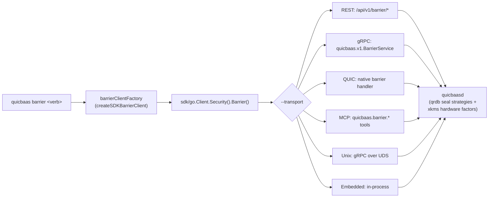

<!--
Copyright (c) 2025 Jeremy Hahn
Copyright (c) 2025 Automate The Things, LLC
SPDX-License-Identifier: AGPL-3.0-or-later
-->

# Barrier — CLI

> **Status: NORMATIVE** · Last verified: 2026-08-19
> Every verb and flag, with runnable examples. Feature folder: `docs/barrier/`.


`quicbaas barrier` exposes the **canonical 9-verb barrier tree** shared
byte-for-byte by `qrdb barrier`, `xkmsctl barrier`, and
`platformctl barrier`. The canonical narrative — flag semantics,
validation matrix, PIN flow, the `--passphrase` vs. PIN distinction — lives
in the qrdb doc (`go-qrdb/docs/cli/barrier.md`).
This page documents the **quicbaas-specific specifics**.

Implementation: [`cmd/quicbaas/barrier.go`](../../cmd/quicbaas/barrier.go).
SDK accessor: [`Client.Security().Barrier()`](../ssh/engineering.md).

---

## 1. The locked verb tree

```
quicbaas barrier status
quicbaas barrier init           --barrier-strategy <none|passphrase|shamir>
                                [--passphrase-stdin]          (required for passphrase/shamir; rejected for none)
                                [--passphrase <pp>]           (same, on argv — see §3a)
                                [--so-pin <pin>]              (optional; rejected when --barrier-strategy=none)
                                [--user-pin <pin>]            (optional; requires --so-pin)
quicbaas barrier init-shamir    --passphrase-stdin | --passphrase <pp>
                                --threshold N
                                --total M
                                [--so-pin <pin>]
                                [--user-pin <pin>]            (requires --so-pin)
quicbaas barrier unseal         --passphrase-stdin | --passphrase <pp>
                                                              (passphrase / single-secret only)
quicbaas barrier unseal-shares  --share <s1> [--share <s2> ...]
                                | --shares-file <path>        ('-' = stdin)
quicbaas barrier seal           [--so-pin <pin>]               (accepted for parity; NOT transmitted -- #491)
                                [-y | --assume-yes]
quicbaas barrier rekey          [--so-pin <pin>]              (NO --user-pin on rekey)
                                [--threshold N --total M]     (paired; Shamir share regeneration;
                                                               no secret on the wire)
quicbaas barrier recovery generate
                                --threshold N --total M
                                [--so-pin <pin>]
quicbaas barrier recovery recover
                                --share <s1> [--share <s2> ...]
                                | --shares-file <path>        ('-' = stdin)
```

> **Enable-encryption.** Migrating an unencrypted barrier to a keyed strategy
> after the fact is exposed over the REST/gRPC/QUIC/MCP transports (system
> route `POST /api/v1/barrier/enable-encryption` and per-tenant route
> `POST /api/v1/tenants/{tenant_id}/barrier/enable-encryption`), driven
> server-side via the embedded qrdb node. It **is** wired as a
> `quicbaas barrier enable-encryption` CLI verb
> ([`cmd/quicbaas/barrier.go`](../../cmd/quicbaas/barrier.go),
> `newBarrierEnableEncryptionCommand`) — an earlier revision of this page said
> it was API-only, which is no longer true. Like every Security verb it is
> **guaranteed on all six transports** (see below); see the API/barrier docs
> for the request shape.

### Transport parity is guaranteed, not conditional

Every verb on this page works over **REST, gRPC, QUIC, MCP, Unix and the
in-process embedded transport** — the locked architecture requires it
([`CLAUDE.md` §Multi-Protocol Parity](../../CLAUDE.md),
[`cmd/quicbaas/CLAUDE.md`](../../cmd/quicbaas/CLAUDE.md),
[multiprotocol-api/architecture.md](../multiprotocol-api/architecture.md)).
Pick a transport with `--transport` and the barrier surface is identical.

This is a guarantee, not a caveat to check before scripting. A transport that
returns `BaasTransportNotSupportedError` or `not yet supported by SDK` for a
barrier verb is a **blocking release regression** and must be fixed before the
change ships — file it as a defect rather than routing around it. The
integration suite at `test/integration/cli/` exercises every CLI command over
every transport for exactly this reason.

### Root persistent flag

| Flag | Default | Allowed values |
|------|---------|----------------|
| `--transport` | `unix` | `rest`, `grpc`, `quic`, `mcp`, `unix`, `embedded` |

```go
rootCmd.PersistentFlags().StringVar(&transport, "transport", "unix",
    "Transport protocol (grpc, rest, quic, unix, mcp, embedded)")
```

— [`cmd/quicbaas/main.go:164`](../../cmd/quicbaas/main.go).

### Security-officer ceremony verbs (canonical; quicbaas mirror pending)

The officer ceremony verb tree (`barrier officer *`,
`barrier shamir-seal-vote`, `barrier recovery officer *`) is part of
the canonical surface — under the share-free INV-1 contract the claim
ceremony is the only way an officer ever holds a share. qrdb is the
reference implementation; the quicbaas mirror is pending. See
[`08-bootstrap-auth-architecture.md §6`](https://github.com/automatethethings/software/blob/main/docs/08-bootstrap-auth-architecture.md#6-cli-surface-convergence)
and go-qrdb `docs/cli/barrier.md` §3.10.

---

## 2. SDK plumbing

Every verb routes through the SDK `Security().Barrier()` accessor; no
transport-specific code lives in the CLI.

```go
// cmd/quicbaas/barrier.go
func createSDKBarrierClient() (BarrierClient, error) {
    sdk, err := sdkClientFactory()
    if err != nil {
        return nil, err
    }
    return sdk.Security().Barrier()
}
```

The returned `BarrierClient` is the qrdb-defined
`sdk/go/transport.BarrierClient` surface — the CLI delegates to it
1:1. The SDK chooses the active transport (`grpc`, `rest`, `quic`,
`unix`, `mcp`, `embedded`) per the global `--transport` flag.



---

## 3. `--passphrase` is the strategy wrapping passphrase, not a PIN

This used to be a source of confusion. It is not anymore. See
the qrdb canonical doc §2
for the full architectural rationale. In quicbaas concretely:

| Flag | Concern | Server-side path |
|------|---------|-----------------|
| `--passphrase` | Strategy wrapping passphrase. `passphrase` Argon2id-derives the wrapping key, `shamir` uses it as the strategy seal, `none` ignores it. | qrdb `pkg/seal` strategy registry |
| `--so-pin`, `--user-pin` | Two-PIN compliance-gating material (FIPS 140-3 / PCI-DSS v4). Gates rekey / recovery-generate. **Not `seal`:** the SDK's `BarrierSeal` takes no request, so `barrier seal --so-pin` is parsed for surface parity and discarded — leave it off rather than putting a PIN in the process list for nothing ([#491](https://github.com/jeremyhahn/go-quicbaas/issues/491)). | qrdb `pkg/pin.PINBackend` (composed in via `WithPINBackend`) |

CLI-side validation lives in `runBarrierInitCmd` / `runBarrierInitShamirCmd`
/ `runBarrierRekeyCmd` ([`cmd/quicbaas/barrier.go`](../../cmd/quicbaas/barrier.go)):

| Rule | Verb(s) | Error |
|------|---------|-------|
| `--barrier-strategy` not in `{none, passphrase, shamir}` | `init` | `errors.ErrInvalidInput` |
| `--passphrase` empty for `passphrase` / `shamir` | `init`, `init-shamir`, `unseal` | `errors.ErrInvalidInput` |
| `--passphrase` supplied with `--barrier-strategy=none` | `init` | `errors.ErrInvalidInput` |
| `--so-pin`/`--user-pin` with `--barrier-strategy=none` | `init` | `PINsNotAllowedError` |
| `--user-pin` without `--so-pin` (or vice versa) | `init`, `init-shamir` | `errors.ErrInvalidInput` |
| `--threshold` / `--total` not paired | `init-shamir`, `rekey`, `recovery generate` | `errors.ErrInvalidInput` |
| `--threshold < 2` or `--total < --threshold` | `init-shamir`, `rekey`, `recovery generate` | `errors.ErrInvalidInput` |
| One of `--share` / `--shares-file` not supplied | `unseal-shares`, `root-token`, `recovery recover` | `BarrierShareInputError` |
| Both `--share` and `--shares-file` supplied | `unseal-shares`, `root-token`, `recovery recover` | `BarrierShareInputError` |
| `--shares-file` unreadable | `unseal-shares`, `root-token`, `recovery recover` | `BarrierSharesFileError` |
| `--shares-file` empty | `unseal-shares`, `root-token`, `recovery recover` | `BarrierSharesFileEmptyError` |

All four carry an `Op` naming the verb the operator actually ran. The three
quorum verbs share `resolveUnsealShares` / `readSharesFile`, so an error that
hard-coded one verb's name would send an operator off to debug a command they
had not invoked ([#227](https://github.com/jeremyhahn/go-quicbaas/issues/227)).

---

## 3a. How the passphrase gets in

A passphrase passed as `--passphrase` sits in `/proc/<pid>/cmdline` for the
life of the call, where **every process of every user on the host can read
it**, and it lands in the shell history besides. So the CLI takes it three
ways, in precedence order — the same surface, and the same precedence, as
xkey's `unlock --pin-stdin` / `XKEY_PIN` / `--pin`:

| Order | Source | Notes |
|-------|--------|-------|
| 1 | `--passphrase-stdin` | **Preferred.** Reads one line — up to the first newline, or EOF, or the 4 KiB cap — and strips exactly one trailing newline (and a `\r` before it). `printf '%s'`, `echo`, and typing at a prompt and pressing Enter all work; nothing past the newline is consumed. Bounded by a timeout (30 s by default). |
| 2 | `QUICBAAS_BARRIER_PASSPHRASE` | Environment variable. Readable from `/proc/<pid>/environ` by the same UID, so it is second, not first. |
| 3 | `--passphrase` | Kept for compatibility. Its `--help` warns that it is *visible in the process list*. |

```bash
# Preferred
printf '%s' "$PP" | quicbaas barrier unseal --passphrase-stdin

# Environment
QUICBAAS_BARRIER_PASSPHRASE="$PP" quicbaas barrier unseal

# Explicit flag (development only)
quicbaas barrier unseal --passphrase '<passphrase>'
```

The precedence is absolute, not a fallback chain: when `--passphrase-stdin`
is given, an empty stdin is a missing passphrase, not a cue to read the
environment. Verbs carrying the full three-way surface are `barrier init`,
`barrier init-shamir`, `barrier unseal`, `barrier enable-encryption`,
`tenant barrier init` and `tenant barrier unseal` — every verb in the CLI
that takes a passphrase. Implementation and the resolution order live in
[`cmd/quicbaas/passphrase.go`](../../cmd/quicbaas/passphrase.go).

`--barrier-strategy=none` still rejects a passphrase, but only when the
operator asked for one on that invocation (`--passphrase` or
`--passphrase-stdin`): an exported `QUICBAAS_BARRIER_PASSPHRASE` left over
from an unseal is ignored rather than turned into an error.

**The stdin read is always bounded, or refused.** It cannot hang: it ends at
`--timeout` — 30 seconds by default — and it completes as soon as you press
Enter rather than waiting for EOF. Raising `--timeout` raises the stdin
deadline with it; until
[#246](https://github.com/jeremyhahn/go-quicbaas/issues/246) the flag
did not reach the barrier verbs at all and the bound was always 30s. On a
platform where the read cannot be bounded at all —
today that means Windows, where the descriptor takes neither a deadline nor a
`poll(2)` wait — `--passphrase-stdin` is **refused up front** with an error
naming the platform and pointing at `QUICBAAS_BARRIER_PASSPHRASE` and
`--passphrase`. A command that fails immediately beats one that hangs with no
explanation. Piping into a Go-created pipe still works everywhere, since a
pipe accepts a deadline directly.

**In protected memory.** A passphrase read this way is held in an mlocked,
guard-paged buffer that is wiped when the command finishes, per
`conventions/security-review.md` §6 — it is never a plain Go string inside
the CLI. Two residues are inherent to the *sources* and are the reason
stdin is listed first: argv and the environment block both hand Go an
immutable string that cannot be wiped. The third — the *request object* the
CLI builds — is **gone**: qrdb's barrier request types now field these
secrets as `[]byte`
([go-qrdb#184](https://github.com/jeremyhahn/go-qrdb/issues/184), adopted
here in [#960](https://github.com/jeremyhahn/go-quicbaas/issues/960)), so the
CLI hands the protected buffer's bytes straight to the request rather than
converting to a Go string first. The `passphraseString` conversion that used
to make that crossing is deleted rather than documented.

**Request storage is not serialization, and the difference is the whole
qualification.** What the request *holds* is now wipeable bytes for every
transport. What a transport *writes on the wire* is its own matter, and two
of those still produce an unwipeable copy:

- **MCP** converts deliberately. An MCP tool argument is JSON and Go renders
  a `[]byte` as base64, so `sdk/go/transport/mcp` has one explicit
  `secretArg` conversion to plaintext — go-qrdb's documented permanent
  exception to the wipeable-credential contract. A CLI invocation that
  selects the MCP transport creates an immutable plaintext string for the
  duration of the call, and no buffer discipline on either side removes it.
  Choose another transport for barrier operations if that residue is
  unacceptable.
- **This daemon's own surfaces.** `string secret` in
  `api/proto/barrier.proto`, the REST JSON request DTOs and the MCP tool
  argument all still declare the credential as a string, so a passphrase
  arriving from a *remote* caller exists as an unwipeable Go string before
  any handler sees it. The handlers convert at the edge and wipe what they
  made, which narrows the window rather than closing it. Retyping the proto
  field and moving REST JSON to base64 is a client-visible wire change,
  tracked as [#962](https://github.com/jeremyhahn/go-quicbaas/issues/962).

The end-to-end guarantee — protected memory from the terminal to the barrier,
with no plaintext string anywhere — therefore holds for the CLI against an
**embedded or in-process** node, and holds for the CLI's own handling of the
passphrase in every case.

**Still on argv.** `--so-pin`, `--user-pin` and `--share` remain
argv-only and carry the same exposure, and are still held as plain Go
strings ([#237](https://github.com/jeremyhahn/go-quicbaas/issues/237)).
All three verbs that collect a share **quorum** — `barrier unseal-shares`,
`barrier root-token` and `barrier recovery recover` — offer `--shares-file -`
as the way off argv; `recovery recover` was the odd one out until
[#227](https://github.com/jeremyhahn/go-quicbaas/issues/227). The PIN
flags have no stdin path yet
([#226](https://github.com/jeremyhahn/go-quicbaas/issues/226)), and
`tenant barrier unseal-share` submits a single share and is still argv-only.

---

## 4. Examples

### Passphrase strategy with PIN-gated administration

```bash
printf '%s' "$PP" | quicbaas barrier init \
  --barrier-strategy passphrase \
  --passphrase-stdin \
  --so-pin SO12345 \
  --user-pin USR12345

quicbaas barrier status --output json
quicbaas barrier seal -y
printf '%s' "$PP" | quicbaas barrier unseal --passphrase-stdin
```

### Shamir M-of-N strategy

```bash
printf '%s' "$SEED" | quicbaas barrier init-shamir \
  --passphrase-stdin \
  --threshold 3 \
  --total 5

# Share-free: shares are sealed to enrolled Security Officers; each
# officer claims their share via the share-claim flow. No share
# material is printed or crosses the wire. Later:

quicbaas barrier unseal-shares --share aaa --share bbb --share ccc
# or
quicbaas barrier unseal-shares --shares-file /etc/quicbaas/shares.txt
# or
cat shares.txt | quicbaas barrier unseal-shares --shares-file -
```

### None strategy (dev / test only)

```bash
quicbaas barrier init --barrier-strategy none
# Data is stored in cleartext. Do NOT use this in production.
```

### Rekey (share layout preserved)

The server generates a fresh unseal key and share set itself — no
secret material travels on the request. All previously distributed
shares are cryptographically revoked.

```bash
quicbaas barrier rekey --so-pin SO12345
```

### Rekey + new Shamir share layout

```bash
quicbaas barrier rekey --threshold 3 --total 5
```

### Disaster-recovery key set

```bash
quicbaas barrier recovery generate --threshold 3 --total 5 --so-pin SO12345
quicbaas barrier recovery recover --share key-a --share key-b --share key-c
# or, keeping the quorum off argv:
quicbaas barrier recovery recover --shares-file /etc/quicbaas/recovery.txt
cat recovery.txt | quicbaas barrier recovery recover --shares-file -
```

### Enable-encryption

Transitioning a cleartext (`none`) barrier to an encrypted one after the fact
is available both as the `quicbaas barrier enable-encryption` CLI verb — over
every transport, like all Security verbs (see §1) — and directly over the API.
The request field is `target_strategy`; `mechanism` and `availability` default
to `swap` / `online`.

```bash
printf '%s' "$PP" | quicbaas barrier enable-encryption \
  --strategy passphrase --passphrase-stdin
```

The raw API form, for callers not going through the CLI:

```bash
# System barrier — passphrase
curl -X POST https://host:port/api/v1/barrier/enable-encryption \
  -d '{"target_strategy":"passphrase","passphrase":"my-wrapping-passphrase"}'

# System barrier — Shamir
curl -X POST https://host:port/api/v1/barrier/enable-encryption \
  -d '{"target_strategy":"shamir","passphrase":"my-wrapping-passphrase","shamir_threshold":2,"shamir_total":3}'

# Per-tenant barrier (tenant 'acme-corp')
curl -X POST https://host:port/api/v1/tenants/acme-corp/barrier/enable-encryption \
  -d '{"target_strategy":"passphrase","passphrase":"tenant-wrapping-passphrase"}'
```

A tenant on the shared system barrier (no dedicated barrier) is rejected with
`403` (`ErrSharedBarrierImmutable`); an in-progress migration returns `409`.

---

## 5. Output formatting

`--output table | json | yaml` is wired at the barrier-group level
(`PersistentFlags`). Defaults to `table`. The renderers (`formatBarrier*Response`
in [`cmd/quicbaas/barrier.go`](../../cmd/quicbaas/barrier.go)) use
the shared `pkg/cli` `ParseOutputFormat` helper so behaviour is
consistent with every other quicbaas verb.

---

## 6. Transport behaviour

| Transport | Endpoint / RPC family |
|-----------|----------------------|
| REST | `POST /api/v1/barrier/{status,init,init-shamir,unseal,unseal-shares,seal,rekey,recovery-generate,recovery-recover}` |
| gRPC | `quicbaas.v1.BarrierService` |
| QUIC | Native quicbaas barrier handler |
| MCP | `quicbaas.barrier.*` tools |
| Unix | gRPC over Unix domain socket (default) |
| Embedded | In-process via `Security().Barrier()` |

---

## 7. Cross-references

* Canonical narrative + PIN flow + strategy taxonomy:
  `go-qrdb/docs/cli/barrier.md`
* Spec: [`08-bootstrap-auth-architecture.md §6`](https://github.com/automatethethings/software/blob/main/docs/08-bootstrap-auth-architecture.md#6-cli-surface-convergence)
* SDK accessor contract: [`docs/sdk/security.md`](../ssh/engineering.md)
* Sibling CLI docs:
  `qrdb barrier` ·
  `xkmsctl barrier` ·
  `platformctl barrier`


---

## quicbaas seal (deprecated)

> **Status:** Deprecated alias. New work should use
> `quicbaas barrier`. Every `seal` verb prints a
> deprecation warning to stderr and forwards to the equivalent
> `barrier` verb.

The legacy `seal` tree is retained for operator-runbook compatibility
through at least the next major release. The verb and flag surface
matches the original; behaviour matches the canonical `barrier`
surface bit-for-bit because both share the same SDK
`Security().Barrier()` backend.

Source:
`cmd/quicbaas/seal.go` (the forwarding
shim) and
[`cmd/quicbaas/barrier.go`](../../cmd/quicbaas/barrier.go) (the
canonical implementation).

### Migration table

| Deprecated `seal` verb | Canonical `barrier` verb |
|------------------------|--------------------------|
| `quicbaas seal status` | `quicbaas barrier status` |
| `quicbaas seal init --shares N --threshold M` | `quicbaas barrier init` (single passphrase) or `quicbaas barrier init-shamir --secret <s> --total N --threshold M` |
| `quicbaas seal unseal --share <s>` | `quicbaas barrier unseal --share <s>` (or `--secret` for password-based) |
| `quicbaas seal seal` | `quicbaas barrier seal` |
| `quicbaas seal rekey --shares N --threshold M` | `quicbaas barrier rekey --total N --threshold M` |

The flag rename `--shares` → `--total` keeps `barrier` aligned with
`xkmsctl barrier` so operators have a single consistent surface
across the four canonical binaries (qrdb, xkmsctl, quicbaas,
platformctl).

### Why the rename

The original surface used "seal" for both "the encryption mechanism"
(the seal) and "the operation that locks the mechanism" (sealing).
The unification spec §6 renames the mechanism to "barrier" so the
nouns and verbs are unambiguous:

| Concept | Old name | New name |
|---------|----------|----------|
| The encryption mechanism | "seal" | "barrier" |
| The action of locking the barrier | "seal" | "seal" (verb, on `barrier`) |
| The action of unlocking the barrier | "unseal" | "unseal" |

So the command tree reads `quicbaas barrier seal` / `quicbaas barrier
unseal` — verb on the noun. The old `quicbaas seal seal` /
`quicbaas seal unseal` redundancy was the immediate motivation for
the rename.

### Behavioural notes

- **Recovery keys** (`--recovery-shares` / `--recovery-threshold` on
  the legacy `seal init`): the canonical `barrier` surface does not
  ship a separate recovery-key concept. Disaster recovery uses the
  same Shamir share material; operators retain shares per their
  organisational policy. The legacy flags are still parsed by the
  forwarding shim but emit a deprecation warning indicating the new
  mechanism.
- **Confirmation prompt** on `seal`: forwarded verbatim. Pass
  `--assume-yes` to skip it.
- **JSON output** on `status` / `init-shamir` / `rekey`: identical
  schemas between `seal` and `barrier`.

### Removal timeline

The deprecation warning ships in the current release. The
forwarding shim will be retained through at least one major version
to give operator runbooks time to migrate. There is no scheduled
removal date.

### See also

- `docs/cli/barrier.md` — canonical barrier verbs.
- [`docs/architecture/barrier.md`](architecture.md) —
  StorageBarrier design.
- [`docs/sdk/security.md`](../ssh/engineering.md) —
  `Security().Barrier()` SDK accessor.


---

## quicbaas ceremony

Drive the QuicBaaS initialisation ceremony state machine.

### Overview

The ceremony subcommand exposes the same verb set as the top-level
`quicbaas init` command. Both reach the same SDK
`Security().Ceremony()` backend; the two surfaces give operators a
choice of whether to think of the flow as "initialise this daemon"
(`init`) or "drive the ceremony state machine" (`ceremony`).

Use `ceremony` when:

- The data dir was initialised with `--barrier-strategy shamir` and the
  daemon is now serving its sealed-window surface: officers register, the
  ceremony splits the secret, and each officer claims their share live.
  Shares are never written to disk — they are held in memguard enclaves
  inside the daemon and released to each officer exactly once, over that
  officer's own mTLS certificate.
- You are completing or auditing an in-progress ceremony from an
  operator workstation other than the daemon host.

Source:
[`cmd/quicbaas/canonical.go:69`](../../cmd/quicbaas/canonical.go)
and [`cmd/quicbaas/init.go`](../../cmd/quicbaas/init.go) (the two
share Cobra builders so the verb trees stay byte-for-byte identical).

### Verb summary

| Verb | Purpose |
|------|---------|
| `status` | Show the current ceremony state |
| `claim-cert` | Two-step certificate claim (`begin`, then `complete`) |
| `claim-share` | Two-step Shamir share claim (`begin`, sign nonce, `complete`) |
| `sign-csr` | SO-authorised CSR signing |
| `enroll-external-officer` | Enrol an officer whose key material is external |

### Global flags

`ceremony` accepts `--output <json|yaml|table>` (default `table`)
through the persistent flag.

### status

Display the current ceremony state. Returns the active strategy, the
expected officer count, the number of officers that have completed
each step (cert claim, share claim, CSR sign), and any pending steps
that block forward progress.

```bash
quicbaas ceremony status
quicbaas ceremony status --output json
```

Empty / "no ceremony in progress" state returns a clear "not
initialised" message rather than a zero-valued struct.

### claim-cert

Two-step certificate claim. The officer presents the material that
matches the `KIND` they were enrolled under (`csr`, `cert`, or
`pubkey`) and the daemon issues a signed officer certificate.

#### claim-cert begin

```bash
quicbaas ceremony claim-cert begin \
  --officer alice \
  --material /etc/quicbaas/officers/alice.csr
```

`begin` validates the material against the recorded officer kind,
emits a server-side challenge nonce, and returns a claim token the
operator carries to `complete`.

#### claim-cert complete

```bash
quicbaas ceremony claim-cert complete \
  --officer alice \
  --token <opaque-from-begin> \
  --proof <signed-challenge>
```

`complete` verifies the proof against the claim token and, on
success, persists the officer's certificate to the ceremony state
and emits the issued certificate PEM on stdout.

### claim-share

Claim the Shamir share assigned to a specific officer via the
challenge-response handshake. The daemon issues a challenge nonce,
the CLI signs it with the officer's certificate private key
(`--tls-key`), and the daemon verifies the signature (and the mTLS
certificate thumbprint against the enrolment record) before
releasing the share exactly once.

```bash
quicbaas init claim-share     --username alice     --tls-cert alice.crt     --tls-key alice.key     --output alice.share.json
```

The share JSON is written to `--output`. Storage is the officer's
responsibility — the daemon does not retain a claimable copy after
the share has been released.

### sign-csr

Submit a CSR for SO-authorised signing. The SO must have completed
their own claim flow; the CSR is signed by the daemon CA and the
issued certificate is returned on stdout.

```bash
quicbaas ceremony sign-csr --csr /etc/quicbaas/csr/svc.csr
```

### enroll-external-officer

Enrol an additional officer post-init. The flag set is the same
shape as `quicbaasd init --so`:

```bash
quicbaas ceremony enroll-external-officer \
  --username dan \
  --kind cert \
  --material /etc/quicbaas/officers/dan.pem
```

The new officer participates in subsequent claim flows but cannot
retroactively change the share threshold. Use this when a security
officer rotates off the team and you need to issue a replacement
without rerunning init.

### Transport behaviour

| Transport | Behaviour |
|-----------|-----------|
| REST | `POST /api/v1/ceremony/*` JSON endpoints |
| gRPC | `quicbaas.v1.CeremonyService` RPCs |
| QUIC | Native QUIC ceremony handler (Phase 8b/c/d) |
| MCP | `quicbaas.ceremony.*` tools (Phase 8b/c/d) |
| Unix | gRPC over Unix domain socket |
| Embedded | In-process via `Security().Ceremony()` (the bootstrap ceremony stack is wired automatically — see [`docs/architecture/embedded-mode.md`](../composition/user.md)) |

### See also

- [`docs/sdk/security.md`](../ssh/engineering.md) —
  `Security().Ceremony()` accessor.
- `docs/cli/init.md` — `quicbaasd init` (daemon-side
  ceremony setup at first boot).
- `docs/cli/barrier.md` — barrier verbs the ceremony
  ultimately unlocks.
- Locked architecture spec
  §6 — canonical verb set the four operator binaries share.
