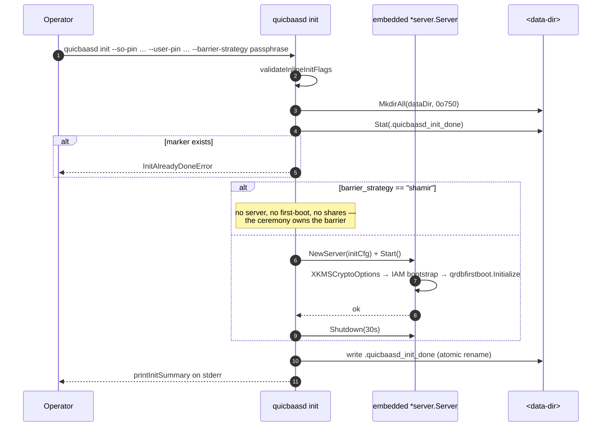

# Bootstrap — CLI

> **Status: NORMATIVE** · Last verified: 2026-08-19
> Every verb and flag, with runnable examples. Feature folder: `docs/bootstrap/`.

Inline initialisation ceremony for a fresh QuicBaaS data directory.

## Overview

`quicbaasd init` is the daemon-side bootstrap command. It validates
operator-supplied PIN material, registers Security Officer (SO)
identity material, runs the canonical first-boot flow (system tenant
+ built-in roles + admin user, idempotent via
`qrdbfirstboot.Initialize`), and persists enough state that the next
`quicbaasd start` brings up an operational daemon.

The command is intentionally distinct from `quicbaas init` (the
operator-side ceremony state-machine driver). `quicbaasd init` runs
on the host that owns the data dir; `quicbaas init` (the CLI) drives
the ceremony state machine over the network from an operator
workstation. The two share verb names but never the same process.

## Prerequisite: `iam.spiffe_trust_domain` (required)

**`quicbaasd init` refuses to run unless `iam.spiffe_trust_domain` is set in the
configuration file.** It is not a flag — it is a config key, because the daemon
needs the same value on every subsequent boot.

```yaml
iam:
  spiffe_trust_domain: quicbaas.example.test
```

Why it is mandatory rather than optional: the xkms CA stamps a tenant-scoped
SPIFFE URI SAN onto the admin certificate init issues —
`spiffe://<trust-domain>/tenant/system/user/admin` — **only when a trust domain
is configured**, and REST login resolves (and pins) the tenant from exactly that
SAN. With no trust domain the certificate carries no SPIFFE SAN, login falls
back to home-realm discovery, and a freshly initialised node has no HRD routing
entries. The result is `401 login tenant could not be resolved` from the very
credential init just handed the operator — even with an explicit `X-Tenant`
header.

Init therefore fails closed, before any side effect (no data dir, no CA, no
marker):

```
init: iam.spiffe_trust_domain is required and is not set.
  It is what lets the issued admin certificate authenticate: the CA stamps
  spiffe://<trust-domain>/tenant/system/user/admin onto it and login resolves
  the tenant from that SAN. Without it, login fails closed with
  "login tenant could not be resolved".
  Set it in your config file, for example:
      iam:
        spiffe_trust_domain: quicbaas.example.test
```

Two alternatives were considered and rejected:

- **Synthesising a trust domain** (e.g. from `--hostname`) would bake a *pinned*
  security identifier into every issued certificate; configuring a real trust
  domain later would silently invalidate all of them.
- **Seeding a system-tenant home-realm entry** would make `system` resolvable
  for *any* unrouted login attempt, permanently widening the authentication
  surface to buy first-boot convenience.

Requiring the value invents no security identifier and widens nothing. The same
requirement is enforced at the point of issuance in the server, so it also
applies to `quicbaasd start` against a data dir with no init marker and to
embedded/library consumers that never invoke the CLI.

## Optional: `iam.bootstrap_admin_email`

First boot creates the platform admin (`admin` in the `system` tenant) with the
synthetic address `admin@system.qrdb.local` unless the configuration names one:

```yaml
iam:
  bootstrap_admin_email: platform-ops@example.test
```

The address applies to the system-tenant admin only; tenant admins keep their
own provisioning path. A re-entered first boot looks the admin up by the same
key, so set it before the first start and leave it in place afterwards.

## init persists state (gap-2 change)

Prior to Phase 10 gap-2, `quicbaasd init` was a validate-and-print
command: it parsed flags, dry-ran the bootstrap, and exited without
writing anything to disk. This produced confusing operator semantics
(no error, no daemon, no marker) and broke the integration test
matrix because the subsequent `quicbaasd start` re-ran the bootstrap
from scratch.

The Phase 10 gap-2 fix made `quicbaasd init` actually persist:

1. The data directory is created (mode `0o750`) if missing.
2. The barrier strategy and credential strategy are validated.
3. SO officer files are parsed and validated.
4. For **every** barrier strategy an embedded `*server.Server` is
   constructed against the data dir and started so the CA comes up and
   the IAM bootstrap runs end-to-end (PebbleDB stores the system tenant,
   built-in roles, the platform admin, and the admin's mTLS certificate
   bound by its canonical SPKI thumbprint), then shut down cleanly. The
   operator's `--so-pin` / `--user-pin` are enrolled into the same PIN
   backend the node verifies against. §08 invariant 5: init leaves
   identical IAM state whichever way the barrier is sealed.
5. For `shamir` **none of step 4 happens**. Init starts no server and
   runs no first-boot. go-qrdb's bootstrap orchestrator reserves M-of-N
   barrier creation for the ceremony — *"Shamir barrier initialization is
   the ceremony's job (multiple SOs), never inline"* — so init only
   records the chosen M-of-N parameters. The daemon then boots SEALED and
   the ceremony runs against it. See [Shamir: the ceremony flow](#shamir-the-ceremony-flow).
6. A `.quicbaasd_init_done` marker JSON file is dropped at the data
   dir root with the chosen strategy, credential strategy, hostname,
   share/threshold counts, and completion timestamp.
7. A short operator summary is printed to stderr; stdout stays clean
   for scripting.

Re-running `quicbaasd init` against the same data dir returns
`InitAlreadyDoneError` instead of silently re-bootstrapping. To
re-initialise, the operator must remove the marker explicitly. The
underlying `firstBootBootstrap` is itself idempotent, so a marker
removed after an interrupted init lets the next attempt complete
without surprise side effects.

## Idempotency markers

| File | Path | Purpose |
|------|------|---------|
| `.quicbaasd_init_done` | `<data-dir>/.quicbaasd_init_done` | Init-complete signal. Presence blocks re-init; absence permits init. Mode `0o600`. JSON. |

The marker file is written via atomic rename (`<file>.tmp` → final) so an
interrupted init cannot leave half-written state. The marker schema
is:

```json
{
  "barrier_strategy":    "passphrase",
  "credential_strategy": "barrier",
  "hostname":            "node1.example.com",
  "officer_count":       0,
  "shares":              0,
  "threshold":           0,
  "completed_at":        "2026-05-25T14:32:11Z"
}
```

## Flag surface

`quicbaasd init` mirrors `xkmsd init` and `qrdb init` verb-for-verb so
the three operator binaries accept identical arguments.

### Canonical flags (locked surface)

| Flag | Default | Required when | Description |
|------|---------|---------------|-------------|
| `--so-pin <string>` | (none) | always | Security Officer PIN. FIPS 140-3 / PCI-DSS v4 SO credential. |
| `--user-pin <string>` | (none) | always | User PIN. FIPS 140-3 / PCI-DSS v4 user credential. |
| `--barrier-strategy <name>` | `passphrase` | always | One of `none` / `disabled` / `passphrase` / `shamir`. Hardware strategies (`pkcs11`, `tpm2`, `awskms`, `gcpkms`, `azurekv`, `vault`) are rejected by `quicbaasd init` and must be initialised by the xkmsd-driven flow. The runtime `auto` sentinel is **not** an init value — it is a `seal.strategy` resolved at `quicbaasd start` (see the axis table below). |
| `--shares <int>` | `0` | `--barrier-strategy=shamir` | Total Shamir shares (N). |
| `--threshold <int>` | `0` | `--barrier-strategy=shamir` | Shamir M-of-N threshold. |
| `--hostname <fqdn>` | (none) | optional | FQDN written into the admin / server certificate CN. |
| `--sans <csv>` | (none) | optional | Additional DNS / IP SANs (comma-separated). |

### Phase 11 inline additions

| Flag | Default | Description |
|------|---------|-------------|
| `--init-data-dir <path>` | (none — falls back to global `--data-dir`) | Per-init data directory override. Useful for running multiple isolated init ceremonies in CI. |
| `--credential-strategy <name>` | `barrier` | One of `manual` / `barrier`. Selects how named credentials are sealed. |

There are deliberately **no officer flags** on `quicbaasd init`. Officers enrol
against the running daemon with `quicbaas init officer register`; see
[Shamir: the ceremony flow](#shamir-the-ceremony-flow).

## --barrier-strategy values

| Value | Meaning | PIN required? | Listener at end of init? |
|-------|---------|---------------|--------------------------|
| `disabled` / `none` | No encryption barrier. Data dir is plaintext on disk. Suitable only for ephemeral test environments. | No — PINs are rejected (there is no SO/User concept without a barrier) | No — the embedded server is started, IAM bootstrap runs, then it shuts down. |
| `passphrase` | qrdb's `SoftwareStrategy`. Root key is derived from the SO/User PIN via Argon2id (PBKDF2 under FIPS) and sealed locally. (Older docs called this value `software`.) | Yes | No — same as `disabled`: embedded run, persist, shut down. |
| `shamir` | qrdb's Shamir M-of-N strategy. Init creates **nothing** — no barrier, no first-boot, no shares. It records `--shares` / `--threshold` in the marker and stops. The next `quicbaasd start` boots SEALED on those parameters and serves the ceremony from its sealed window; officers register, the ceremony splits the secret, each officer claims their share live, and a quorum unseals. There are no `--so` flags on init: officers enrol against the running daemon. | Yes | Yes — this is the one strategy that starts no server. Starting one would boot sealed and fail with `EmbeddedSealedBootError`. |
| `pkcs11` / `tpm2` / `awskms` / `gcpkms` / `azurekv` / `vault` | Hardware-backed strategies | n/a | **Rejected by `quicbaasd init`**. These run through the xkms-orchestrated flow and `xkmsd init`. |

## init `--barrier-strategy` vs runtime `seal.strategy` and the `crypto:` block

Three distinct axes are easy to confuse. `quicbaasd init --barrier-strategy` is
an **init-time** choice limited to software-class seals; the hardware-prefer
`auto` sentinel and the hardware seals are **runtime** (`quicbaasd start`)
concerns; and the `crypto:` block is about *key storage*, not the seal at all.

| Axis | Where / when | What it selects | Valid values |
|------|--------------|-----------------|--------------|
| `--barrier-strategy` (init flag) | `quicbaasd init`, once | The root-key seal the data dir is **initialised** with | `none` / `disabled` / `passphrase` / `shamir` |
| `seal.strategy` (config) | `quicbaasd start`, every boot | The **runtime** root-key seal, including hardware and the hardware-prefer sentinel | `none` / `passphrase` / `shamir` / `tpm2` / `pkcs11` / `awskms` / `gcpkms` / `azurekv` / `vault` / `auto` |
| `crypto:` block (config) | `quicbaasd start`, every boot | Which go-xkms backend **stores** each subsystem's keys (KMS, CA, PIN, barrier AEAD) | see [crypto.md](../composition/engineering.md) |

- `auto` is **not** an init `--barrier-strategy` value (the init validator rejects
  it). It is a runtime `seal.strategy` sentinel resolved at `quicbaasd start` by
  the `BackendResolver`: a TPM2 seal when a provisioned, seal-capable device is
  present, else software. `quicbaasd init` only initialises software-class seals
  (`none`/`disabled`/`passphrase`/`shamir`); hardware and `auto` seals come up at
  start. See [Seal/Unseal](../barrier/engineering.md#seal-strategy-sealstrategy).
- The `crypto:` block is orthogonal to the seal strategy: it decides *where keys
  live*, not *how the root key is sealed*. A passphrase-sealed barrier can still
  pin its CA signing key into a TPM via `crypto.subsystems.ca.backend: tpm2`. See
  [Crypto Backend Selection](../composition/engineering.md).

## PIN handling per strategy

| Strategy | SO PIN | User PIN | Notes |
|----------|--------|----------|-------|
| `disabled` / `none` | Validated for parity; not stored anywhere persistent | Validated for parity; not stored | Reject empty PINs so an operator does not accidentally bring up an unauthenticated cluster. |
| `passphrase` | Hashed via `pin.AutoDetectHashConfig()` and stored in the qrdb `PINBackend` (PebbleDB-backed by the composed server). | Hashed and stored alongside SO PIN. | `PINBackend` defaults to PBKDF2 in FIPS mode, Argon2id otherwise. |
| `shamir` | Recorded into the pending-ceremony state so the daemon can reapply it during the resume flow. | Same. | Final hashing happens after the operator completes the ceremony. |

PINs travel only through the in-process embedded server during init —
no PIN ever crosses a network boundary on the `quicbaasd init` path.

## SO officer material

Officer material is **not** supplied to `quicbaasd init`. Under go-qrdb's
Security Officer distribution model each officer registers their own CSR
against the running daemon:

```bash
quicbaas init officer register --username alice --csr alice.csr --output alice.crt
```

The ceremony CA signs the CSR and binds the officer to the SHA-256 thumbprint of
the issued certificate. Only the officer holds the matching private key, which is
what makes their later share claim provable — and what stops the server from
being able to impersonate them. Officers whose key material is held externally
(a corporate CA certificate, or a public key alone) enrol with
`quicbaas init enroll-external-officer`.

## init → start contract

After a successful `quicbaasd init`:

1. The data dir contains `.quicbaasd_init_done`.
2. For **every** strategy: PebbleDB holds the system tenant, built-in
   roles and the platform admin (created via the
   `qrdbadapter.UserAdapter`, which also serves as qrdb's `CertBinder`),
   and `<data-dir>/admin/` holds the issued admin certificate.
3. For `shamir` additionally: the officer bundles record the
   M-of-N resume state.

The next `quicbaasd start` reads the marker and:

- `passphrase` / `disabled` / `none`: starts every configured listener
  and resumes from the persisted bootstrap state. `firstBootBootstrap`
  detects the existing admin and short-circuits.
- `shamir`: brings up the listener stack in a "ceremony pending"
  state. Only the ceremony endpoints accept traffic until the
  operator completes the ceremony via `quicbaas ceremony` /
  `quicbaas init` verbs against the daemon. `firstBootBootstrap` also
  short-circuits here, because init already established the admin.

> **Why the M-of-N ceremony does not run inside `quicbaasd init`.**
> qrdb's `CeremonyService.Initialize` produces two artifacts that live only in
> the process that called it: the Shamir shares (an in-memory
> `sealedShareStore` of `secure.Secret` enclaves, never persisted) and the
> officers' signed certificates (the in-memory `pendingCerts` map —
> `RestoreFromRegistry` rehydrates only public metadata and rebuilds
> `PendingCert` **without** `CertPEM`). Both are consumed by `claim-cert` /
> `claim-share` against a **live** daemon. Running `Initialize` in the one-shot
> init process and exiting would destroy every officer certificate and every
> share, leaving a ceremony stuck in `Enrolling` that no officer could complete.
> Persisting the shares to the server's disk to work around that would hand any
> host-root the full quorum, defeating the purpose of M-of-N. So init records
> intent plus the officers' public CSRs, and the daemon runs the ceremony.

`quicbaasd start` without a marker emits a typed
`InitMissingError` so the operator gets a precise message instead of
a confusing startup failure deep in the lifecycle.

## End-to-end flow



## Examples

Every example below assumes `iam.spiffe_trust_domain` is set in the config file
(see [Prerequisite](#prerequisite-iamspiffe_trust_domain-required)); init fails
closed without it.

```yaml
# /etc/quicbaas/config.yaml
iam:
  spiffe_trust_domain: quicbaas.example.test
```

### Passphrase (single-host)

```bash
quicbaasd init \
  --data-dir /var/lib/quicbaas \
  --so-pin $SO_PIN \
  --user-pin $USER_PIN \
  --barrier-strategy passphrase \
  --credential-strategy barrier \
  --hostname quicbaas-1.example.com
```

### Shamir 3-of-5 with internal CSRs

```bash
quicbaasd init \
  --data-dir /var/lib/quicbaas \
  --so-pin $SO_PIN \
  --user-pin $USER_PIN \
  --barrier-strategy shamir \
  --shares 5 --threshold 3
```

No `--so` officers are supplied. Init records the 3-of-5 parameters and stops;
the barrier does not exist yet.

## Shamir: the ceremony flow

`quicbaasd init --barrier-strategy shamir` is only step 1 of five. The rest run
against the **running** daemon, because Shamir needs multiple Security Officers
present and the shares must never touch disk.

```bash
# 2. Start the daemon. It boots SEALED and serves only the sealed-window
#    surface: health, barrier lifecycle, officer enrolment, and the ceremony.
quicbaasd start --data-dir /var/lib/quicbaas

# 3. Register each officer's CSR. The CA signs it and binds the officer to the
#    issued certificate's SPKI thumbprint. The response carries that
#    certificate and the officer's share index — never share bytes.
#    Officers generate their keypair on a security key or PIV smartcard, so the
#    private key never exists as a file.
for who in alice bob carol dan eve; do
  quicbaas init officer register \
    --username "$who" \
    --csr "/etc/quicbaas/officers/$who.csr" \
    --output "/etc/quicbaas/officers/$who.crt"
done

# 4. Run the ceremony. The barrier secret is split 3-of-5 and ONE SHARE IS
#    SEALED PER OFFICER into a memguard enclave inside the daemon. Nothing is
#    returned and nothing is written to disk.
quicbaas init initialize \
  --so-pin "$SO_PIN" --user-pin "$USER_PIN" \
  --threshold 3 \
  --so alice:/etc/quicbaas/officers/alice.csr \
  --so bob:/etc/quicbaas/officers/bob.csr \
  --so carol:/etc/quicbaas/officers/carol.csr \
  --so dan:/etc/quicbaas/officers/dan.csr \
  --so eve:/etc/quicbaas/officers/eve.csr

# 5. Each officer claims their own certificate and share, from their own host,
#    proving possession of their private key. Each share is released EXACTLY
#    ONCE; the only way to recover it afterwards is for that officer to supply it.
quicbaas init claim-cert  --username alice --csr-key alice.key --output alice.crt
quicbaas init claim-share --username alice --cert alice.crt --key alice.key

# Track progress at any point (never reports share bytes):
quicbaas init officer status

# 6. A quorum submits shares. The barrier unseals, the sealed window closes,
#    and the daemon completes its boot — first-boot IAM runs behind the now
#    unsealed barrier.
quicbaas barrier unseal --share "$SHARE_A"
quicbaas barrier unseal --share "$SHARE_B"
quicbaas barrier unseal --share "$SHARE_C"
```

### Officers whose key material is external

An officer holding a certificate from a corporate CA — rather than submitting a
CSR — enrols with `quicbaas init enroll-external-officer` against the running
daemon. There is no init-time `--trusted-ca` flag; the trust decision belongs to
the ceremony, not to a one-shot command.

### Ephemeral test (no barrier)

```bash
quicbaasd init \
  --init-data-dir /tmp/qb-test \
  --so-pin testSO --user-pin testUser \
  --barrier-strategy none \
  --credential-strategy manual
```

`--init-data-dir` overrides the global `--data-dir` only for the init
ceremony, so a single binary can drive multiple isolated CI runs.

## Errors

All init errors are typed (no `fmt.Errorf` returns). Common ones:

| Type | Cause |
|------|-------|
| `ErrSecretRequiredForSoftware` | `--barrier-strategy=passphrase` without `--passphrase` |
| `ErrInvalidCredentialStrategy` | `--credential-strategy` not in `{manual, barrier}` |
| `SPIFFETrustDomainRequiredError` | `iam.spiffe_trust_domain` unset |
| `InitAlreadyDoneError` | `.quicbaasd_init_done` exists in the data dir |
| `UnsupportedBarrierStrategyError` | Hardware strategy supplied — handled by xkmsd init |

Validation runs in two phases: flag-level rules first (which short
out before any I/O), then loader-level rules (which read and parse
files but never touch the data dir). Persistence only begins after
both phases succeed.

## Source

- [`cmd/quicbaasd/init.go`](../../cmd/quicbaasd/init.go) — full
  implementation including the loader dispatch table.
- [`cmd/quicbaasd/init_test.go`](../../cmd/quicbaasd/init_test.go) —
  per-flag validation tests + marker idempotency tests.
- [`pkg/server/iam_init.go`](../../pkg/server/iam_init.go) — the
  `firstBootBootstrap` the init flow exercises (which itself
  delegates to `qrdbfirstboot.Initialize` via
  [`pkg/iam/qrdbadapter`](../../pkg/iam/qrdbadapter/qrdbadapter.go)).

## See also

- [`docs/architecture/composition.md`](../composition/architecture.md)
  — how the embedded server is composed at init time.
- [`docs/architecture/embedded-mode.md`](../composition/user.md)
  — why init can run entirely in-process.
- `docs/cli/auth.md` — how the admin invite is consumed
  after init completes.
- `docs/cli/seal.md` → superseded by the canonical
  `barrier` verb tree below.
- `quicbaas barrier` — the operator-facing verb tree that drives the
  post-init unseal / status / rekey workflow.
- `quicbaas ceremony` — the ceremony state-machine driver used after
  Shamir init.


---

## quicbaas bootstrap

Trust-bootstrap the CA bundle from a QuicBaaS server without prior
trust.

### Overview

The `bootstrap` tree fetches a server's CA bundle from a fresh client
that has no a-priori knowledge of the server's PKI. Verbs mirror
`xkmsctl bootstrap` so operators have a single consistent surface;
under the hood every verb delegates to the canonical
`xkms/pkg/trust/bootstrap` library through the SDK re-export
[`sdk/go/xkms/trust/bootstrap`](../../sdk/go/xkms/trust/bootstrap)
and routes through `Security().Trust().Bootstrap()`.

There is exactly **one** trust-bootstrap implementation across the
entire stack — Phase 7 collapsed the three previously-diverging
copies in xkms, the xkey GUI, and platform into this single library.

### When to use bootstrap

Bootstrap is for the very first connection from a new client to a
QuicBaaS deployment. Once you have the CA bundle, mTLS handles the
rest. Typical scenarios:

- A new node joining an existing cluster.
- A new operator workstation that has not yet pulled the bundle.
- Disaster recovery against a known-good DNS / Noise channel.
- Tooling (CI runners, ephemeral containers) that fetches the bundle
  at runtime.

### Verb summary

| Verb | Purpose |
|------|---------|
| `auto` | Try methods in priority order (DANE → Noise → SPKI → Direct) |
| `dane` | DANE TLSA verification (DNSSEC required) |
| `noise` | Noise IK channel with pre-shared static public key |
| `spki` | SPKI-pin verification against a known SHA-256 pin |
| `direct` | Direct HTTPS fetch (warning: trust-on-first-use) |

(Verb-level flag pages are emitted by `--help`; this page documents
the cross-cutting behaviour.)

### auto

Trust-bootstrap by trying methods in priority order:

```
DANE  →  Noise  →  SPKI  →  Direct
```

Each method is attempted with its own configuration; the first to
succeed wins. The verb supports `--method` to pin a single method,
which is equivalent to running the per-method verb directly.

```bash
quicbaas bootstrap auto --server https://quicbaas.local
```

### dane

DANE TLSA verification requires DNSSEC and a published `_443._tcp.<host>`
TLSA record. The bootstrap client resolves the TLSA record via the
configured resolver, then verifies the TLS certificate the server
presents against the TLSA hash.

```bash
quicbaas bootstrap dane \
  --server https://quicbaas.local \
  --resolver 8.8.8.8:53
```

### noise

Noise IK uses a pre-shared static public key out-of-band; the
bootstrap channel dials a Noise listener (separate from the main
TLS listener) and verifies the server identity against the
pre-shared key before downloading the bundle.

```bash
quicbaas bootstrap noise \
  --server https://quicbaas.local \
  --static-key <base64-noise-public-key>
```

Use `Security().Trust().Bootstrap().DeriveNoiseAddr(serverURL)` to
compute the canonical Noise host:port from the server URL when
scripting; the CLI does the same derivation internally.

### spki

SPKI-pin verification compares the SHA-256 of the server's
Subject Public Key Info against an operator-supplied pin.

```bash
quicbaas bootstrap spki \
  --server https://quicbaas.local \
  --pin sha256:abcd1234...
```

The pin is typically published alongside the server hostname (in
documentation, a configuration management system, or a previous
bundle exchange).

### direct

Direct HTTPS fetch with no out-of-band verification. **Trust on
first use** — the client accepts whatever certificate the server
presents on the first call and pins it for the lifetime of the
local bundle store.

```bash
quicbaas bootstrap direct --server https://quicbaas.local
```

The CLI emits a `WARNING: trust-on-first-use` line to stderr so the
operator notices.

### TrustBootstrapClient SDK contract

The CLI is a thin wrapper around `Security().Trust().Bootstrap()`:

```go
boot := sdk.Security().Trust().Bootstrap()
bundle, err := boot.Fetch(ctx, trustbootstrap.Config{
    ServerURL:  "https://quicbaas.local",
    Method:     trustbootstrap.MethodDANE,
    DANEConfig: &trustbootstrap.DANEConfig{ Resolver: "8.8.8.8:53" },
})
```

`bundle` is a `*trustbootstrap.CABundle` carrying the PEM-encoded
chain, the verification method that succeeded, and a timestamp. The
caller is responsible for writing the bundle to disk (the CLI does
this under `~/.quicbaas/trust/` by default; programmatic callers
pick their own destination).

`Fetch` is a **local-only** call: it performs a direct outbound
network fetch from the caller, not a transport hop through the
configured QuicBaaS backend. The SDK acts as a library facade here.

### Output

Successful runs print the bundle path and the method that succeeded:

```
bundle: /home/operator/.quicbaas/trust/quicbaas.local/ca-bundle.pem
method: dane
fetched_at: 2026-05-25T10:14:33Z
```

`--output json` returns the same fields as a JSON object.

### See also

- [`docs/sdk/security.md`](../ssh/engineering.md) —
  `Security().Trust().Bootstrap()` SDK contract.
- xkms `pkg/trust/bootstrap` — the canonical implementation
  (single-source-of-truth across the stack).
- Locked architecture spec
  §7 — trust-bootstrap mode descriptions and security analysis.


---

## quicbaas migrate

Data migration operations for QuicBaaS.

### Overview

Commands for managing data migration between storage systems with support for verification, rate limiting, and progress tracking.

#### Storage URLs

Storage URLs use the format: `scheme://path`

Supported schemes:
- `pebble://path/to/storage` - PebbleDB storage
- `memory://` - In-memory storage
- `file://path/to/storage` - File-based storage (using pebble)

### Commands

#### start

Start migrating data from a source storage to a destination storage.

```bash
quicbaas migrate start --source <url> --dest <url>
```

##### Flags
- `--source string`: Source storage URL (required)
- `--dest string`: Destination storage URL (required)
- `--batch-size int`: Number of keys per batch (default: 1000)
- `--concurrency int`: Number of parallel workers (default: 4)
- `--verify`: Verify data after migration (default: true)
- `--delete-source`: Delete source data after successful migration
- `--rate-limit int`: Rate limit in KB/s (0 = unlimited)
- `--checkpoint duration`: Checkpoint interval (default: 30s)
- `--output string`: Output format (json, table) (default: "table")
- `--follow`: Follow migration progress until completion

##### Examples

```bash
# Basic migration
quicbaas migrate start --source pebble://./data/old --dest pebble://./data/new

# Migration with verification and rate limiting
quicbaas migrate start \
  --source pebble://./data/old \
  --dest pebble://./data/new \
  --verify \
  --rate-limit 10240 \
  --batch-size 1000

# Migration with automatic source deletion
quicbaas migrate start \
  --source pebble://./data/old \
  --dest pebble://./data/new \
  --verify \
  --delete-source

# Follow migration progress
quicbaas migrate start \
  --source pebble://./data/old \
  --dest pebble://./data/new \
  --follow
```

#### status

Check the progress of an ongoing migration operation.

```bash
quicbaas migrate status
```

##### Flags
- `--output string`: Output format (json, table) (default: "table")

##### Examples

```bash
# Check migration status
quicbaas migrate status

# Check migration status with JSON output
quicbaas migrate status --output json
```

#### cancel

Cancel an ongoing migration operation.

```bash
quicbaas migrate cancel
```

##### Flags
- `--rollback`: Rollback migrated data

##### Examples

```bash
# Cancel migration
quicbaas migrate cancel

# Cancel migration with rollback
quicbaas migrate cancel --rollback
```

### Migration Process

1. **Initialization**: Create migration manager and validate storage URLs
2. **Scanning**: Scan source storage for keys to migrate
3. **Batching**: Group keys into batches for efficient transfer
4. **Transfer**: Migrate batches using parallel workers
5. **Verification**: Verify data integrity (if enabled)
6. **Cleanup**: Delete source data (if requested)
7. **Completion**: Generate migration report

### Notes

- Migrations are atomic per batch
- Failed batches are automatically retried
- Checkpoints allow resuming interrupted migrations
- Rate limiting helps control bandwidth usage
- Verification compares checksums to ensure data integrity
- Rollback is a best-effort operation and may not restore exact previous state
- Progress includes: keys processed, bytes transferred, current rate, estimated time remaining
