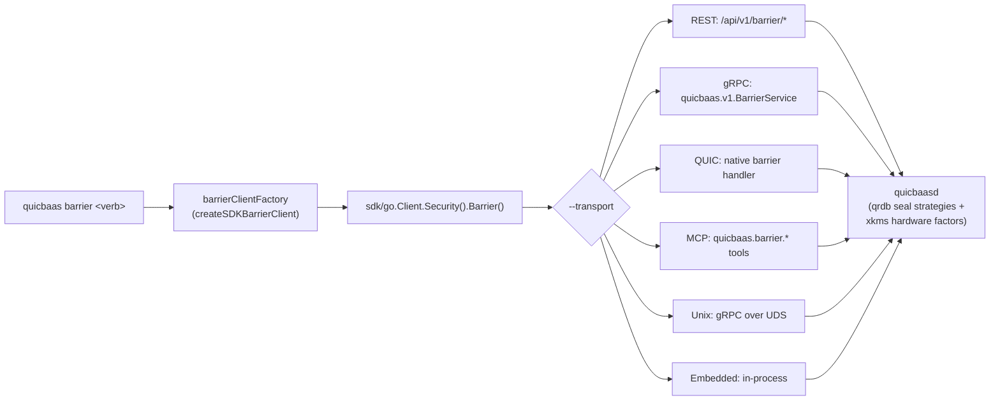

<!--
Copyright (c) 2025 Jeremy Hahn
Copyright (c) 2025 Automate The Things, LLC
SPDX-License-Identifier: AGPL-3.0-or-later
-->

# `quicbaas barrier` — Canonical Barrier CLI Surface

`quicbaas barrier` exposes the **canonical 9-verb barrier tree** shared
byte-for-byte by `qrdb barrier`, `xkmsctl barrier`, and
`platformctl barrier`. The canonical narrative — flag semantics,
validation matrix, PIN flow, the `--passphrase` vs. PIN distinction — lives
in the qrdb doc ([`go-qrdb/docs/cli/barrier.md`](../../../go-qrdb/docs/cli/barrier.md)).
This page documents the **quicbaas-specific specifics**.

Implementation: [`cmd/quicbaas/barrier.go`](../../cmd/quicbaas/barrier.go).
SDK accessor: [`Client.Security().Barrier()`](../sdk/security.md).

---

## 1. The locked verb tree

```
quicbaas barrier status
quicbaas barrier init           --barrier-strategy <none|passphrase|shamir>
                                [--passphrase <pp>]               (required for passphrase/shamir; rejected for none)
                                [--so-pin <pin>]              (optional; rejected when --barrier-strategy=none)
                                [--user-pin <pin>]            (optional; requires --so-pin)
quicbaas barrier init-shamir    --passphrase <pp>
                                --threshold N
                                --total M
                                [--so-pin <pin>]
                                [--user-pin <pin>]            (requires --so-pin)
quicbaas barrier unseal         --passphrase <pp>                 (passphrase / single-secret only)
quicbaas barrier unseal-shares  --share <s1> [--share <s2> ...]
                                | --shares-file <path>        ('-' = stdin)
quicbaas barrier seal           [--so-pin <pin>]
                                [-y | --assume-yes]
quicbaas barrier rekey          [--so-pin <pin>]              (NO --user-pin on rekey)
                                [--threshold N --total M]     (paired; Shamir share regeneration;
                                                               no secret on the wire)
quicbaas barrier recovery generate
                                --threshold N --total M
                                [--so-pin <pin>]
quicbaas barrier recovery recover
                                --share <s1> [--share <s2> ...]
```

> **Enable-encryption is API-only (no CLI verb yet).** Migrating an
> unencrypted barrier to a keyed strategy after the fact is exposed over the
> REST/gRPC/QUIC/MCP transports (system route `POST /api/v1/barrier/enable-encryption`
> and per-tenant route `POST /api/v1/tenants/{tenant_id}/barrier/enable-encryption`),
> driven server-side via the embedded qrdb node. It is **not** wired as a
> `quicbaas barrier` CLI verb — the barrier CLI uses the qrdb `BarrierClient`
> transport, whose enable-encryption method is intentionally stubbed (the
> operation runs on the node, not through that transport). See the API/barrier
> docs for the request shape.

### Root persistent flag

| Flag | Default | Allowed values |
|------|---------|----------------|
| `--transport` | `unix` | `rest`, `grpc`, `quic`, `mcp`, `unix`, `embedded` |

```go
rootCmd.PersistentFlags().StringVar(&transport, "transport", "unix",
    "Transport protocol (grpc, rest, quic, unix, mcp, embedded)")
```

— [`cmd/quicbaas/main.go:164`](../../cmd/quicbaas/main.go).

### Security-officer ceremony verbs (canonical; quicbaas mirror pending)

The officer ceremony verb tree (`barrier officer *`,
`barrier shamir-seal-vote`, `barrier recovery officer *`) is part of
the canonical surface — under the share-free INV-1 contract the claim
ceremony is the only way an officer ever holds a share. qrdb is the
reference implementation; the quicbaas mirror is pending. See
[`08-bootstrap-auth-architecture.md §6`](https://github.com/automatethethings/software/blob/main/docs/08-bootstrap-auth-architecture.md#6-cli-surface-convergence)
and [go-qrdb `docs/cli/barrier.md` §3.10](../../../go-qrdb/docs/cli/barrier.md).

---

## 2. SDK plumbing

Every verb routes through the SDK `Security().Barrier()` accessor; no
transport-specific code lives in the CLI.

```go
// cmd/quicbaas/barrier.go
func createSDKBarrierClient() (BarrierClient, error) {
    sdk, err := sdkClientFactory()
    if err != nil {
        return nil, err
    }
    return sdk.Security().Barrier()
}
```

The returned `BarrierClient` is the qrdb-defined
`sdk/go/transport.BarrierClient` surface — the CLI delegates to it
1:1. The SDK chooses the active transport (`grpc`, `rest`, `quic`,
`unix`, `mcp`, `embedded`) per the global `--transport` flag.



---

## 3. `--passphrase` is the strategy wrapping passphrase, not a PIN

This used to be a source of confusion. It is not anymore. See
[the qrdb canonical doc §2](../../../go-qrdb/docs/cli/barrier.md#2-architectural-concept---passphrase-is-not-a-pin)
for the full architectural rationale. In quicbaas concretely:

| Flag | Concern | Server-side path |
|------|---------|-----------------|
| `--passphrase` | Strategy wrapping passphrase. `passphrase` Argon2id-derives the wrapping key, `shamir` uses it as the strategy seal, `none` ignores it. | qrdb `pkg/seal` strategy registry |
| `--so-pin`, `--user-pin` | Two-PIN compliance-gating material (FIPS 140-3 / PCI-DSS v4). Gates rekey / seal / recovery-generate. | qrdb `pkg/pin.PINBackend` (composed in via `WithPINBackend`) |

CLI-side validation lives in `runBarrierInitCmd` / `runBarrierInitShamirCmd`
/ `runBarrierRekeyCmd` ([`cmd/quicbaas/barrier.go`](../../cmd/quicbaas/barrier.go)):

| Rule | Verb(s) | Error |
|------|---------|-------|
| `--barrier-strategy` not in `{none, passphrase, shamir}` | `init` | `errors.ErrInvalidInput` |
| `--passphrase` empty for `passphrase` / `shamir` | `init`, `init-shamir`, `unseal` | `errors.ErrInvalidInput` |
| `--passphrase` supplied with `--barrier-strategy=none` | `init` | `errors.ErrInvalidInput` |
| `--so-pin`/`--user-pin` with `--barrier-strategy=none` | `init` | `PINsNotAllowedError` |
| `--user-pin` without `--so-pin` (or vice versa) | `init`, `init-shamir` | `errors.ErrInvalidInput` |
| `--threshold` / `--total` not paired | `init-shamir`, `rekey`, `recovery generate` | `errors.ErrInvalidInput` |
| `--threshold < 2` or `--total < --threshold` | `init-shamir`, `rekey`, `recovery generate` | `errors.ErrInvalidInput` |
| One of `--share` / `--shares-file` not supplied | `unseal-shares` | `BarrierShareInputError` |
| Both `--share` and `--shares-file` supplied | `unseal-shares` | `BarrierShareInputError` |
| `--shares-file` unreadable | `unseal-shares` | `BarrierSharesFileError` |
| `--shares-file` empty | `unseal-shares` | `BarrierSharesFileEmptyError` |

---

## 4. Examples

### Passphrase strategy with PIN-gated administration

```bash
quicbaas barrier init \
  --barrier-strategy passphrase \
  --passphrase '<wrapping-passphrase>' \
  --so-pin SO12345 \
  --user-pin USR12345

quicbaas barrier status --output json
quicbaas barrier seal --so-pin SO12345 -y
quicbaas barrier unseal --passphrase '<wrapping-passphrase>'
```

### Shamir M-of-N strategy

```bash
quicbaas barrier init-shamir \
  --passphrase '<seed>' \
  --threshold 3 \
  --total 5

# Share-free: shares are sealed to enrolled Security Officers; each
# officer claims their share via the share-claim flow. No share
# material is printed or crosses the wire. Later:

quicbaas barrier unseal-shares --share aaa --share bbb --share ccc
# or
quicbaas barrier unseal-shares --shares-file /etc/quicbaas/shares.txt
# or
cat shares.txt | quicbaas barrier unseal-shares --shares-file -
```

### None strategy (dev / test only)

```bash
quicbaas barrier init --barrier-strategy none
# Data is stored in cleartext. Do NOT use this in production.
```

### Rekey (share layout preserved)

The server generates a fresh unseal key and share set itself — no
secret material travels on the request. All previously distributed
shares are cryptographically revoked.

```bash
quicbaas barrier rekey --so-pin SO12345
```

### Rekey + new Shamir share layout

```bash
quicbaas barrier rekey --threshold 3 --total 5
```

### Disaster-recovery key set

```bash
quicbaas barrier recovery generate --threshold 3 --total 5 --so-pin SO12345
quicbaas barrier recovery recover --share key-a --share key-b --share key-c
```

### Enable-encryption (API-only)

Transitioning a cleartext (`none`) barrier to an encrypted one after the fact is
exposed over the transports, not the CLI (see the note in §1). The request field
is `target_strategy`; `mechanism` and `availability` default to `swap` / `online`.

```bash
# System barrier — passphrase
curl -X POST https://host:port/api/v1/barrier/enable-encryption \
  -d '{"target_strategy":"passphrase","passphrase":"my-wrapping-passphrase"}'

# System barrier — Shamir
curl -X POST https://host:port/api/v1/barrier/enable-encryption \
  -d '{"target_strategy":"shamir","passphrase":"my-wrapping-passphrase","shamir_threshold":2,"shamir_total":3}'

# Per-tenant barrier (tenant 'acme-corp')
curl -X POST https://host:port/api/v1/tenants/acme-corp/barrier/enable-encryption \
  -d '{"target_strategy":"passphrase","passphrase":"tenant-wrapping-passphrase"}'
```

A tenant on the shared system barrier (no dedicated barrier) is rejected with
`403` (`ErrSharedBarrierImmutable`); an in-progress migration returns `409`.

---

## 5. Output formatting

`--output table | json | yaml` is wired at the barrier-group level
(`PersistentFlags`). Defaults to `table`. The renderers (`formatBarrier*Response`
in [`cmd/quicbaas/barrier.go`](../../cmd/quicbaas/barrier.go)) use
the shared `pkg/cli` `ParseOutputFormat` helper so behaviour is
consistent with every other quicbaas verb.

---

## 6. Transport behaviour

| Transport | Endpoint / RPC family |
|-----------|----------------------|
| REST | `POST /api/v1/barrier/{status,init,init-shamir,unseal,unseal-shares,seal,rekey,recovery-generate,recovery-recover}` |
| gRPC | `quicbaas.v1.BarrierService` |
| QUIC | Native quicbaas barrier handler |
| MCP | `quicbaas.barrier.*` tools |
| Unix | gRPC over Unix domain socket (default) |
| Embedded | In-process via `Security().Barrier()` |

---

## 7. Cross-references

* Canonical narrative + PIN flow + strategy taxonomy:
  [`go-qrdb/docs/cli/barrier.md`](../../../go-qrdb/docs/cli/barrier.md)
* Spec: [`08-bootstrap-auth-architecture.md §6`](https://github.com/automatethethings/software/blob/main/docs/08-bootstrap-auth-architecture.md#6-cli-surface-convergence)
* SDK accessor contract: [`docs/sdk/security.md`](../sdk/security.md)
* Sibling CLI docs:
  [`qrdb barrier`](../../../go-qrdb/docs/cli/barrier.md) ·
  [`xkmsctl barrier`](../../../go-xkms/docs/cli/barrier.md) ·
  [`platformctl barrier`](../../../go-trusted-platform/docs/cli/barrier.md)
