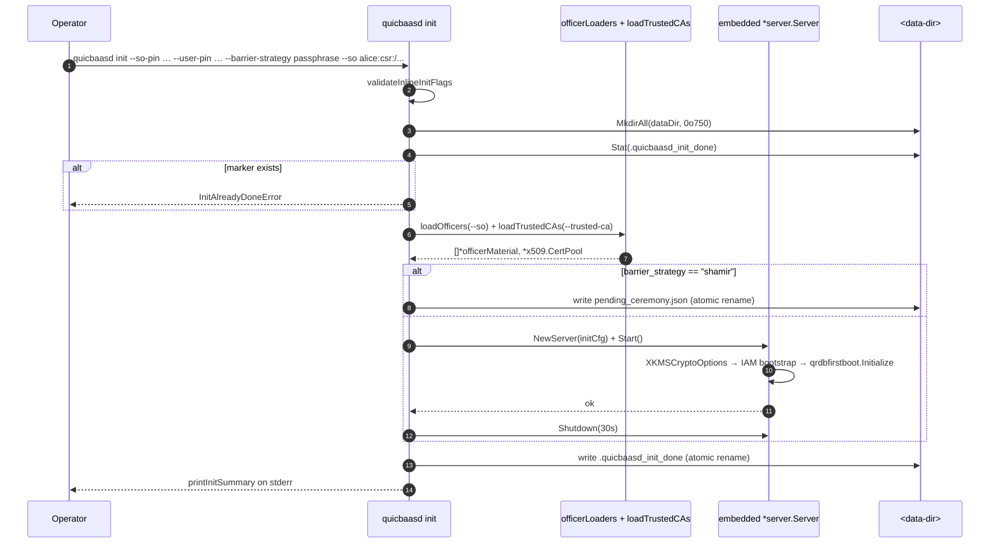

# quicbaasd init

Inline initialisation ceremony for a fresh QuicBaaS data directory.

## Overview

`quicbaasd init` is the daemon-side bootstrap command. It validates
operator-supplied PIN material, registers Security Officer (SO)
identity material, runs the canonical first-boot flow (system tenant
+ built-in roles + admin user, idempotent via
`qrdbfirstboot.Initialize`), and persists enough state that the next
`quicbaasd start` brings up an operational daemon.

The command is intentionally distinct from `quicbaas init` (the
operator-side ceremony state-machine driver). `quicbaasd init` runs
on the host that owns the data dir; `quicbaas init` (the CLI) drives
the ceremony state machine over the network from an operator
workstation. The two share verb names but never the same process.

## init persists state (gap-2 change)

Prior to Phase 10 gap-2, `quicbaasd init` was a validate-and-print
command: it parsed flags, dry-ran the bootstrap, and exited without
writing anything to disk. This produced confusing operator semantics
(no error, no daemon, no marker) and broke the integration test
matrix because the subsequent `quicbaasd start` re-ran the bootstrap
from scratch.

The Phase 10 gap-2 fix made `quicbaasd init` actually persist:

1. The data directory is created (mode `0o750`) if missing.
2. The barrier strategy and credential strategy are validated.
3. SO officer files are parsed and validated.
4. For `passphrase` / `none` strategies an embedded `*server.Server` is
   constructed against the data dir, started so the IAM bootstrap
   runs end-to-end (PebbleDB stores the system tenant, built-in
   roles, admin user, admin invite), then shut down cleanly.
5. For `shamir`, a `pending_ceremony.json` file is written under the
   data dir so the next `quicbaasd start` resumes the ceremony state
   machine.
6. A `.quicbaasd_init_done` marker JSON file is dropped at the data
   dir root with the chosen strategy, credential strategy, hostname,
   officer count, share/threshold counts, and completion timestamp.
7. A short operator summary is printed to stderr; stdout stays clean
   for scripting.

Re-running `quicbaasd init` against the same data dir returns
`InitAlreadyDoneError` instead of silently re-bootstrapping. To
re-initialise, the operator must remove the marker explicitly. The
underlying `firstBootBootstrap` is itself idempotent, so a marker
removed after an interrupted init lets the next attempt complete
without surprise side effects.

## Idempotency markers

| File | Path | Purpose |
|------|------|---------|
| `.quicbaasd_init_done` | `<data-dir>/.quicbaasd_init_done` | Init-complete signal. Presence blocks re-init; absence permits init. Mode `0o600`. JSON. |
| `pending_ceremony.json` | `<data-dir>/pending_ceremony.json` | Shamir resume state. Contains strategy, share count, threshold, credential strategy, officer metadata (username/kind/path), creation timestamp. Mode `0o600`. JSON. |

Both files are written via atomic rename (`<file>.tmp` → final) so an
interrupted init cannot leave half-written state. The marker schema
is:

```json
{
  "barrier_strategy":    "passphrase",
  "credential_strategy": "barrier",
  "hostname":            "node1.example.com",
  "officer_count":       0,
  "shares":              0,
  "threshold":           0,
  "completed_at":        "2026-05-25T14:32:11Z"
}
```

## Flag surface

`quicbaasd init` mirrors `xkmsd init` and `qrdb init` verb-for-verb so
the three operator binaries accept identical arguments.

### Canonical flags (locked surface)

| Flag | Default | Required when | Description |
|------|---------|---------------|-------------|
| `--so-pin <string>` | (none) | always | Security Officer PIN. FIPS 140-3 / PCI-DSS v4 SO credential. |
| `--user-pin <string>` | (none) | always | User PIN. FIPS 140-3 / PCI-DSS v4 user credential. |
| `--barrier-strategy <name>` | `passphrase` | always | One of `none` / `disabled` / `passphrase` / `shamir`. Hardware strategies (`pkcs11`, `tpm2`, `awskms`, `gcpkms`, `azurekv`, `vault`) are rejected by `quicbaasd init` and must be initialised by the xkmsd-driven flow. The runtime `auto` sentinel is **not** an init value — it is a `seal.strategy` resolved at `quicbaasd start` (see the axis table below). |
| `--shares <int>` | `0` | `--barrier-strategy=shamir` | Total Shamir shares (N). |
| `--threshold <int>` | `0` | `--barrier-strategy=shamir` | Shamir M-of-N threshold. |
| `--hostname <fqdn>` | (none) | optional | FQDN written into the admin / server certificate CN. |
| `--sans <csv>` | (none) | optional | Additional DNS / IP SANs (comma-separated). |
| `--admin-bundle <path>` | `-` | optional | Path for the admin client cert+key bundle. `-` writes once to stdout. |

### Phase 11 inline additions

| Flag | Default | Description |
|------|---------|-------------|
| `--init-data-dir <path>` | (none — falls back to global `--data-dir`) | Per-init data directory override. Useful for running multiple isolated init ceremonies in CI. |
| `--credential-strategy <name>` | `barrier` | One of `manual` / `barrier`. Selects how named credentials are sealed. |
| `--so <username:KIND:/path>` | (none, repeatable) | SO officer identity material. `KIND ∈ {csr, cert, pubkey}`. Each entry is parsed and validated before any state is persisted. |
| `--trusted-ca <path>` | (none, repeatable) | PEM file with CA certificates used to validate `--so KIND=cert` material. |

## --barrier-strategy values

| Value | Meaning | PIN required? | Listener at end of init? |
|-------|---------|---------------|--------------------------|
| `disabled` / `none` | No encryption barrier. Data dir is plaintext on disk. Suitable only for ephemeral test environments. | Yes (validator enforces parity with the other strategies) | No — the embedded server is started, IAM bootstrap runs, then it shuts down. |
| `passphrase` | qrdb's `SoftwareStrategy`. Root key is derived from the SO/User PIN via Argon2id (PBKDF2 under FIPS) and sealed locally. (Older docs called this value `software`.) | Yes | No — same as `disabled`: embedded run, persist, shut down. |
| `shamir` | qrdb's Shamir M-of-N strategy. Root key is split into N shares; M shares are required to unseal. Init persists `pending_ceremony.json` only; the operator completes the ceremony via `quicbaas ceremony claim-cert begin ...` after the next `quicbaasd start`. | Yes (PIN material is included in the ceremony state) | No daemon and no IAM bootstrap until the ceremony completes. |
| `pkcs11` / `tpm2` / `awskms` / `gcpkms` / `azurekv` / `vault` | Hardware-backed strategies | n/a | **Rejected by `quicbaasd init`**. These run through the xkms-orchestrated flow and `xkmsd init`. |

## init `--barrier-strategy` vs runtime `seal.strategy` and the `crypto:` block

Three distinct axes are easy to confuse. `quicbaasd init --barrier-strategy` is
an **init-time** choice limited to software-class seals; the hardware-prefer
`auto` sentinel and the hardware seals are **runtime** (`quicbaasd start`)
concerns; and the `crypto:` block is about *key storage*, not the seal at all.

| Axis | Where / when | What it selects | Valid values |
|------|--------------|-----------------|--------------|
| `--barrier-strategy` (init flag) | `quicbaasd init`, once | The root-key seal the data dir is **initialised** with | `none` / `disabled` / `passphrase` / `shamir` |
| `seal.strategy` (config) | `quicbaasd start`, every boot | The **runtime** root-key seal, including hardware and the hardware-prefer sentinel | `none` / `passphrase` / `shamir` / `tpm2` / `pkcs11` / `awskms` / `gcpkms` / `azurekv` / `vault` / `auto` |
| `crypto:` block (config) | `quicbaasd start`, every boot | Which go-xkms backend **stores** each subsystem's keys (KMS, CA, PIN, barrier AEAD) | see [crypto.md](../configuration/crypto.md) |

- `auto` is **not** an init `--barrier-strategy` value (the init validator rejects
  it). It is a runtime `seal.strategy` sentinel resolved at `quicbaasd start` by
  the `BackendResolver`: a TPM2 seal when a provisioned, seal-capable device is
  present, else software. `quicbaasd init` only initialises software-class seals
  (`none`/`disabled`/`passphrase`/`shamir`); hardware and `auto` seals come up at
  start. See [Seal/Unseal](../security/seal.md#seal-strategy-sealstrategy).
- The `crypto:` block is orthogonal to the seal strategy: it decides *where keys
  live*, not *how the root key is sealed*. A passphrase-sealed barrier can still
  pin its CA signing key into a TPM via `crypto.subsystems.ca.backend: tpm2`. See
  [Crypto Backend Selection](../configuration/crypto.md).

## PIN handling per strategy

| Strategy | SO PIN | User PIN | Notes |
|----------|--------|----------|-------|
| `disabled` / `none` | Validated for parity; not stored anywhere persistent | Validated for parity; not stored | Reject empty PINs so an operator does not accidentally bring up an unauthenticated cluster. |
| `passphrase` | Hashed via `pin.AutoDetectHashConfig()` and stored in the qrdb `PINBackend` (PebbleDB-backed by the composed server). | Hashed and stored alongside SO PIN. | `PINBackend` defaults to PBKDF2 in FIPS mode, Argon2id otherwise. |
| `shamir` | Recorded into the pending-ceremony state so the daemon can reapply it during the resume flow. | Same. | Final hashing happens after the operator completes the ceremony. |

PINs travel only through the in-process embedded server during init —
no PIN ever crosses a network boundary on the `quicbaasd init` path.

## SO officer material

`--so` repeats for each officer. The value is parsed as
`username:KIND:/path/to/file`:

| KIND | What `<path>` contains | Validation | Trust source |
|------|------------------------|------------|--------------|
| `csr` | PEM-encoded `CERTIFICATE REQUEST` | `x509.ParseCertificateRequest` + `csr.CheckSignature()` | Daemon CA signs during init (internal CA path) |
| `cert` | PEM-encoded `CERTIFICATE` already issued by an external CA | `x509.ParseCertificate` (chain validation runs during ceremony enrolment against `--trusted-ca`) | External CA |
| `pubkey` | PEM-encoded `PUBLIC KEY` (PKIX) | `x509.ParsePKIXPublicKey` | Admin-asserted |

Officer file loading is dispatched through a map at
[`cmd/quicbaasd/init.go:91`](../../cmd/quicbaasd/init.go) so adding a
new officer kind is a one-line addition to `officerLoaders`.

Validation runs **before** any persistence. If any `--so` value is
malformed, the init aborts without touching the data dir.

## init → start contract

After a successful `quicbaasd init`:

1. The data dir contains `.quicbaasd_init_done`.
2. For `passphrase` / `disabled` / `none`: PebbleDB holds the system
   tenant + admin user + admin invite (synthesised via the
   `qrdbadapter.UserAdapter`).
3. For `shamir`: PebbleDB is empty; `pending_ceremony.json` is the
   only state.

The next `quicbaasd start` reads the marker and:

- `passphrase` / `disabled` / `none`: starts every configured listener
  and resumes from the persisted bootstrap state. `firstBootBootstrap`
  detects the existing admin and short-circuits.
- `shamir`: brings up the listener stack in a "ceremony pending"
  state. Only the ceremony endpoints accept traffic until the
  operator completes the ceremony via `quicbaas ceremony` /
  `quicbaas init` verbs against the daemon.

`quicbaasd start` without a marker emits a typed
`InitMissingError` so the operator gets a precise message instead of
a confusing startup failure deep in the lifecycle.

## End-to-end flow



## Examples

### Passphrase (single-host)

```bash
quicbaasd init \
  --data-dir /var/lib/quicbaas \
  --so-pin $SO_PIN \
  --user-pin $USER_PIN \
  --barrier-strategy passphrase \
  --credential-strategy barrier \
  --hostname quicbaas-1.example.com
```

### Shamir 3-of-5 with internal CSRs

```bash
quicbaasd init \
  --data-dir /var/lib/quicbaas \
  --so-pin $SO_PIN \
  --user-pin $USER_PIN \
  --barrier-strategy shamir \
  --shares 5 --threshold 3 \
  --so alice:csr:/etc/quicbaas/officers/alice.csr \
  --so bob:csr:/etc/quicbaas/officers/bob.csr \
  --so carol:csr:/etc/quicbaas/officers/carol.csr \
  --so dan:csr:/etc/quicbaas/officers/dan.csr \
  --so eve:csr:/etc/quicbaas/officers/eve.csr
```

After this returns successfully:

```bash
quicbaasd start --data-dir /var/lib/quicbaas
# ... in another shell ...
quicbaas ceremony status
quicbaas ceremony claim-cert begin --officer alice
```

### Shamir with external officer certificates

```bash
quicbaasd init \
  --data-dir /var/lib/quicbaas \
  --so-pin $SO_PIN --user-pin $USER_PIN \
  --barrier-strategy shamir --shares 5 --threshold 3 \
  --trusted-ca /etc/pki/corp-root.pem \
  --so alice:cert:/etc/quicbaas/officers/alice.pem \
  --so bob:cert:/etc/quicbaas/officers/bob.pem \
  --so carol:cert:/etc/quicbaas/officers/carol.pem \
  --so dan:cert:/etc/quicbaas/officers/dan.pem \
  --so eve:cert:/etc/quicbaas/officers/eve.pem
```

### Ephemeral test (no barrier)

```bash
quicbaasd init \
  --init-data-dir /tmp/qb-test \
  --so-pin testSO --user-pin testUser \
  --barrier-strategy none \
  --credential-strategy manual
```

`--init-data-dir` overrides the global `--data-dir` only for the init
ceremony, so a single binary can drive multiple isolated CI runs.

## Errors

All init errors are typed (no `fmt.Errorf` returns). Common ones:

| Type | Cause |
|------|-------|
| `ErrInvalidOfficerFormat` | `--so` value did not match `username:KIND:/path` |
| `ErrEmptyOfficerUsername` / `ErrEmptyOfficerPath` | Trimmed components empty |
| `ErrUnknownOfficerKind` | KIND not in `{csr, cert, pubkey}` |
| `ErrOfficerFileNotFound` / `ErrOfficerFileRead` | `--so` file missing / unreadable / is a directory |
| `ErrOfficerPEMDecode` | `--so` file is not valid PEM |
| `ErrCSRParseFailed` / `ErrCSRSignatureInvalid` | CSR malformed or fails self-signature check |
| `ErrCertParseFailed` / `ErrPubKeyParseFailed` | KIND=cert/pubkey file unparseable |
| `ErrTrustedCANotFound` / `ErrTrustedCARead` / `ErrTrustedCANoCerts` | `--trusted-ca` problems |
| `ErrInvalidCredentialStrategy` | `--credential-strategy` not in `{manual, barrier}` |
| `InitAlreadyDoneError` | `.quicbaasd_init_done` exists in the data dir |
| `UnsupportedBarrierStrategyError` | Hardware strategy supplied — handled by xkmsd init |

Validation runs in two phases: flag-level rules first (which short
out before any I/O), then loader-level rules (which read and parse
files but never touch the data dir). Persistence only begins after
both phases succeed.

## Source

- [`cmd/quicbaasd/init.go`](../../cmd/quicbaasd/init.go) — full
  implementation including the loader dispatch table.
- [`cmd/quicbaasd/init_test.go`](../../cmd/quicbaasd/init_test.go) —
  per-flag validation tests + marker idempotency tests.
- [`pkg/server/iam_init.go`](../../pkg/server/iam_init.go) — the
  `firstBootBootstrap` the init flow exercises (which itself
  delegates to `qrdbfirstboot.Initialize` via
  [`pkg/iam/qrdbadapter`](../../pkg/iam/qrdbadapter/qrdbadapter.go)).

## See also

- [`docs/architecture/composition.md`](../architecture/composition.md)
  — how the embedded server is composed at init time.
- [`docs/architecture/embedded-mode.md`](../architecture/embedded-mode.md)
  — why init can run entirely in-process.
- [`docs/cli/auth.md`](auth.md) — how the admin invite is consumed
  after init completes.
- [`docs/cli/seal.md`](seal.md) → superseded by the canonical
  `barrier` verb tree below.
- `quicbaas barrier` — the operator-facing verb tree that drives the
  post-init unseal / status / rekey workflow.
- `quicbaas ceremony` — the ceremony state-machine driver used after
  Shamir init.
