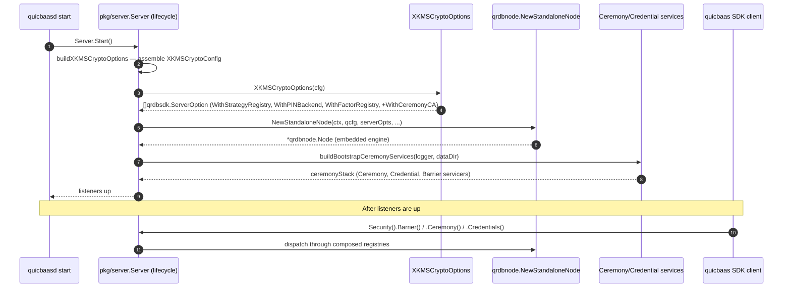

# Composition — Architecture

> **Status: NORMATIVE** · Last verified: 2026-08-19
> Design, component boundaries and data flow. Feature folder: `docs/composition/`.

## Scope

QuicBaaS is a 4-level composition stack: **go-quicraft(L1)** →
**go-qrdb(L2)** → **go-xkms(L3)** → **go-quicbaas(L4)**.
Each layer owns specific primitives.

QuicBaaS does not contain its own sealing strategies, PIN backend,
authentication factor implementations, or distributed key-value store
primitives. It composes those from two upstream libraries at server
startup:

- **go-qrdb(L2)** — software StorageBarrier (Software + None + Shamir
  strategies), PIN hashing, the `FactorRegistry` contract, and the source
  of truth for tenant-safe barrier-encrypted distributed primitives
  (vector storage + k-NN search via persistent HNSW, embedding provider
  proxy for Ollama/OpenAI/LMStudio/Voyage).
- **go-xkms(L3)** — every hardware-backed backend (TPM2, PKCS#11, AWS KMS,
  GCP KMS, Azure Key Vault, HashiCorp Vault) and every hardware Factor
  (FIDO2, PIV, PKCS#11).

The composition contract is the locked architecture rule **"qrdb(L2) =
software only + distributed encryption + tenant-safe primitives; xkms(L3)
= all hardware; quicbaas(L4) = RAG orchestration + LLM generation + API
facade; composition via `With*`"**.
This page documents how `pkg/server/crypto_options.go` enforces that rule
and how `cmd/quicbaasd` consumes the result.

## Why composition (not inheritance)

The earlier design embedded a hardcoded `seal.StrategyRegistry` inside
qrdb and a parallel auth-factor set inside qrdb just to satisfy
unit tests. That violated three rules at once:

1. Hardware code lived in two repos (qrdb + xkms), drifting out of
   sync.
2. qrdb shipped factor adapters it could not actually exercise without
   a TPM/PIV reader/HSM at the test bench.
3. quicbaas had no single, testable seam where an operator could
   inject a custom strategy or factor.

Phase 4 of the unification plan resolved this by making qrdb expose
four `With*` options on its embedded server constructor —
`WithStrategyRegistry`, `WithPINBackend`, `WithFactorRegistry`, and
`WithCeremonyCA` — and pushing all hardware construction up to
quicbaas, where the xkms SDK already lives.

## The composition seam

The entry point is
[`pkg/server/crypto_options.go`](../../pkg/server/crypto_options.go):

```go
func XKMSCryptoOptions(cfg *XKMSCryptoConfig) ([]qrdbsdk.ServerOption, error)
```

It returns the canonical set of `qrdbsdk.ServerOption` values for an
embedded qrdb server configured according to `cfg`. Every type in the
signature is a qrdb **SDK** re-export, not a `go-qrdb/pkg/*` type — that
is the SDK boundary the whole stack is built on. The returned slice is
independent of the input and safe to pass directly to a qrdbsdk-composed
qrdb server.

### XKMSCryptoConfig

`XKMSCryptoConfig` describes the hardware backends and Factor
implementations quicbaas composes into the embedded qrdb server.
Every field is optional: a nil/empty config yields qrdb's software-only
defaults.

| Field | Type | Default | Purpose |
|-------|------|---------|---------|
| `Logger` | `*slog.Logger` | `slog.Default()` | Composition-time log sink |
| `PINStorage` | `qrdbsdk.PINStorage` | nil — in-memory only, not persistent across restarts | Backing store for the default SoftwareBackend |
| `PINBackend` | `qrdbsdk.PINBackend` | constructed from `PINStorage` | Override the default with a hardware PIN backend (TPM2 / PKCS#11). When set, `PINStorage` is ignored. |
| `StrategyFactories` | `map[qrdbsdk.StrategyID]qrdbsdk.StrategyFactory` | empty | Hardware-backed sealing strategies registered alongside the software defaults |
| `Factors` | `[]qrdbsdk.AuthFactorPlugin` | empty | xkms-backed authentication factors (FIDO2 / PIV / PKCS#11) |
| `CeremonyCA` | `qrdbsdk.CeremonyCA` | nil | The CA the embedded node's init ceremony issues from. Appended as `qrdbsdk.WithCeremonyCA` when non-nil. |

Note that qrdb's default factor registry is **empty**: mTLS is not an
`AuthFactorPlugin` — qrdb handles mTLS login natively in its
`LoginResolver` — so a deployment that wants any factor at all,
software mTLS included, registers it through `cfg.Factors`.

Source: [`pkg/server/crypto_options.go`](../../pkg/server/crypto_options.go).

### Composition algorithm

```mermaid
flowchart TD
    Start[XKMSCryptoOptions cfg] --> NilCheck{cfg == nil?}
    NilCheck -->|yes| EmptyCfg[cfg = &XKMSCryptoConfig{}]
    NilCheck -->|no| HasCfg[use caller cfg]
    EmptyCfg --> LogCheck
    HasCfg --> LogCheck

    LogCheck{Logger nil?} -->|yes| DefaultLog[logger = slog.Default]
    LogCheck -->|no| KeepLog[keep cfg.Logger]
    DefaultLog --> Strategy
    KeepLog --> Strategy

    Strategy[strategyReg = qrdbsdk.NewDefaultStrategyRegistry] --> StrategyLoop[for each cfg.StrategyFactories]
    StrategyLoop --> Register[strategyReg.Register name, factory]
    Register --> RegisterErr{err?}
    RegisterErr -->|yes| FailReg[return XKMSCryptoError stage='register strategy']
    RegisterErr -->|no| StrategyLoop
    StrategyLoop --> PinCheck

    PinCheck{cfg.PINBackend nil?} -->|no| UseCustom[pinBackend = cfg.PINBackend]
    PinCheck -->|yes| MakeSoftware[pinBackend = qrdbsdk.NewSoftwareBackend cfg.PINStorage, qrdbsdk.AutoDetectHashConfig]
    MakeSoftware --> SoftErr{err?}
    SoftErr -->|yes| FailPin[return XKMSCryptoError stage='construct default qrdbsdk.SoftwareBackend']
    SoftErr -->|no| Factors
    UseCustom --> Factors

    Factors[factorReg = qrdbsdk.NewFactorRegistry] --> FactorLoop[for each cfg.Factors]
    FactorLoop --> NilCheckF{factor nil?}
    NilCheckF -->|yes| FailNil[return XKMSCryptoError stage='register factor #N' cause=ErrNilFactor]
    NilCheckF -->|no| RegFactor[factorReg.Register factor]
    RegFactor --> FactorErr{err?}
    FactorErr -->|yes| FailFactor[return XKMSCryptoError stage='register factor name']
    FactorErr -->|no| FactorLoop
    FactorLoop --> CACheck

    CACheck{cfg.CeremonyCA nil?} -->|no| AppendCA[append WithCeremonyCA]
    CACheck -->|yes| Return
    AppendCA --> Return

    Return[return WithStrategyRegistry, WithPINBackend, WithFactorRegistry, +WithCeremonyCA]
```

The algorithm is intentionally additive: software defaults are
created first, hardware overrides are layered on top, and every
register call surfaces a typed `XKMSCryptoError` that names the failing
stage.

```go
return nil, &XKMSCryptoError{Stage: "register strategy " + string(name), Cause: err}
```

`*XKMSCryptoError` implements `Error()` and `Unwrap()` so callers can
`errors.As(err, &xe)` to inspect the failing stage. A nil entry in
`cfg.Factors` is caught before `f.Name()` is called and reported with
the `ErrNilFactor` cause, rather than panicking.

## Defaults (cfg nil)

When `cfg == nil` (the test path and the "software-only" production
deployment):

| Component | Concrete type | Strategies | Notes |
|-----------|---------------|------------|-------|
| `StrategyRegistry` | `qrdbsdk.NewDefaultStrategyRegistry()` | `Software`, `None` | Provided by qrdb |
| `PINBackend` | `qrdbsdk.NewSoftwareBackend(nil, qrdbsdk.AutoDetectHashConfig())` | n/a | PBKDF2 in FIPS mode, Argon2id otherwise |
| `FactorRegistry` | `qrdbsdk.NewFactorRegistry()` | empty | Caller adds factors via `cfg.Factors` |
| `CeremonyCA` | (unset) | n/a | **No `WithCeremonyCA` option is emitted, so qrdb's ceremony CA stays unset and every CA-dependent ceremony verb fails closed.** There is no software-CA fallback inside `XKMSCryptoOptions`. |

## Hardware deployments

When `cfg.StrategyFactories` carries entries, they are registered into
the same registry as the software defaults so a single registry
advertises every active strategy. The same is true for `cfg.Factors`.

A typical hardware-enabled composition looks like:

```go
cfg := &server.XKMSCryptoConfig{
    Logger: slogger,
    StrategyFactories: map[qrdbsdk.StrategyID]qrdbsdk.StrategyFactory{
        xkmssdk.StrategyTPM2: func() (qrdbsdk.SealingStrategy, error) {
            return buildTPM2Strategy(serverCfg)
        },
    },
    Factors:    buildXKMSFactors(serverCfg), // []qrdbsdk.AuthFactorPlugin
    PINBackend: pinBackend,
    CeremonyCA: ceremonyCA,
}
opts, err := server.XKMSCryptoOptions(cfg)
```

That is essentially what `buildXKMSCryptoOptions`
(`pkg/server/qrdb_node.go`) does at daemon start. It does **not** hand
`XKMSCryptoOptions` a raw hardware constructor: quicbaas keeps its own
`hardwareStrategyFactory` registry, `hardwareStrategyFactories`
(`pkg/server/seal_factories.go`), keyed by `qrdbsdk.StrategyID` and
populated from `init()`. The TPM2 factory registers unconditionally; the
five build-tagged backends — `awskms`, `gcpkms`, `azurekv`, `vault`,
`pkcs11` — each register from their own guarded file
(`seal_factory_awskms.go` and siblings). A strategy configured without
its tag compiled is absent from the map and yields a
`StrategyNotCompiledError` telling the operator which `-tags` value to
rebuild with.

`buildXKMSCryptoOptions` then wraps the one factory matching
`cfg.Seal.Strategy` in a closure that captures the quicbaas
`*config.Config`, adapting it to the argument-free
`qrdbsdk.StrategyFactory` shape.

`PINBackend` is resolved separately by `buildPINBackend` before
`XKMSCryptoOptions` is called, so on the daemon path `PINStorage` is
never consulted. A `tpm2` PIN verifies over the **same** TPM open the
seal strategy holds — never a second open — and fails closed with
`PINRequiresTPMSealError` when no TPM2 seal is active.

## How CeremonyCA fits in

The ceremony layer needs a CA to mint officer and share certificates
during initialisation. Software-only deployments use a self-issued CA
constructed by the bootstrap flow; hardware deployments inject an
xkms-backed CA (typically rooted in TPM2 or PKCS#11) via the
`WithCeremonyCA` option on the qrdb embedded server.

`XKMSCryptoOptions` **does** carry the CeremonyCA: `XKMSCryptoConfig`
has a `CeremonyCA qrdbsdk.CeremonyCA` field, and when it is non-nil the
function appends `qrdbsdk.WithCeremonyCA(cfg.CeremonyCA)` to the option
slice. On the daemon path `buildXKMSCryptoOptions` threads
`s.ceremonyCA` into that field.

What `XKMSCryptoOptions` does not do is *construct* the CA. That wiring
lives alongside the bootstrap services in
[`pkg/server/ceremony_wiring.go`](../../pkg/server/ceremony_wiring.go).
The CA is built once per data dir, persists across daemon restarts,
and is the source of truth for the ceremony's TLS serving certificate,
officer CSR signatures, and the CA bundle / SPKI pin the operator
verifies. Leave it nil and every CA-dependent ceremony verb fails
closed — there is no fallback.

## Phase B: standalone mode embeds the real qrdb engine

Since Phase B of the unified-engine refactor, **standalone mode** (the
default `server.mode` when no Raft cluster is configured) no longer runs a
no-op Raft node backed by quicbaas's own per-shard `baasTransport` stores.
Instead it calls `qrdbnode.NewStandaloneNode` to embed the real qrdb engine
in-process.

### What changes

| Before Phase B | After Phase B |
|----------------|---------------|
| `standaloneRaftNode` (no-op) + `baasTransport` per-shard Pebble stores | `qrdbnode.NewStandaloneNode` — real qrdb engine, no Raft SM |
| quicbaas built its own `dataPlaneBarrier` + `atrest.Encryptor` (duplicate) | qrdb node owns the barrier + at-rest encryptor end-to-end |
| `XKMSCryptoOptions` result was built but never passed anywhere | Result is passed as `serverOpts` to `NewStandaloneNode` — hardware crypto is live |
| Per-shard `ShardedClient.ForShard` created new `baasTransport` clients | `ForShard` returns `node.Client()` — the same in-process embedded transport client for every shard ID |

### How it works

`Server.initialize()` in `pkg/server/server.go` calls
`s.initStandaloneQRDBNode()` (defined in `pkg/server/qrdb_node.go`) for the
standalone branch, which:

1. Calls `buildQRDBConfig` to map quicbaas `Storage/Seal/Raft` config fields
   to a `*qrdbsdk.DaemonConfig` (the SDK re-export of qrdb's `pkg/config`
   types — quicbaas never imports `go-qrdb/pkg/config` directly).
2. Calls `buildXKMSCryptoOptions` which invokes `XKMSCryptoOptions` with
   hardware strategy factories from `seal_factories.go` populated for the
   configured strategy.
3. Calls `qrdbnode.NewStandaloneNode(ctx, qcfg, serverOpts, ...)` — the
   returned `*Node` owns a `LocalBackend` (no Raft SM), the StorageBarrier, the
   at-rest `Encryptor`, and all service instances (KV/MVCC/TS/Vector/Barrier/
   Ceremony/Credential/Tenant).
4. Stores the node on `s.qrdbNode`.

`startService()` in `lifecycle.go` detects `s.qrdbNode != nil` and creates a
`nodeBackedShardedClient` (via `newNodeBackedShardedClient`) that wraps
`node.Client()`. `ShardedClient.ForShard` short-circuits to return that single
client for every shard ID; the qrdb engine handles all routing internally.

### quicbaas → qrdb config mapping

| quicbaas field | qrdb field | Notes |
|----------------|------------|-------|
| `cfg.Storage.DataDir` | `qcfg.Raft.DataDir` | Primary data root; qrdb uses `Raft.DataDir` for pebble + seal sub-stores |
| `cfg.Seal.BarrierDir` | `qcfg.Raft.DataDir` (fallback) | Used when `Storage.DataDir` is empty |
| `cfg.Storage.Backend` | `qcfg.Databases[0].Backend` | `"memory"` / `"file"` / `"pebble"` (identical names) |
| `cfg.Seal.Enabled` | `qcfg.Seal.Enabled` | Direct copy |
| `cfg.Seal.Strategy` | `qcfg.Seal.Strategy` | Defaults to `"passphrase"` when empty |
| `cfg.Seal.Threshold` | `qcfg.Seal.ShamirThreshold` | Shamir M-of-N threshold |
| `cfg.Seal.TotalShares` | `qcfg.Seal.ShamirTotal` | Shamir total shares |

### Hardware crypto injection

`buildXKMSCryptoOptions` wraps each entry in `hardwareStrategyFactories`
(populated at `init()` time by `seal_factories.go` and the tagged
`seal_factory_*.go` files) as a `qrdbsdk.StrategyFactory` closure that
captures the quicbaas `*config.Config`. The resulting `[]qrdbsdk.ServerOption`
is passed verbatim to `NewStandaloneNode` → `server.New` — this is the first
time hardware crypto (TPM2/PKCS#11/cloud KMS) + at-rest encryption +
per-tenant barriers actually apply to the quicbaas data plane.

## Phase C: clustered mode embeds the real qrdb Raft host

Since Phase C, **clustered mode** (`server.mode = "cluster"`) no longer runs
a no-op `standaloneRaftNode` + `baasTransport` stack. It calls
`qrdbnode.NewClusteredNode` to embed a real quicraft Raft host in-process.

### What changes (Phase C)

| Before Phase C | After Phase C |
|----------------|---------------|
| `standaloneRaftNode` (no-op) + legacy `baasTransport` per-shard stores | `qrdbnode.NewClusteredNode` — real quicraft host, MVCC SM factory |
| quicbaas built its own barrier + at-rest encryptor for cluster mode | qrdb node owns barrier + at-rest end-to-end |
| No real Raft consensus | Full quicraft Raft consensus (multi-node or single-node-clustered) |
| Ceremony/credential built separately via `buildBootstrapCeremonyServices` | Node's `Services().Ceremony` / `.Credential` wired for both modes |

### How it works (cluster)

`Server.initialize()` calls `s.initClusteredQRDBNode()` for the cluster
branch, which:

1. Calls `buildQRDBConfig(cfg, true)` — populates Raft address, shard/replica
   IDs, deployment ID, peer list, and discovery method.
2. Calls `buildClusterMembers(cfg)` — parses `cfg.Raft.JoinAddresses` into
   `map[replicaID]raftAddress`. Falls back to single-node map when no
   `id=`-prefixed peers are configured.
3. Calls `buildRaftMTLSConfig(cfg)` — loads PEM bytes from
   `cfg.Raft.TLSCertFile` / `TLSKeyFile` / `TLSCAFile`. Returns nil for
   single-node clusters (no transport = no mTLS needed).
4. Calls `qrdbnode.NewClusteredNode(ctx, qcfg, members, serverOpts, nodeOpts...)`
   with `WithRaftMTLS(mtls)` when mtls is non-nil.
5. Stores the node on `s.qrdbNode`.

`startService()` detects `s.qrdbNode != nil` (same path for both standalone
and clustered), creates a `nodeBackedShardedClient`, and populates
`s.ceremonyServices` from the node's `Services().Barrier` / `.Ceremony` /
`.Credential` when the seal barrier is enabled.

### quicbaas → qrdb config mapping (cluster additions)

| quicbaas field | qrdb field | Notes |
|----------------|------------|-------|
| `cfg.Raft.RaftAddress` | `qcfg.Raft.RaftAddress` | Raft peer address |
| `cfg.Raft.ListenAddress` | `qcfg.Raft.ListenAddress` | Bind address |
| `cfg.Raft.NodeID` | `qcfg.Raft.ReplicaID` + `DeploymentID` | ReplicaID = NodeID; DeploymentID = NodeID (min 1) |
| `cfg.Raft.JoinAddresses` (id= prefix) | `qcfg.Raft.Peers` | Comma-separated `id=addr` peer list |
| `cfg.Discovery.Type` | `qcfg.Discovery.Method` | `static`/`multicast`/`dns`/`token`; k8s/consul → `static` |
| `cfg.Discovery.Multicast.ClusterSecret` | `qcfg.Discovery.MulticastSecret` | HMAC secret for multicast |
| `cfg.Raft.TLSCertFile` / `TLSKeyFile` / `TLSCAFile` | `quicraftconfig.MTLSConfig` | Loaded and passed via `WithRaftMTLS` |

### `baasTransport` (deleted)

Phase E completed: the `baasTransport` type, its per-shard Pebble stores, the
`BaasKVAdapter` / `BaasAdminAdapter` service-layer adapters,
`ShardedClient.EmbeddedTransportForShard`, and `BaasTransportNotSupportedError`
are all gone from `pkg/server`. The only survivor of the `Baas*` naming is
`pkg/server/interfaces_baas.go`, which is a set of type aliases onto the qrdb
SDK (`BaasBarrierService = qrdbsdk.BarrierServicer`), not a transport.

A few stale `baasTransport` mentions remain in Go comments
(`lifecycle_databases.go`, `ceremony_wiring.go`, `lifecycle.go`,
`cmd/quicbaas/client.go`); they describe a layer that no longer exists. Do not
reintroduce it — see embedded-mode.md for the node-servicer
path that replaced it.

## Wire path: composer → qrdb server → SDK consumer



## Failure modes

`XKMSCryptoError` carries the wiring stage that failed:

| Stage prefix | Cause |
|--------------|-------|
| `register strategy <id>` | A `StrategyFactory` returned a non-nil error from `Register` (usually a duplicate-name collision with the software defaults) |
| `construct default qrdbsdk.SoftwareBackend` | `qrdbsdk.NewSoftwareBackend` failed (typically out-of-memory or invalid `qrdbsdk.AutoDetectHashConfig` in a sandboxed FIPS environment) |
| `register factor #<i>` | `cfg.Factors[i]` is nil; `Cause` is `ErrNilFactor`. Caught before `f.Name()` so the composition returns an error instead of panicking. |
| `register factor <name>` | An `AuthFactorPlugin` returned a non-nil error from `Register` (usually a duplicate-name collision) |

All are recoverable: the operator can prune the duplicate, fix the hash
config, and rerun `quicbaasd start`. `XKMSCryptoOptions` is idempotent —
calling it twice with the same `cfg` produces two independent
registries, so a retry is safe.

## Test coverage

- [`pkg/server/crypto_options_test.go`](../../pkg/server/crypto_options_test.go)
  and
  [`pkg/server/crypto_options_errors_test.go`](../../pkg/server/crypto_options_errors_test.go)
  exercise the branches: nil cfg, software-only cfg, duplicate strategy
  registration, nil and duplicate factor registration, custom
  PINBackend override, CeremonyCA passthrough, and
  `XKMSCryptoError.Unwrap` traversal.

## Relationship to the rest of the platform

| Layer | Repo | Role | Composition seam |
|-------|------|------|------------------|
| L2 | go-qrdb | Software StorageBarrier + canonical first-boot + named credentials + **tenant-safe vector storage + persistent HNSW + embedding provider proxy** | `WithStrategyRegistry`, `WithPINBackend`, `WithFactorRegistry`, `WithCeremonyCA` |
| L3 | go-xkms | All hardware backends + all hardware factors | Producers of `qrdbsdk.StrategyFactory` and `qrdbsdk.AuthFactorPlugin` |
| **L4** | **go-quicbaas** | **Composer + multi-protocol facade + SDK frontage + RAG orchestration + LLM text generation + chunking + ranking + context assembly** | `XKMSCryptoOptions` is the single point where qrdb(L2) and xkms(L3) meet; go-quicbaas owns RAG pipeline logic and delegates vector ops to qrdb via SDK |
| L5 | go-trusted-platform | Downstream consumer | Imports `sdk/go` only — never touches qrdb or xkms directly |

## Passphrase barrier auto-unseal (Phase F addition)

A passphrase-strategy qrdb node boots **sealed** by default — `node.Client()`
returns nil until the operator supplies the passphrase via the barrier API.
For the `quicbaasd init` path and for operators who want the daemon to self-unseal
at boot, the passphrase can be injected at construction time:

```go
srv, err := server.NewServer(cfg,
    server.WithSealPassphrase([]byte("admin-passphrase")),
)
```

`WithSealPassphrase` is a `server.ServerOption`. Internally it forwards the
passphrase to `qrdbnode.WithSealPassphrase` inside `initStandaloneQRDBNode` /
`initClusteredQRDBNode`. Without it the node is returned sealed and
`GetKVStore` will panic on first call (the "vector storage init: barrier is
sealed" failure). For daemons that require explicit operator unsealing, omit
the option and use the REST/gRPC barrier-unseal endpoint after boot.

## Cluster DeploymentID (Phase F addition)

All nodes in a Raft cluster must share the same `deployment_id`.
quicbaas `RaftConfig` now exposes an explicit `deployment_id` field:

```yaml
raft:
  node_id: 1
  deployment_id: 42      # must match on every node
  raft_address: "node1:63101"
  join_addresses:
    - "1=node1:63101"
    - "2=node2:63101"
    - "3=node3:63101"
```

Resolution order inside `buildQRDBConfig`:
1. `cfg.Raft.DeploymentID` if non-zero — production multi-node (all nodes
   must set the same value).
2. `cfg.Raft.NodeID` when `DeploymentID` is unset — backward-compatible
   single-node dev/test fallback. **Not suitable for multi-node clusters.**
3. Literal `1` — last-resort non-zero fallback.

## Host module seam — mounting a downstream host's own ServiceModule

A `ServiceModule` is go-qrdb's capability seam: one registration is exposed
across the node's transports under the node's single authorizer. Every node
go-quicbaas builds already carries two — go-quicbaas's own broker plane
(`quicbaas`) and go-xkms's (`xkms`), both assembled in
`unifiedModuleServerOptions` ([`pkg/server/qrdb_node.go`](../../pkg/server/qrdb_node.go)).

A **downstream host** — go-trusted-platform mounting its device / attestation /
SDN plane — mounts a third one the same way.

### Canonical shape: `quicbaas.WithModule` on `quicbaas.NewServer`

```go
srv, err := quicbaas.NewServer(cfg, quicbaas.WithModule(myModule))
```

**This is the only supported shape.** go-quicbaas does *not* re-export a qrdb
server constructor, and a host must not reach for one:

- go-qrdb's SDK publishes the server **options** (`ServerOption`,
  `WithModule`, `WithServerTLS`, …) and deliberately **no `NewServer`**.
  Constructing the node is the composer's job — ownership doc 00 L7,
  "composition happens in one place".
- go-quicbaas **is** that composer. Building the node means assembling the ONE
  audit sink, the module shard router, the late-binding REST and MCP
  resolvers, go-xkms's module with its four host options, and the unified TLS
  config — all of which read unexported `pkg/server.Server` state. A host
  handed a raw `NewServer` would have to rebuild that composition root, which
  is exactly what the layer boundary forbids.

Threading the host's modules *into* go-quicbaas's composition keeps one node,
one authorizer, one audit plane, and one place where modules are registered.

### Mount order and the collision guards

`unifiedModuleServerOptions` registers `quicbaas`, then `xkms`, then each host
module in the order it was declared. Two guards apply, both **fail
construction** rather than degrading silently:

| Guard | When | Error |
|-------|------|-------|
| Module name is nil / empty / duplicates `quicbaas`, `xkms`, or an earlier host module | `NewServer` | `NilHostModuleError`, `UnnamedHostModuleError`, `HostModuleNameConflictError` |
| A host module claims a REST route another mounted module already owns | qrdb node construction | `HostModuleRouteConflictError`, naming **both** owners and both spellings |
| A host module registers a route straight onto the registrar's embedded `chi.Router` | qrdb node construction | `HostModuleUnregisteredRouteError` |
| A host module registers something chi refuses — bad pattern, unsupported method, router middleware | qrdb node construction | `HostModuleInvalidRouteError` |
| A host module claims a route under `/v1` or one of go-qrdb's top-level planes | qrdb node construction | `HostModuleReservedRouteError` |
| A module's router cannot be enumerated | qrdb node construction | `HostModuleRouterInspectionError` (fails closed) |

go-qrdb enforces both itself — `WithModule` panics on a duplicate name and
`RESTRouteRegistry.assertNotRegistered` panics on a duplicate route — but only
once the node is deep into construction. go-quicbaas replays the
registrations through a capture registrar first (only when a host module is
present, so the default composition is unchanged) and reports a typed error at
the host's own composition site instead.

The route guard reports **only** conflicts a host module is party to. Overlap
*between* the two already-mounted modules predates this seam and is nothing a
downstream host can act on — reporting it here would newly fail a composition
that boots today. (There is one such known overlap: `GET`/`POST
/api/v1/tenants/`, tracked as issue #361.)

**Not reporting an overlap is not the same as it being resolved.** Which of two
overlapping surfaces serves a request must be a **stated precedence rule**,
pinned by a test — not whichever module happened to register first. Registration
order is invisible at the call site, it changes when a module is added, and chi
resolves the overlap by replacing the handler while the permission registry
still names the displaced owner: the route then answers under one module's
authorization contract while the default-deny assertion believes it belongs to
another. Every remaining inter-module overlap is therefore a **defect to
resolve**, and the precedence between built-in routes, `quicbaas`, `xkms` and a
host module is to be written here rather than left to the mount sequence in
`unifiedModuleServerOptions`.

Every module route must be registered through the registrar's
`Handle` (declaring its `resource:action` permission) or `HandlePublic`
(genuine first-contact surfaces only). A route registered straight onto the
embedded `chi.Router` skips the permission registry — and because chi silently
*replaces* the handler for a pattern it already holds, such a route can quietly
take over one another module serves while the registry still names that other
module, which the default-deny assertion cannot detect. The guard therefore
walks each host module's router after the dry run and rejects any registration
that did not go through `Handle`/`HandlePublic`.

Route comparison runs each pattern through a shadow `chi.Mux` — the same matcher
the live router uses — instead of comparing pattern text. chi matches a path
parameter by position, so `/devices/{id}` and `/devices/{deviceID}` are one
route and the later registration silently replaces the earlier one; a regex
constraint *is* part of the match, so `{id:[0-9]+}` and `{name}` coexist.
Delegating the decision to chi means the guard cannot drift from chi's actual
rules the way a hand-rolled pattern model would. go-qrdb's own registry keys on
raw pattern text and misses the renamed-parameter case entirely. A pattern chi
refuses outright fails the mount with `HostModuleInvalidRouteError` rather than
panicking the process — and because a host module mounts after `quicbaas` and
`xkms`, the shared router already holds routes, so chi rejects router-level
middleware (`r.Use`) from a host module. The dry run reproduces that state and
reports it as the same typed error instead of letting the panic surface during
real registration.

**`RegisterHTTP` must be repeatable.** Validating a module's REST surface means
asking it for that surface, so the guard calls `RegisterHTTP` once against a
throwaway router and go-qrdb calls it again against the live one. A module that
mutates state, counts calls or refuses a second registration will not survive
that; nor would one that stashed the live `chi.Router` and added routes from
`Start` be described by what was checked. go-qrdb's `ServiceModule` interface
does not itself demand repeatability — mounting through `WithModule` does, and
`TestUnifiedModuleServerOptions_MountedModulesAreRepeatable` pins it for the
two modules quicbaas mounts. Lifting the requirement needs a registration-time
introspection hook from go-qrdb, filed as part of go-qrdb#194, whose stronger
remedy is to stop embedding the live router in the registrar at all.

**go-qrdb's built-in REST routes are guarded by a snapshot, not by the table.**
Modules register before built-ins and a built-in yields silently to a module
that already claimed its path (go-qrdb `pkg/api/rest` `routeIf`), so a host
module claiming e.g. `GET /kv` or `POST /v1/databases` would take over a core
endpoint under its own authorization contract. The mount therefore refuses a
host route inside `qrdbReservedRouteSegments` with
`HostModuleReservedRouteError`.

`/v1` is reserved **wholesale** rather than by enumerating go-qrdb's
sub-namespaces there: it needs no list to keep in sync and it covers every
future `/v1` route. It costs a host nothing, because the check applies to HOST
modules only — quicbaas's own `/v1/barrier/*`, `/v1/ceremony/*` and
`/v1/init/*` are never subjected to it — and the documented host shape is
`/api/v1/<module>/...`, which `/api` keeps clear.
`TestQRDBReservedRouteSegments_LeaveTheDocumentedHostPrefixOpen` pins that the
reserved set never grows into that prefix.

One limit remains from this being a snapshot rather than the live table: a
plane go-qrdb adds under a *new* top-level segment is not covered. go-qrdb#194
asks for the built-in table (and covers the parameter-name and registrar-bypass
gaps in qrdb's own registry).

### Transport coverage — the two transports a host must plan around

`RegisterGRPC`, `RegisterHTTP` and `RegisterMCP` reach **gRPC, unix, REST and
MCP**. Two transports need more:

- **QUIC.** go-qrdb's QUIC transport is a frame protocol, so `RegisterHTTP`
  never reaches it. A module reaches it through its `RegisterQUIC` hook
  (`BaseModule` leaves it a no-op): the QUIC server projects each unary method
  of the gRPC descriptors registered there onto its frames, so a module usually
  delegates to `RegisterGRPC`. Every projected method must declare a
  `(qrdb.v1.permission)` option, or QUIC server construction panics; a method
  the module also lists as public is skipped, because QUIC has no
  unauthenticated path (a public method that declares a permission is still
  projected). Streaming methods are not projected. quicbaas's own module
  registers its `RegisterGRPC` services on `RegisterQUIC` (go-quicbaas#819); see
  [QUIC projection of the API module](#quic-projection-of-the-api-module).
- **The embedded (in-process) transport.** That surface is each capability
  owner's own SDK, independent of this seam. A host calls its module's Go API
  directly in-process rather than routing through the node.

Both are upstream go-qrdb gaps, not go-quicbaas omissions; a host that needs
either files the gap against go-qrdb rather than working around it locally.

### QUIC projection of the API module

`pkg/apimodule.Module.RegisterQUIC` registers the same late-bound services as
`RegisterGRPC`, so a QUIC call made before the facade is composed answers
Unavailable, exactly as on gRPC. Every unary method projects onto QUIC under
the permission its `(qrdb.v1.permission)` option declares, the same one gRPC
enforces. Two carve-outs:

- **Public methods are not served.** QUIC is mTLS-only and has no
  unauthenticated path, so the methods `PublicGRPCMethods` lists, which declare
  no permission, are skipped: `QuicBaaS/Health`, `QuicBaaS/Login`,
  `Login/BeginLogin`, `Login/FinishLogin`, `FIDO2Service/BeginAuthentication`
  and `FIDO2Service/FinishAuthentication`.
- **Streaming methods are not served.** QUIC's frame protocol has no generic
  streaming path; use gRPC, unix or REST for them.

`EmbeddingService` authorizes each RPC with the verb REST and MCP apply to the
same operation, on gRPC, unix and QUIC alike:

| RPC | REST route | MCP tool | Permission |
|---|---|---|---|
| `EmbeddingGenerate` | `POST /api/v1/embedding/generate` | `quicbaas_embedding_generate` | `embedding:embed` |
| `EmbeddingBatchGenerate` | `POST /api/v1/embedding/batch` | `quicbaas_embedding_batch` | `embedding:embed` |
| `EmbeddingClearCache` | `DELETE /api/v1/embedding/cache` | `quicbaas_embedding_cache_clear` | `embedding:embed` |
| `EmbeddingListProviders` | `GET /api/v1/embedding/providers` | `quicbaas_embedding_list_providers` | `embedding:list_models` |
| `EmbeddingGetProviderInfo` | `GET /api/v1/embedding/providers/{provider}` | `quicbaas_embedding_get_provider` | `embedding:list_models` |
| `EmbeddingSetDefaultProvider` | `PUT /api/v1/embedding/providers/default` | `quicbaas_embedding_set_default` | `embedding:list_models` |
| `EmbeddingGetCacheStats` | `GET /api/v1/embedding/cache/stats` | `quicbaas_embedding_cache_stats` | `embedding:list_models` |

Per service:

| Service | Projects onto QUIC | Not on QUIC |
|---|---|---|
| `quicbaas.v1.QuicBaaS` | Yes, unary methods | `Health`, `Login` (public); `List`, `Watch`, `Query`, `ScanIndex`, `TimeSeriesQuery`, `StreamBatchPut` (streaming) |
| `quicbaas.login.v1.Login` | No | `BeginLogin`, `FinishLogin` (public) |
| `quicbaas.fido2.v1.FIDO2Service` | Yes, registration methods | `BeginAuthentication`, `FinishAuthentication` (public) |
| `quicbaas.scheduler.v1.SchedulerService` | Yes, all | — |
| `quicbaas.orchestrator.v1.OrchestratorService` | Yes, unary methods | `SubscribeJobEvents`, `PushEvents`, `SubscribeSessionEvents`, `InferenceStream` (streaming) |
| `quicbaas.project.v1.ProjectService` | Yes, all | — |
| `quicbaas.account.v1.AccountService` | Yes, all | — |
| `quicbaas.ssh.v1.SSHService` | Yes, all | — |
| `quicbaas.messaging.v1.MessagingService` | Yes, unary methods | `StreamNotifications` (streaming) |
| `quicbaas.embedding.v1.EmbeddingService` | Yes, all | — |
| `quicbaas.parameterstore.v1.ParameterStore` | Yes, all | — |
| `quicbaas.dynamicsecrets.v1.DynamicSecretsService` | Yes, all | — |
| `quicbaas.objectstorage.v1.ObjectStorageService` | Yes, unary methods | `StreamGetObject`, `StreamPutObject` (streaming) |
| `quicbaas.objectstorage.v1.ObjectStorageAdmin` | Yes, all | — |
| `quicbaas.ollama.v1.OllamaService` | Yes, all | — |
| `quicbaas.kms.v1.SecretsManagement` | Yes, unary methods | `WatchSecretsByPrefix` (streaming) |

`TestGRPCRegistrations_EveryProjectedMethodDeclaresAPermission` walks every
descriptor `RegisterQUIC` registers, so a new RPC without a permission fails
the unit tests instead of QUIC server startup.

See [../go-sdk/api.md](../go-sdk/api.md) § *Mounting a host ServiceModule* for
the exact call sequence and the SDK types a host implements against.

## See also

- `docs/architecture/embedded-mode.md` — how the
  composed server is exposed through the in-process SDK transport.
- [`docs/sdk/security.md`](../ssh/engineering.md) — the SDK surface that
  end users hit on top of the composed server.
- `docs/architecture/barrier.md` — the
  StorageBarrier contract that the composed `StrategyRegistry` serves.
- [`docs/testing/phase-f-integration-guide.md`](../testing/phase-f-integration-guide.md) —
  Phase F end-to-end integration test guide (standalone, cluster, seal/hardware).
- Locked architecture spec
  §4 — "Composition over inheritance" rule.
