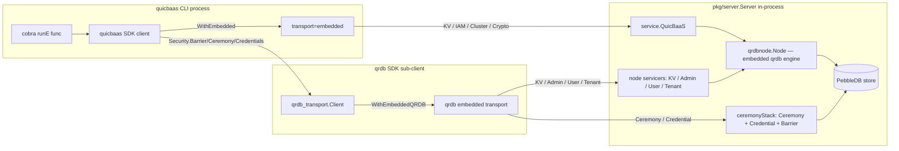

# Composition — User Guide

> **Status: NORMATIVE** · Last verified: 2026-08-19
> Task-oriented usage, in the order tasks are done. Feature folder: `docs/composition/`.

## Scope

QuicBaaS exposes six transports — REST, gRPC, QUIC, MCP, Unix, and
**embedded**. The first five reach the server through a network
listener. Embedded mode does not: the SDK client lives in the same
process as `*server.Server`, and every method call resolves directly to
in-memory state.

Embedded mode is the foundation of:

- `quicbaasd init` (no listener is up while the inline ceremony runs)
- The CLI's `--transport embedded` flag for single-host operator
  workflows
- Integration tests that exercise the full lifecycle without binding
  ports
- Library use of the SDK from inside larger programs (e.g.
  `go-trusted-platform`)

This page documents the Phase 10 gap-1 fix that wired the qrdb
sub-client through the same in-process transport that the QuicBaaS
facade uses, so `Security().Barrier()`, `Security().Ceremony()`, and
`Security().Credentials()` work in embedded mode with zero special
casing.

## The problem before gap-1

The SDK's `WithEmbedded(svc)` option installs a transport that calls
into `pkg/service.Service` directly. That covers KV, Batch,
Transaction, Vector, TimeSeries, IAM, Cluster, Operations, Cache,
Auth, Crypto, KMS, Secrets, Certificate, and ObjectStorage.

It did **not** cover the qrdb sub-client surface (Barrier, Ceremony,
Credential, Tenant, Share, CustodianGroup, AuthFactor). The reason:
those services live behind a separate `qrdb_transport.Client` —
created lazily on first call — that expects to dial a network
endpoint. In embedded mode there is no network endpoint to dial, so
the qrdb sub-client returned a transport-level error on every call.

Gap-1 closes that loop by adding a second SDK option,
`WithEmbeddedQRDB(servicers)`, that installs a qrdb-side embedded
transport pointing at the same in-process state the QuicBaaS facade
already owns.

## QRDBEmbeddedServicers

The payload is
[`QRDBEmbeddedServicers`](../../sdk/go/qrdb_embedded.go):

```go
type QRDBEmbeddedServicers struct {
    KV             QRDBKVServicer            // REQUIRED — positional ctor arg
    Admin          QRDBAdminServicer         // REQUIRED — positional ctor arg

    Barrier        QRDBBarrierServicer       // optional — gates Security().Barrier()
    Ceremony       QRDBCeremonyServicer      // optional — gates Security().Ceremony()
    CeremonyCA     QRDBCeremonyCA            // optional — needed for ceremony.Initialize CSR issuance
    Credential     QRDBCredentialServicer    // optional — gates Security().Credentials()

    Tenant         QRDBTenantServicer        // optional — per-tenant barrier ops
    CustodianGroup QRDBCustodianGroupServicer // optional — Shamir group management
    Share          QRDBShareServicer         // optional — Shamir share submit/track
    AuthFactor     QRDBAuthFactorServicer    // optional — factor enrol/verify
    UserAuthFactor QRDBUserAuthFactorServicer // optional — per-user MFA
    User           QRDBUserServicer          // optional — qrdb user store; needed to
                                             //   resolve a subject to a uint64 user id
                                             //   during user-login factor enrollment
}
```

Every field is a type alias for the corresponding `go-qrdb/pkg/...`
servicer interface, re-exported through
[`sdk/go/qrdb_embedded.go`](../../sdk/go/qrdb_embedded.go) so SDK
consumers never need a direct `go-qrdb/pkg/service` import.

Rationale for the required/optional split: the qrdb embedded transport
constructor (`go-qrdb/sdk/go/transport/embedded.New`) takes KV and
Admin as positional arguments because they back the most common
operations and must be present for the transport to function at all.
Every other servicer is wired via a functional option and is
therefore opt-in — calling an absent servicer returns a typed
`NilServiceError` from the qrdb embedded transport so consumers see
a clean diagnostic instead of a nil pointer panic.

## WithEmbeddedQRDB

The matching SDK option lives at
[`sdk/go/options.go`](../../sdk/go/options.go):

```go
// Pair with WithEmbedded(svc) to install an in-process QuicBaaS facade
// AND an in-process qrdb sub-client backed by `servicers`.
func WithEmbeddedQRDB(servicers QRDBEmbeddedServicers) Option
```

Without `WithEmbeddedQRDB`, calls to `Security().Barrier()`,
`Security().Ceremony()`, `Security().Credentials()`, and the other
qrdb-backed accessors return an explicit configuration error rather
than falling through to the network transport — making the missing
wiring obvious instead of silent.

## The node path: servicers come straight off the qrdb engine

An earlier design bridged the qrdb embedded transport onto a QuicBaaS
`*baasTransport` through two adapter types, `BaasKVAdapter` and
`BaasAdminAdapter`, in a `pkg/server/baas_kv_admin_adapter.go`. **None
of that exists any more.** `baasTransport`, the adapters, their
constructors, `ShardedClient.EmbeddedTransportForShard`, and the
`BaasTransportNotSupportedError` they returned were all removed once
standalone and clustered mode began embedding the real qrdb engine
(see composition.md, Phases B and C). Do not
reintroduce them.

The servicers now come directly off the embedded qrdb node's own
service graph. `*server.Server` exposes them as accessors, and
`cmd/quicbaas/embedded_qrdb.go` carries a compile-time assertion that
the set is present:

| Accessor | Returns | Feeds |
|----------|---------|-------|
| `GetQRDBKVServicer()` | `qrdbsdk.KVServicer` | `servicers.KV` (required) |
| `GetQRDBAdminServicer()` | `qrdbsdk.AdminServicer` | `servicers.Admin` (required) |
| `GetQRDBUserServicer()` | `qrdbsdk.UserServicer` | `servicers.User` |
| `GetQRDBUserAuthFactorServicer()` | `qrdbsdk.UserAuthFactorServicer` | `servicers.UserAuthFactor` |
| `GetQRDBTenantServicer()` | `qrdbsdk.ServiceTenantServicer` | `servicers.Tenant` |
| `GetCeremonyServices()` | `*server.CeremonyServices` | `servicers.Ceremony`, `servicers.Credential`, barrier fallback |
| `GetDataPlaneBarrierService()` | `server.BaasBarrierService` | `servicers.Barrier` (preferred) |

The KV and Admin servicers are the canonical service-layer
implementations backed by the in-process engine, so no interface
bridging is needed: barrier, ceremony, credential and tenant
operations route through the node's own SDK client embedded transport
with no intermediate layer.

## CLI embedded mode wiring

The CLI's wiring path lives at
[`cmd/quicbaas/embedded_qrdb.go`](../../cmd/quicbaas/embedded_qrdb.go),
in `buildEmbeddedQRDBServicers`:

```go
// 1) KV + Admin come straight off the node's service graph.
kv := es.server.GetQRDBKVServicer()
admin := es.server.GetQRDBAdminServicer()
if kv == nil || admin == nil {
    return quicbaas.QRDBEmbeddedServicers{},
        &EmbeddedQRDBWiringError{Stage: "qrdb node services"}
}
servicers := quicbaas.QRDBEmbeddedServicers{KV: kv, Admin: admin}

// 2) User store + unified-login factor service, so a factor enrolled via
//    Security().Auth().Factors().Add lands in the SAME instance the login
//    ceremony resolves against.
if userSvc := es.server.GetQRDBUserServicer(); userSvc != nil {
    servicers.User = userSvc
}
if uafSvc := es.server.GetQRDBUserAuthFactorServicer(); uafSvc != nil {
    servicers.UserAuthFactor = uafSvc
}

// 3) Tenant servicer — the node's own SDK client does not register one on
//    its embedded transport, so TenantMgmt() and the per-tenant barrier
//    verbs need it wired explicitly here.
if tenantSvc := es.server.GetQRDBTenantServicer(); tenantSvc != nil {
    servicers.Tenant = tenantSvc
}

// 4) Ceremony + credential from the node's bootstrap ceremony stack.
if ceremonyStack := es.server.GetCeremonyServices(); ceremonyStack != nil {
    servicers.Ceremony   = ceremonyStack.Ceremony
    servicers.Credential = ceremonyStack.Credential
}

// 5) The REAL data-plane barrier (persistent, PebbleDB-backed), falling
//    back to the bootstrap-window barrier when seal is disabled.
if dp := es.server.GetDataPlaneBarrierService(); dp != nil {
    servicers.Barrier = dp
} else if cs := es.server.GetCeremonyServices(); cs != nil && cs.Barrier != nil {
    servicers.Barrier = cs.Barrier
}
```

The barrier precedence is load-bearing: `Security().Barrier()` must
operate on the persistent data-plane barrier, **not** the bootstrap
ceremony's ephemeral in-memory one. When seal is disabled,
`startService` populates `GetCeremonyServices()` with the bootstrap
stack instead, so the embedded transport serves the same
bootstrap-window barrier every other transport sees.

`embeddedQRDBOption` wraps `buildEmbeddedQRDBServicers` and returns
`quicbaas.WithEmbeddedQRDB(servicers)`, so a wiring failure surfaces to
the operator instead of silently dropping back to a no-op qrdb client.

The CLI surfaces wiring failures as `*EmbeddedQRDBWiringError`:

```go
type EmbeddedQRDBWiringError struct {
    Stage string // "embedded server" | "qrdb node services"
    Cause error
}
```

`Unwrap()` exposes the cause for `errors.As`/`errors.Is` traversal.
There is no shard-selection stage: the node client answers for every
shard ID, so no shard is chosen at wiring time.

## Routing diagram



The QuicBaaS facade and the qrdb sub-client end up calling the same
in-process state — there is no double-buffering, no extra
serialisation, no network roundtrip.

## Servicer availability matrix

| Servicer | Required? | Wired by CLI? | Operations enabled |
|----------|-----------|---------------|--------------------|
| `KV` | Yes | Yes | All KV ops via `Security()`-adjacent qrdb paths |
| `Admin` | Yes | Yes | `Cluster()` and `Operations()` admin reads |
| `Barrier` | No | Yes | Full barrier surface: `status`, `init`, `unseal`, `seal`, `rekey`, `recovery`, `enable-encryption` (system and per-tenant) |
| `Ceremony` | No | Yes (when ceremonyStack present) | `Security().Ceremony()` |
| `Credential` | No | Yes (when ceremonyStack present) | `Security().Credentials()` |
| `Tenant` | No | Yes (when the node exposes one) | `TenantMgmt()` and the per-tenant barrier verbs |
| `User` | No | Yes (when the node exposes one) | Subject → uint64 user-id resolution for factor enrollment |
| `UserAuthFactor` | No | Yes (when the node exposes one) | Unified-login factor enrol/verify against the login ceremony's own store |
| `CeremonyCA`, `CustodianGroup`, `Share`, `AuthFactor` | No | Not wired | Planned: the SDK accepts them, but `buildEmbeddedQRDBServicers` sets none of them today, so calls hit the qrdb embedded transport's `NilServiceError` |

All servicers listed in the "Wired by CLI" = Yes rows are fully operational in embedded mode,
including the complete barrier surface. The bootstrap barrier is wired to the embedded qrdb
node, enabling all barrier operations (initialization, seal/unseal, rekey, recovery, and
enable-encryption for both system and per-tenant scopes) without a network listener.

## Caller contract

The CLI is the canonical reference, but any program embedding the SDK
follows the same pattern:

```go
// 1) Build the in-process *server.Server (transport=embedded, no listeners).
srv, err := server.NewServer(cfg)
if err != nil {
    return err
}
defer srv.Shutdown(context.Background()) // see "Start-failure cleanup" below
// ... srv.Start() ...

// 2) Assemble the QRDBEmbeddedServicers payload from the node's servicers.
servicers := quicbaas.QRDBEmbeddedServicers{
    KV:    srv.GetQRDBKVServicer(),
    Admin: srv.GetQRDBAdminServicer(),
}
if cs := srv.GetCeremonyServices(); cs != nil {
    servicers.Ceremony   = cs.Ceremony
    servicers.Credential = cs.Credential
}
if dp := srv.GetDataPlaneBarrierService(); dp != nil {
    servicers.Barrier = dp
}

// 3) Construct the SDK client with both options. NewClient takes an address
//    first. The embedded transport never dials it, but NewClient rejects an
//    empty string outright, so pass the deployment's configured address (the
//    CLI passes whatever --address resolved to).
sdk, err := quicbaas.NewClient(address,
    quicbaas.WithEmbedded(srv.Service()),
    quicbaas.WithEmbeddedQRDB(servicers),
)
defer sdk.Close()

// 4) All Security() accessors now route in-process.
credCli, err := sdk.Security().Credentials()
```

`WithEmbeddedQRDB` validates eagerly: it returns an invalid-input error
if `servicers.KV` or `servicers.Admin` is nil. Every other servicer is
optional, and an operation against an absent one returns the qrdb
embedded transport's typed `NilServiceError`.

Omitting `WithEmbeddedQRDB` is a configuration error, not a silent
fall-through: the qrdb sub-client refuses to initialise without an
embedded transport to dispatch to. This is intentional — there is no
sensible "default" network endpoint for the in-process case, and
silent fall-through hid bugs during gap-1 development.

### Start-failure cleanup

`srv.Start()` does **not** unwind on failure. It returns at the first
component that fails and leaves everything started before it running —
the embedded qrdb node, an open audit log, the cache-cleanup goroutine,
the lease reaper, the scheduler poll loop.

**A non-nil error from `Start()` MUST be followed by `Shutdown()`.** The
daemon is unaffected in practice: it logs the error and exits, and process
teardown collects everything. An embedding program — a CLI that stays
alive, a library inside someone else's process, a test binary that boots
many servers — has no such backstop and leaks every one of those
resources.

`Shutdown()` is safe on a server that never started, on one that started
fully, and on one that stopped anywhere in between: every teardown step is
guarded on the resource it releases, and resources whose owner was never
built (the cache manager without its facade, the audit sink and seal
strategy without their node) are released by `Shutdown` itself. It is also
idempotent, which is why the deferred call above sits immediately after
`NewServer` rather than after a successful `Start`.

## Comparison to network transports

| Concern | Embedded | gRPC / REST / QUIC / MCP / Unix |
|---------|----------|----------------------------------|
| Latency | direct function call | full RTT through listener |
| Auth | bypassed (caller already has process privilege) | enforced by middleware / interceptors |
| Serialisation | none | proto / JSON encode/decode |
| Cancellation | `context.Context` only | `context.Context` + listener timeout |
| Failure modes | `NilServiceError` for an unwired servicer; `*EmbeddedQRDBWiringError` at construction | listener errors + auth + serialisation |
| Use case | init, single-host CLI, libraries, integration tests | production multi-node clusters |

Embedded mode is **not** a security boundary. Any in-process caller
has full server privilege. Network transports retain the full
authentication / authorisation chain.

## Test coverage

- [`cmd/quicbaas/embedded_qrdb_test.go`](../../cmd/quicbaas/embedded_qrdb_test.go)
  drives `buildEmbeddedQRDBServicers` against the staged server
  fixtures and asserts the `EmbeddedQRDBWiringError` stages.
- [`sdk/go/qrdb_embedded_test.go`](../../sdk/go/qrdb_embedded_test.go)
  exercises the SDK side of `WithEmbeddedQRDB`, including the
  missing-servicer error path.
- Integration tests in `test/integration/cli/` run every canonical
  CLI verb against `--transport embedded` so the wiring stays honest
  with each release.

## See also

- `docs/architecture/composition.md` — how the
  in-process server is constructed via `XKMSCryptoOptions`.
- [`docs/sdk/security.md`](../ssh/engineering.md) — the SDK surface the
  embedded transport ultimately serves.
- [`docs/cli/init.md`](../bootstrap/cli.md) — the canonical caller of
  embedded mode (the init ceremony runs entirely in-process).
- [`docs/sdk/`](../go-sdk) — the SDK reference a library consumer works
  against once the embedded transport is wired. (Note:
  `docs/embedding/` is **not** related — it covers vector embedding
  providers, not embedding the SDK.)
