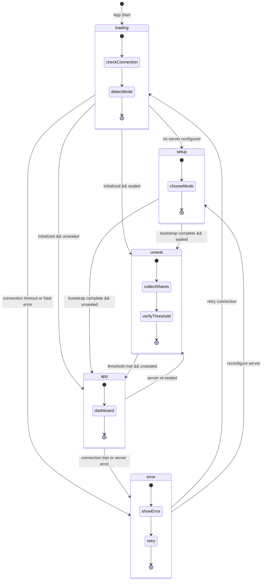
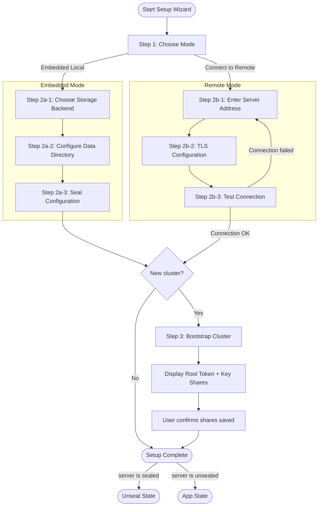
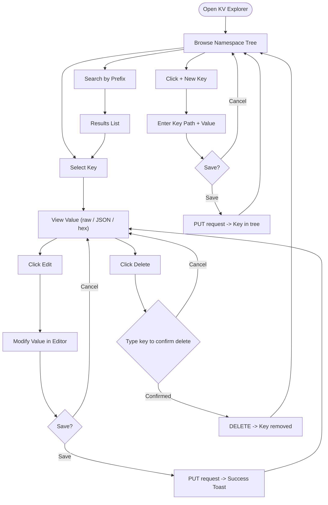
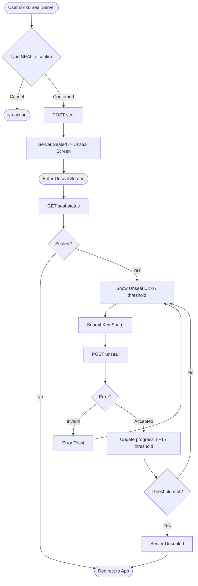
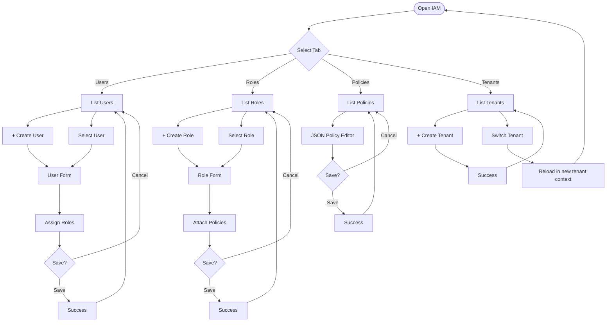
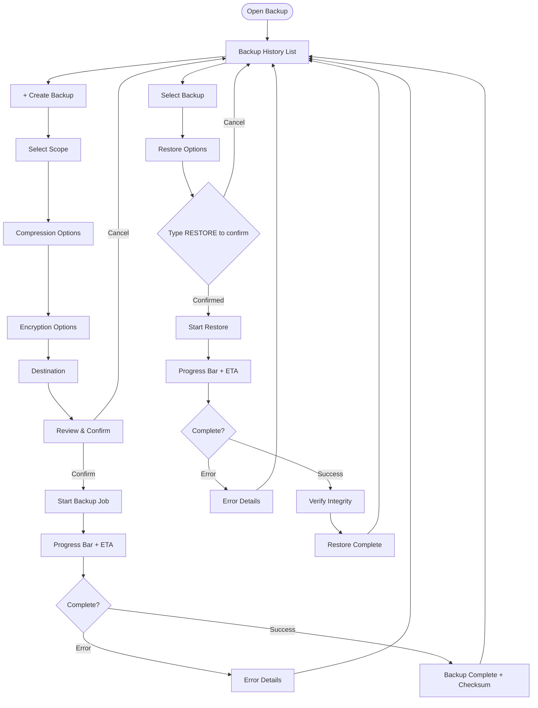
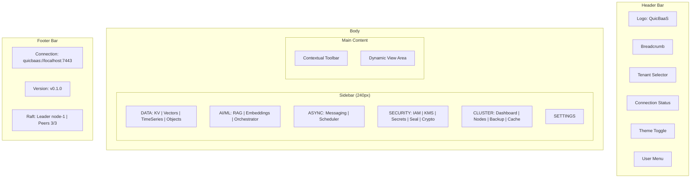

# Desktop GUI — Architecture

> **Status: NORMATIVE** · Last verified: 2026-08-19
> Design, component boundaries and data flow. Feature folder: `docs/desktop-gui/`.

QuicBaaS ships a single Svelte 5 + Tailwind 4 + daisyUI bundle that runs as both a Wails desktop app (native binary, offline-capable) and an embedded web UI served by the quicbaas process at `/ui/`.

Same code, same UX, two shells:

| Shell | Transport | Use case |
|-------|-----------|----------|
| Wails desktop | Embedded Go bindings (no RPC) | Offline ops, single-tenant, laptop install |
| Embedded web (`/ui/`) | REST + SSE (optionally gRPC-Web) | Remote operators, shared deployments |

The frontend auto-detects its shell via `@quicbaas/sdk` and selects the matching transport at runtime. Application code never imports `fetch` or gRPC clients directly — it always calls the SDK.

## Building

### Desktop (Wails)

```bash
# From the project root.
make build-cli WITH_GUI=1
```

This installs `npm` dependencies under `cmd/quicbaas/frontend/`, builds the Svelte bundle, copies it to `pkg/api/rest/ui/dist`, and links Wails into the `quicbaas` binary. CGO is required.

### Web-only

```bash
# Build the frontend bundle and embed it in the daemon.
make _build-frontend
make build
```

The daemon exposes the UI at `GET /ui/` once REST is enabled.

## Transport Selection

`@quicbaas/sdk` exports `createClient({ transport: 'auto' | ... })`. On Wails, `'auto'` returns the embedded Wails transport. In a browser, it returns REST (+ SSE for live streams). Both return the same `Client` interface — screens never know which one they hold.

For gRPC-Web, QUIC, Unix-socket gRPC, and MCP flavors, pass the transport name explicitly. All six transports share the same request/response types.

## Complete GUI Walkthroughs

Comprehensive step-by-step walkthroughs for all 22+ views are available in GUI Walkthroughs. Each walkthrough includes:

- **Purpose** — what the view is for and when to use it
- **Layout** — detailed description of the page structure
- **Lifecycle actions** — table of all row/card actions with backend endpoints
- **Walkthrough** — numbered end-to-end example flows
- **Troubleshooting** — common errors and fixes
- **See also** — links to CLI equivalents and related views

## Key Screens Overview

- **Dashboard** — system health, uptime, service status, and resource counts (sessions, agents, jobs, workflows)
- **Sessions list** — live view of running/paused/closed sessions, filterable by tenant, backend, and status
- **Session attach** — history replay + live SSE tail. Renders each event kind with its own component (prompts, tool calls, file diffs, etc.). Scrollback virtualizes with IntersectionObserver sentinels.
- **Fleet** — enrolled fleet node daemons, their heartbeat status, and the jobs they own
- **Software Factory → Inference** — stateless prompt submission to a fleet-resident backend with optional streaming, host affinity, and a per-session history of the last 10 calls. See [agents/inference.md](../software-factory/user.md#using-the-gui) and Inference walkthrough for the full layout and error matrix.

## Loading the UI

Once `quicbaasd` is running with REST enabled, browse to:

```
https://<host>:18080/ui/
```

The browser must trust the daemon's CA. Either:

1. **Recommended** — install the daemon's CA into the system trust store via
   [`xkey`](https://github.com/jeremyhahn/go-xkms) +
   [`go-truststrap`](https://github.com/jeremyhahn/go-truststrap):
   ```bash
   xkey ca install --address https://<host>:18080
   ```
2. **Development only** — accept the warning ("Advanced → Proceed to <host>")
   in Chrome / Firefox. The UI works but sub-resource loads will be flagged as
   not secure.

The Wails desktop build skips this step entirely — it talks to the embedded
Go bindings, never over TLS.

## Authentication

By default the embedded UI uses the daemon's IAM service for login. Initial
operator credentials are printed once when the data dir is bootstrapped:

```
quicbaasd start --data-dir ./data ...
# →  initial admin: admin / <generated password>
```

Subsequent logins use the same credentials (or any user provisioned via the
IAM API / GUI). Sessions persist as JWTs in `localStorage`; logging out
clears the token and reloads the login view.

## Development

```bash
# Frontend dev server with hot reload, proxying to a running daemon.
cd cmd/quicbaas/frontend
npm run dev
```

Tests run under vitest:

```bash
cd cmd/quicbaas/frontend && npm test
```


---

## QuicBaaS Wails GUI - Implementation Plan & Design Specification

### Context

QuicBaaS needs a web-based UI that serves two contexts:
1. **Desktop GUI** - When `quicbaas` is run with no subcommands and a display is available, launch a Wails desktop app
2. **Server WebUI** - The same Svelte frontend embedded in `quicbaasd` for browser-based administration

This follows the proven pattern from go-qrdb (`<go-qrdb-checkout>/cmd/qrdb/`) which already implements dual-context Wails GUI with Svelte + TypeScript SDK dual-transport (Wails IPC + REST).

### Implementation Priority: Seal/Unseal/Barrier First

The seal/barrier system is the foundation - nothing else works without it. We implement this first:

#### Phase 0A: Wails Foundation + Seal GUI Flow
1. **Wails scaffold** - display detection, build tags, gui_stub/gui_desktop, wails.json
2. **Core bindings** - ConnectionBinding (atomic SDK client), EmbeddedServerBinding
3. **SealBinding** - Uses SDK seal client (NOT lower-level libraries)
4. **TypeScript SDK** - @quicbaas/sdk with dual transport, seal operations first
5. **Frontend** - App.svelte state machine, setup wizard with seal integration, unseal view
6. **SDK gaps** - Add recovery key + root token operations to Go SDK seal client

#### What Already Exists (keep, extend):
- `pkg/seal/barrier_seal_manager.go` - delegates to go-qrdb BarrierClient
- `pkg/service/seal_service.go` - service layer with request/response types
- `pkg/api/rest/handlers_seal.go` - REST handlers
- `pkg/api/grpc/server_seal_methods.go` - gRPC handlers
- `sdk/go/client/seal/client.go` - basic SDK seal client (needs recovery/root-token)
- `cmd/quicbaas/seal.go` - CLI commands (needs recovery/root-token)
- `pkg/config/config.go` - SealConfig struct
- `pkg/server/lifecycle.go` - initBarrier() server integration

#### Reference Files (go-qrdb):
- `<go-qrdb-checkout>/cmd/qrdb/bindings_seal.go` - GUI seal bindings pattern
- `<go-qrdb-checkout>/cmd/qrdb/gui_desktop.go` - Wails launcher pattern
- `<go-qrdb-checkout>/cmd/qrdb/display_*.go` - display detection
- `<go-qrdb-checkout>/sdk/typescript/src/factory.ts` - dual-transport SDK

### Architecture

```
┌─────────────────────────────────────────────────────┐
│  Svelte 5 Frontend (single codebase)                │
│  cmd/quicbaas/frontend/src/                         │
│  ┌──────────────────┐  ┌────────────────────────┐   │
│  │ TypeScript SDK    │  │ @quicbaas/sdk           │   │
│  │ ┌──────────────┐ │  │ sdk/typescript/          │   │
│  │ │ WailsClient  │ │  │ factory.ts auto-detects  │   │
│  │ │ (IPC)        │ │  │ context via window.go    │   │
│  │ ├──────────────┤ │  │                          │   │
│  │ │ RestClient   │ │  │                          │   │
│  │ │ (fetch)      │ │  │                          │   │
│  │ └──────────────┘ │  └────────────────────────┘   │
│  └──────────────────┘                               │
└──────────┬──────────────────────────┬───────────────┘
           │ Wails IPC               │ REST fetch
           ▼                         ▼
┌──────────────────┐      ┌──────────────────┐
│ Desktop (Wails)  │      │ Server (quicbaasd)│
│ Go Bindings      │      │ SPA Handler       │
│ → SDK Client     │      │ → REST API        │
│ cmd/quicbaas/    │      │ cmd/quicbaasd/    │
└──────────────────┘      └──────────────────┘
```

**Build tag gating**: `desktop` tag compiles Wails GUI; without it, `gui_stub.go` returns `GUIUnavailableError` and falls through to CLI.

### Directory Layout

```
cmd/quicbaas/
  main.go                      # MODIFY: add isGUIOnly/hasDisplay/launchGUI
  display_linux.go             # NEW: DISPLAY/WAYLAND_DISPLAY check
  display_darwin.go            # NEW: SSH_TTY check  
  display_windows.go           # NEW: always true
  gui_desktop.go               # NEW: //go:build desktop - Wails launcher
  gui_stub.go                  # NEW: //go:build !desktop - GUIUnavailableError
  gui_errors.go                # NEW: typed GUI errors
  bindings.go                  # NEW: ConnectionBinding (atomic SDK client)
  bindings_server.go           # NEW: EmbeddedServerBinding
  bindings_types.go            # NEW: config structs for bindings
  bindings_seal.go             # NEW: seal/unseal/bootstrap
  bindings_kv.go               # NEW: KV CRUD
  bindings_cluster.go          # NEW: cluster status/nodes
  bindings_iam.go              # NEW: users/roles/policies/tenants
  bindings_kms.go              # NEW: key management
  bindings_secrets.go          # NEW: secrets
  bindings_vector.go           # NEW: vector search
  bindings_timeseries.go       # NEW: time-series
  bindings_objectstorage.go    # NEW: object storage
  bindings_messaging.go        # NEW: pub/sub
  bindings_scheduler.go        # NEW: job scheduling
  bindings_orchestrator.go     # NEW: AI orchestration
  bindings_rag.go              # NEW: RAG pipelines
  bindings_embedding.go        # NEW: embeddings
  bindings_backup.go           # NEW: backup/restore
  bindings_cache.go            # NEW: cache management
  bindings_crypto.go           # NEW: sign/verify/encrypt/decrypt
  bindings_auth.go             # NEW: authentication
  wails.json                   # NEW: Wails config
  frontend/                    # NEW: Svelte 5 + Vite 6 + Tailwind 4 + daisyUI 5
    package.json
    vite.config.ts
    svelte.config.js
    tsconfig.json
    index.html
    src/
      App.svelte               # State machine: loading→setup→unseal→app→error
      app.css
      main.ts
      stores/                  # Svelte 5 reactive stores
        connection.svelte.ts
        capabilities.svelte.ts
        identity.svelte.ts
        seal.svelte.ts
        theme.svelte.ts
        toast.svelte.ts
        tenant.svelte.ts       # Multi-tenant selector
      views/
        MainApp.svelte         # Sidebar navigation shell
        user/                  # Data operation views
        admin/                 # Admin views
      components/
        core/                  # DataTable, SearchBar, ActionMenu, etc.
        wizard/setup/          # First-run setup wizard
        wizard/database/       # Embedded database wizard
        feedback/              # Toast, modals
      lib/
        retry.ts
        wails/wailsjs/         # Auto-generated Wails bindings

sdk/typescript/                # NEW: @quicbaas/sdk
  package.json
  src/
    index.ts
    interfaces.ts              # Client interface + sub-interfaces
    types.ts                   # Request/response types
    factory.ts                 # isDesktop() + getClient()
    wails.ts                   # WailsClient (window.go IPC)
    rest.ts                    # RestClient (fetch)
    errors.ts                  # Typed errors

cmd/quicbaasd/
  webui.go                     # NEW: //go:build !quicbaasd_webui - nil handler
  webui_embed.go               # NEW: //go:build quicbaasd_webui - embed dist/
  webui_dist/                  # STAGED: copied from frontend/dist by Makefile

pkg/api/rest/
  webui.go                     # NEW: SPA handler with API path exclusion
```

### Phase 1: Foundation

**Goal**: Build system, display detection, TypeScript SDK scaffold, minimal Wails app that compiles.

#### 1.1 Makefile Additions
- `DESKTOP_TAGS := desktop production webkit2_41 $(BUILD_TAGS)`
- `WITH_WEBUI ?= 0` feature flag
- Targets: `install-sdk`, `build-sdk`, `install-frontend`, `build-frontend`, `build-desktop`, `dev-gui`, `_stage-webui`, `build-server-webui`

#### 1.2 Display Detection (3 files)
- `display_linux.go` - checks `DISPLAY`/`WAYLAND_DISPLAY` env vars
- `display_darwin.go` - returns true unless `SSH_TTY` set
- `display_windows.go` - always true
- Port directly from go-qrdb `cmd/qrdb/display_*.go`

#### 1.3 CLI/GUI Entry Point (`main.go`)
- Add `isGUIOnly()` - returns true when no subcommands present
- Add flow: `isGUIOnly() && hasDisplay()` → `launchGUI()` → on `GUIUnavailableError` fall through to CLI
- Keep existing Cobra command structure intact for CLI path

#### 1.4 Build Tag Gating
- `gui_errors.go` - `GUIUnavailableError`, `NotConnectedError`, binding error types
- `gui_stub.go` (`!desktop`) - returns `GUIUnavailableError`
- `gui_desktop.go` (`desktop`) - `//go:embed all:frontend/dist`, creates bindings, calls `wails.Run()`

#### 1.5 Core Bindings
- `bindings.go` - `ConnectionBinding` with `atomic.Pointer` for SDK client, `Connect()`, `Disconnect()`, `IsConnected()`
- `bindings_server.go` - `EmbeddedServerBinding` wrapping existing `embedded.go`
- `bindings_types.go` - `EmbeddedConfig`, `ConnectionConfig`, `SealConfig` structs
- `wails.json` - Wails project config

#### 1.6 TypeScript SDK (`sdk/typescript/`)
- `interfaces.ts` - `Client` interface with sub-interfaces matching Go SDK grouping
- `factory.ts` - `isDesktop()` checks `window.go`, `getClient()` auto-selects transport
- `wails.ts` - `WailsClient` delegates to `window.go.main.*Binding.*`
- `rest.ts` - `RestClient` uses `fetch()` against REST API
- `types.ts`, `errors.ts`

#### 1.7 Frontend Scaffold
- `package.json` with Svelte 5, Vite 6, Tailwind 4, daisyUI 5, @quicbaas/sdk
- `App.svelte` with state machine (loading→setup→unseal→app→error)
- Basic stores: `connection.svelte.ts`, `tenant.svelte.ts`

### Phase 2: Core UI

**Goal**: Connection management, seal/unseal, setup wizard, main app shell.

#### 2.1 Go Bindings
- `bindings_seal.go` - Bootstrap, Unseal, Seal, Status
- `bindings_auth.go` - Login, Logout, WhoAmI
- `bindings_cluster.go` (partial) - Health, Status, Capabilities

#### 2.2 Frontend
- **Setup Wizard**: ConnectionStep → StorageStep → SealStep → BootstrapStep
- **Main App Shell**: Sidebar navigation grouped by domain (Data, AI/ML, Async, Security, Cluster, Settings)
- **Tenant selector** in header
- **Stores**: seal, identity, theme, toast, capabilities
- **Shared components**: ToastContainer, ConfirmModal, PageHeader, StatusBadge, JsonViewer

### Phase 3: Data Views (parallel with Phase 4)

**Goal**: KV browser, vector search, time-series, object storage.

#### 3.1 Go Bindings
- `bindings_kv.go` - Put, Get, Delete, List, Scan
- `bindings_vector.go` - CreateCollection, Search, Upsert, Delete
- `bindings_timeseries.go` - Write, Query, Aggregate, ListMetrics
- `bindings_objectstorage.go` - PutObject, GetObject, ListObjects, CreateBucket

#### 3.2 Frontend Views
- `KVExplorer.svelte` - prefix search, pagination, inline editing
- `VectorSearch.svelte` - collection management, query with similarity scores
- `TimeSeriesView.svelte` - echarts visualization, aggregation controls
- `ObjectStorageView.svelte` - bucket browser, upload/download
- Shared: `DataTable`, `SearchBar`, `TimeSeriesChart`, `StatCard`

### Phase 4: Admin Views (parallel with Phase 3)

**Goal**: IAM, KMS, secrets, cluster, backup, cache.

#### 4.1 Go Bindings
- `bindings_iam.go` - Users, Roles, Policies, Tenants CRUD
- `bindings_kms.go` - Key lifecycle management
- `bindings_secrets.go` - Store, Fetch, Delete, List, Rotate
- `bindings_cluster.go` (expanded) - ListNodes, RemoveNode, Rebalance
- `bindings_backup.go` - Create, Restore, List, Delete, Status
- `bindings_cache.go` - Stats, Invalidate, Warm, Clear
- `bindings_crypto.go` - Sign, Verify, Encrypt, Decrypt

#### 4.2 Frontend Views
- `IAMManager.svelte` - tabbed CRUD for users/roles/policies/tenants
- `KMSManager.svelte` - key list, creation wizard, rotation
- `SecretsManager.svelte` - hierarchical path browser, masked values
- `ClusterManager.svelte` - node topology, health, rebalance
- `BackupManager.svelte` - backup history, create/restore wizards
- `TenantManager.svelte` - tenant list, per-tenant barrier status

### Phase 5: Advanced Features

**Goal**: Messaging, scheduler, orchestration, RAG, embeddings.

#### 5.1 Go Bindings
- `bindings_messaging.go` - CreateChannel, Publish, Subscribe (uses Wails events for real-time)
- `bindings_scheduler.go` - Job CRUD, Pause/Resume, Trigger
- `bindings_orchestrator.go` - Fleet registry, task submission/tracking
- `bindings_rag.go` - Ingest, Query, collection management
- `bindings_embedding.go` - Generate, BatchGenerate, ListModels

#### 5.2 Frontend Views
- `MessagingView.svelte` - channel management, real-time message stream
- `SchedulerView.svelte` - job list, cron builder, execution history
- `OrchestratorView.svelte` - fleet, task tracking
- `RAGView.svelte` - document ingestion, query with source attribution
- `EmbeddingView.svelte` - text input, model selector, batch

### Phase 6: Server WebUI Integration

**Goal**: Embed frontend in `quicbaasd` for browser-based admin.

#### 6.1 Files
- `pkg/api/rest/webui.go` - `NewSPAHandler(assets fs.FS)` with API path exclusion
- `cmd/quicbaasd/webui.go` (`!quicbaasd_webui`) - returns nil handler
- `cmd/quicbaasd/webui_embed.go` (`quicbaasd_webui`) - `//go:embed webui_dist/*`, returns SPA handler
- Modify `cmd/quicbaasd/main.go` to register webui handler on REST mux

#### 6.2 Build
- `make build-server-webui` chains: build-frontend → _stage-webui → build with `quicbaasd_webui` tag
- `_stage-webui` copies `cmd/quicbaas/frontend/dist/` to `cmd/quicbaasd/webui_dist/`

### Phase Dependencies

```
Phase 1 (Foundation)
  └── Phase 2 (Core UI)
        ├── Phase 3 (Data Views)     ← parallel
        ├── Phase 4 (Admin Views)    ← parallel
        │     └── Phase 5 (Advanced)
        └── Phase 6 (Server WebUI)   ← can start after Phase 2
```

### Key Design Decisions

1. **Dual-transport SDK**: Single `Client` interface, `WailsClient` + `RestClient` implementations, auto-detected via `isDesktop()`
2. **One binding per service**: Keeps TypeScript types clean (Wails generates per-struct), all bindings registered at startup but lightweight (just logger + connection ref)
3. **Multi-tenancy**: Global tenant selector in UI header, all bindings pass active tenant to SDK
4. **Lazy views**: `{#if activeView === 'kv'}` pattern avoids loading all 20+ views at startup
5. **Real-time**: Wails `runtime.EventsEmit()` for desktop, SSE/WebSocket for web mode
6. **No InsecureSkipVerify**: All TLS properly configured (FedRAMP)

### Verification

1. `make dev-gui` launches Wails dev mode with hot reload
2. `make build-desktop` produces `quicbaas` binary with GUI support
3. Running `./quicbaas` with display → opens GUI window
4. Running `./quicbaas get key` → processes CLI command
5. Running `./quicbaas` without display (SSH) → falls through to CLI help
6. `make build-server-webui` produces `quicbaasd` with embedded web dashboard
7. TypeScript SDK tests verify both WailsClient and RestClient parity
---

## Part 2: UI/UX Design Specification

### Document Overview

This specification covers the complete UI/UX design for the QuicBaaS desktop/web GUI application built with Svelte 5, Tailwind CSS 4, daisyUI 5, lucide-svelte, and ECharts. The design prioritizes operational clarity, data density appropriate for a database management tool, and safe interactions with destructive operations.

---

### 1. App State Machine & Initialization Flow

#### State Diagram

```
                    ┌─────────────────────────────────────────────┐
                    │                                             │
              ┌─────▼─────┐                                      │
    start ───►│  LOADING  │                                      │
              └─────┬─────┘                                      │
                    │                                            │
         ┌──────────┼──────────────────┐                        │
         │          │                  │                        │
         ▼          ▼                  ▼                        │
    ┌────────┐  ┌────────┐      ┌──────────┐                   │
    │ SETUP  │  │UNSEAL  │      │   APP    │                   │
    │        │  │        │      │          │                   │
    └────┬───┘  └────┬───┘      └────┬─────┘                   │
         │           │               │                         │
         │           └──────────────►│                         │
         └──────────────────────────►│                         │
                                     │                         │
                                     │  fatal error           │
                                     └────────────────────────►│
                                                         ┌─────┴─────┐
                                                         │   ERROR   │
                                                         └───────────┘
```

#### State Definitions

**LOADING** (entry point, 0-3 seconds typically)

Purpose: Detect application context and determine the next state.

Actions performed:
- Detect runtime mode (Wails desktop vs. browser)
- Load persisted settings from localStorage / system config
- Attempt connection to configured server endpoint
- Check server health and seal status
- Verify stored auth token validity

Transition conditions:
- No configuration found AND desktop mode → SETUP
- Server is sealed → UNSEAL
- Server is healthy AND valid token exists → APP
- Server is healthy AND no valid token → APP (login screen within APP state)
- Connection failure after retries → ERROR with retry option
- First-run desktop (no config) → SETUP

Visual: Full-screen centered logo with animated pulse ring, progress bar across the bottom, status text below logo showing current check ("Checking server health...", "Verifying credentials...").

---

**SETUP** (first-run wizard)

Purpose: Guide users through initial configuration. Desktop-only for embedded mode; both modes for remote cluster configuration.

Covered in detail in Section 2.

Transition to APP: Setup wizard completes bootstrap successfully, auth token obtained.

---

**UNSEAL** (seal state management)

Purpose: Accept Shamir key shares to unseal a sealed server.

Actions: Display seal status, accept shares progressively, show unlock progress.

Transition to APP: Threshold shares submitted, server unseals successfully.

Transition to ERROR: Server unreachable during unseal attempt.

---

**APP** (main application)

Purpose: Full application UI. Contains its own login sub-state if token is missing or expired.

Sub-states within APP:
- `authenticated` - Normal operation
- `unauthenticated` - Login overlay displayed, navigation disabled
- `token_expired` - Session renewal dialog displayed

---

**ERROR** (fatal error state)

Purpose: Display unrecoverable errors with actionable recovery paths.

Error categories:
- `connection_failed` - Cannot reach server, show retry + reconfigure buttons
- `version_mismatch` - Client/server API version incompatible, show upgrade instructions
- `ssl_error` - TLS certificate issue, show certificate details + bypass warning (never bypass silently)
- `config_corrupt` - Configuration file unreadable, show reset option with data warning

Recovery actions: Each error type surfaces specific recovery actions rather than a generic "something went wrong" message.

---

#### Loading Screen Layout

```
┌─────────────────────────────────────────────────────┐
│                                                     │
│                                                     │
│                    ┌─────────┐                      │
│                    │  ◎ QB   │  ← logo with pulse  │
│                    └─────────┘                      │
│                                                     │
│                     QuicBaaS                        │
│               Distributed Database                  │
│                                                     │
│          ○ Connecting to cluster...                 │
│                                                     │
│  ████████████████████░░░░░░░░░░░░░░░░░░░░░░  42%  │
│                                                     │
│                                                     │
└─────────────────────────────────────────────────────┘
```

daisyUI components: `loading loading-ring loading-lg`, `progress`, custom logo component.

---

### 2. Setup Wizard Flow

#### Mode Detection

```
Desktop (Wails) mode:
  └─ First run?
       ├─ Yes → Wizard Step 1: Deployment Mode
       └─ No  → Skip to connection check

Web (browser) mode:
  └─ Always skip to Step 3 (Remote Connection)
       because server is already running
```

#### Wizard Container

Full-screen with centered card, max-width 640px. Step indicator at top showing progress. Back/Next buttons at bottom. Keyboard navigation: Enter advances, Escape cancels where safe.

```
┌───────────────────────────────────────────────────────┐
│                                                       │
│  QuicBaaS Setup                              Step 2/6 │
│  ─────────────────────────────────────────────────── │
│  ●━━━━━●━━━━━○─────○─────○─────○                     │
│  Mode    Conn  Store  Seal  Boot  Done                │
│                                                       │
│  [  Wizard Content Area  ]                            │
│                                                       │
│                                                       │
│  ┌──────────┐                    ┌──────────────────┐ │
│  │   Back   │                    │  Next →          │ │
│  └──────────┘                    └──────────────────┘ │
└───────────────────────────────────────────────────────┘
```

#### Step 1: Deployment Mode (Desktop only)

```
┌────────────────────────────────────────────────────┐
│  How would you like to run QuicBaaS?               │
│                                                    │
│  ┌─────────────────────────────────────────────┐  │
│  │  ⬡  Embedded Server (Recommended)          │  │
│  │                                             │  │
│  │  Run a local QuicBaaS instance directly     │  │
│  │  in this application. Best for development  │  │
│  │  and single-node use.                       │  │
│  └─────────────────────────────────────────────┘  │
│                                                    │
│  ┌─────────────────────────────────────────────┐  │
│  │  ⬡  Remote Cluster                         │  │
│  │                                             │  │
│  │  Connect to an existing QuicBaaS cluster.   │  │
│  │  For production environments and teams.     │  │
│  └─────────────────────────────────────────────┘  │
└────────────────────────────────────────────────────┘
```

Selection uses large radio card pattern (daisyUI `card` with `border-2 border-primary` when selected). Clicking the card selects it. No checkboxes needed.

#### Step 2: Connection Configuration

Fields for remote mode:
- Server URL (`input input-bordered`, placeholder `https://quicbaas.example.com:7443`)
- TLS Certificate verification toggle (default ON, warning badge if disabled: "FedRAMP non-compliant")
- Custom CA certificate upload (file input, optional)
- Connection timeout slider (5s - 120s, default 30s)
- "Test Connection" button that runs inline validation with spinner

For embedded mode this step shows:
- Listen address (default `127.0.0.1`)
- API port (default `7443`)
- Admin port (default `7444`)

Inline validation feedback appears below each field, not in a toast. Green checkmark when valid, red error text when invalid.

#### Step 3: Storage Backend

```
┌────────────────────────────────────────────────────┐
│  Storage Backend                                   │
│                                                    │
│  ( ) PebbleDB  [Recommended for production]        │
│      Data directory: [/var/lib/quicbaas  ][Browse] │
│      Bloom filter bits: [10     ]                  │
│      Cache size: [256 MB   ]                       │
│                                                    │
│  ( ) Memory                                        │
│      ⚠ Data is not persisted across restarts       │
│                                                    │
└────────────────────────────────────────────────────┘
```

Memory mode shows an `alert alert-warning` banner: "All data is lost when the server stops. Use only for testing." Storage path field has a native file picker in Wails mode, text input in web mode.

#### Step 4: Seal Configuration

```
┌────────────────────────────────────────────────────┐
│  Seal Configuration                                │
│                                                    │
│  QuicBaaS uses Shamir's Secret Sharing to protect  │
│  encryption keys. The master key is split into     │
│  shares; a threshold number is required to unseal. │
│                                                    │
│  Total Key Shares                                  │
│  [━━━━━━━━━━━━━━━━●━━━━━━━━━━] 5                  │
│   1                             10                  │
│                                                    │
│  Unseal Threshold                                  │
│  [━━━━━━━━━●━━━━━━━━━━━━━━━━━] 3                  │
│   1                             5 (≤ total)         │
│                                                    │
│  ┌──────────────────────────────────────────────┐  │
│  │  ℹ  3 of 5 shares required to unseal.       │  │
│  │  Distribute shares to trusted administrators.│  │
│  └──────────────────────────────────────────────┘  │
└────────────────────────────────────────────────────┘
```

Threshold slider max dynamically capped at total shares value. Live info box updates as sliders change.

#### Step 5: Bootstrap

Triggered by clicking "Initialize Cluster" button. This is a one-way action with a confirmation dialog before proceeding.

```
┌────────────────────────────────────────────────────┐
│  Cluster Initialized                               │
│                                                    │
│  ✓ PebbleDB initialized                            │
│  ✓ Master key generated                            │
│  ✓ Key shares created                              │
│  ✓ Root token issued                               │
│  ✓ Cluster unsealed                                │
│                                                    │
│  ─────────────────────────────────────────────     │
│  Root Token  [save this now - shown once]          │
│  ┌──────────────────────────────────────────────┐  │
│  │ qbaas_root_v1.XXXXXXXXXXXXXXXXXXXXXXXXXXXXXXX│  │
│  └──────────────────────────────────────────────┘  │
│  [Copy]  [Download as file]                        │
│                                                    │
│  Key Shares (save each separately)                 │
│  Share 1: [▓▓▓▓▓▓▓▓▓▓▓▓▓▓▓▓▓▓▓] [Copy] [Show]    │
│  Share 2: [▓▓▓▓▓▓▓▓▓▓▓▓▓▓▓▓▓▓▓] [Copy] [Show]    │
│  Share 3: [▓▓▓▓▓▓▓▓▓▓▓▓▓▓▓▓▓▓▓] [Copy] [Show]    │
│  Share 4: [▓▓▓▓▓▓▓▓▓▓▓▓▓▓▓▓▓▓▓] [Copy] [Show]    │
│  Share 5: [▓▓▓▓▓▓▓▓▓▓▓▓▓▓▓▓▓▓▓] [Copy] [Show]    │
│                                                    │
│  ⚠ This information will not be shown again.      │
│  [ ] I have saved the root token and all shares   │
│                                                    │
│  [           Continue to Application           ]  │
└────────────────────────────────────────────────────┘
```

"Continue" button disabled until checkbox is checked. Key shares shown as masked by default, revealed with "Show" toggle. Each copy action triggers a checkmark confirmation inline. A "Download all as JSON" button exports all shares and the token in a single encrypted bundle (password-protected).

#### Step 6: Web Mode Setup

Web mode skips steps 1, 3, 4, 5 (server already running). Shows a simplified connection confirmation screen:

```
┌────────────────────────────────────────────────────┐
│  Connected to QuicBaaS                             │
│                                                    │
│  Server: quicbaas.example.com:7443                 │
│  Version: v2.1.0                                   │
│  Status: ● Healthy                                 │
│  Nodes: 3 (1 leader, 2 followers)                  │
│                                                    │
│  Please sign in to continue.                       │
│                                                    │
│  [        Sign In        ]                         │
└────────────────────────────────────────────────────┘
```

---

### 3. Main App Navigation Design

#### Overall Layout

```
┌──────────────────────────────────────────────────────────────────────┐
│  HEADER BAR (56px fixed)                                             │
│  [≡] QuicBaaS  │  [tenant: acme-corp ▼]  │  ●●● nodes  │ [◐] [👤] │
├──────────────┬───────────────────────────────────────────────────────┤
│  SIDEBAR     │  MAIN CONTENT AREA                                    │
│  (240px)     │                                                       │
│              │  Breadcrumb: Cluster / Dashboard                      │
│  nav items   │  ─────────────────────────────────────                │
│              │                                                       │
│              │  [  Page Content  ]                                   │
│              │                                                       │
│  ──────────  │                                                       │
│  [settings]  │                                                       │
│  [user]      │                                                       │
└──────────────┴───────────────────────────────────────────────────────┘
```

#### Header Bar

Left: hamburger toggle (collapses sidebar) + wordmark "QuicBaaS"

Center: Tenant selector dropdown (described in Section 8)

Right side (left to right):
- Connection status indicator: green dot + "3 nodes" or amber dot + "degraded" or red dot + "offline"
- Theme toggle (sun/moon icon, lucide `Sun` / `Moon`)
- User identity button (avatar initials + username, dropdown with Profile / Sign Out)

Header uses `navbar bg-base-200 border-b border-base-300` classes.

#### Sidebar Navigation Structure

Width: 240px expanded, 64px collapsed (icon-only mode). Collapse persists to localStorage.

```
┌────────────────────────┐
│  [◎] QuicBaaS     [←] │  ← collapse toggle
├────────────────────────┤
│                        │
│  ─ DATA ───────────── │
│  [Database]  KV Store  │
│  [Sparkles]  Vectors   │
│  [TrendingUp] TimeSeries│
│  [Package]   Objects   │
│                        │
│  ─ AI/ML ──────────── │
│  [Brain]    RAG        │
│  [Cpu]      Embeddings │
│  [Bot]      Orchestrate│
│                        │
│  ─ ASYNC ──────────── │
│  [Radio]    Messaging  │
│  [Clock]    Scheduler  │
│                        │
│  ─ SECURITY ────────  │
│  [Shield]   IAM        │
│  [Key]      KMS        │
│  [Lock]     Secrets    │
│  [Lock]     Seal       │
│  [Binary]   Crypto     │
│                        │
│  ─ CLUSTER ─────────  │
│  [LayoutDashboard] Dashboard│
│  [Server]   Nodes      │
│  [HardDrive] Backup    │
│  [Zap]      Cache      │
│                        │
│  ─ ─ ─ ─ ─ ─ ─ ─ ─ │
│  [Settings] Settings   │
└────────────────────────┘
```

Section headers are non-interactive labels with `text-xs font-semibold text-base-content/50 uppercase tracking-wider px-3 py-2`.

Active nav item: `bg-primary/10 text-primary font-medium border-r-2 border-primary` (left-side accent line on the right edge of the sidebar, acting as visual indicator against the content area).

Hover state: `hover:bg-base-300`.

Icon + label layout: `flex items-center gap-3 px-3 py-2 rounded-lg mx-2`.

Collapsed state: icons centered, group labels hidden, active item shows only colored icon. Tooltip on hover using `tooltip tooltip-right` shows the item label.

#### Breadcrumb / Context Area

Sits at top of main content area, below header. Single row: `breadcrumbs text-sm` component. Shows full path for nested views.

Examples:
- `Cluster / Dashboard`
- `Security / IAM / Users / alice@example.com`
- `Data / KV Store / namespace:production`

#### Responsive Behavior

Breakpoints:
- `< 1024px`: Sidebar collapses to icon-only automatically
- `< 768px`: Sidebar becomes a drawer (overlay), hamburger required to open
- `< 640px`: Header tenant selector truncates to icon only

The app is primarily designed for desktop-scale screens (1280px+) but must remain functional at 1024px. Mobile at 768px is a secondary concern, primarily for read-only monitoring views.

---

### 4. Navigation Hierarchy (Detailed)

#### DATA Section

**KV Store** (`/data/kv`)
- List view: key browser with prefix tree
- Key detail view: value display + metadata
- Key editor: create/update value with format selector
- Namespace manager: list and create namespaces

**Vectors** (`/data/vectors`)
- Collections list
- Collection detail: schema, stats, index config
- Search playground: query + results
- Upsert interface: single vector or batch import

**Time-Series** (`/data/timeseries`)
- Metric browser: list all metric names with cardinality
- Query builder: metric + label filters + aggregation + time range
- Chart view: ECharts line/area with time controls
- Retention policy manager

**Objects** (`/data/objects`)
- Bucket list
- Object browser (folder-style hierarchy)
- Object detail: metadata, tags, download
- Upload interface with progress

#### AI/ML Section

**RAG** (`/ai/rag`)
- Pipeline list (name, status, vector collection link, LLM config)
- Pipeline detail: data sources, chunking config, embedding model
- Query playground: input prompt → retrieved context + response
- Ingestion job history

**Embeddings** (`/ai/embeddings`)
- Model registry: list configured embedding models
- Model detail: dimensions, provider, usage stats
- Encode playground: text in → vector out with visualization
- Batch encode job submission

**Orchestrator** (`/ai/orchestrator`)
- Fleet: list of registered fleet nodes with health status
- Task queue: pending/running/completed tasks
- Task detail: input, output, trace log, timing
- Workflow builder: DAG visualization of multi-step workflows
- Submit task form

#### ASYNC Section

**Messaging** (`/async/messaging`)
- Channel list (name, subscribers, message rate, retention)
- Channel detail: configuration, subscriber list
- Message stream: real-time view of messages on a channel
- Publish form: channel select, payload editor, headers

**Scheduler** (`/async/scheduler`)
- Job list: name, schedule (cron), last run, next run, status
- Job detail: handler, payload, history log
- Job editor: create/edit job with cron expression builder
- Run history with output logs

#### SECURITY Section

**IAM** (`/security/iam`)
- Users: list, detail, create, edit, delete
- Roles: list, detail, policy attachment
- Policies: list, policy editor (JSON)
- Tenants: list, detail, resource quotas

**KMS** (`/security/kms`)
- Key list: name, algorithm, version, rotation schedule
- Key detail: versions, usage policy, rotation history
- Key create wizard
- Rotate key action

**Secrets** (`/security/secrets`)
- Secrets engine list (namespaces/mounts)
- Secret browser (path-based tree, similar to KV)
- Secret detail: value (masked by default), metadata, lease
- Secret create/update form

**Seal** (`/security/seal`)
- Seal status panel (always visible, prominent)
- Unseal interface: share submission
- Seal (emergency) action with confirmation
- Key rotation controls

**Crypto** (`/security/crypto`)
- Sign/Verify form: key selector, payload, signature
- Encrypt/Decrypt form: key selector, data input/output
- Operation history log (audit)

#### CLUSTER Section

**Dashboard** (`/cluster/dashboard`) - default landing after login
- Node health grid
- Raft group status
- Resource usage overview (storage, memory, connections)
- Recent events/alerts feed

**Nodes** (`/cluster/nodes`)
- Node list with status badges
- Node detail: address, role, Raft state, resource metrics
- Add node wizard (join token generation)
- Remove node with safety check (checks Raft quorum)

**Backup** (`/cluster/backup`)
- Backup list with metadata (size, date, type, encryption)
- Create backup form with options
- Restore wizard: backup select → options → confirmation → progress
- Schedule backup (cron-based)

**Cache** (`/cluster/cache`)
- Cache hit/miss ratio chart (ECharts)
- Eviction statistics
- Cache size and item count
- Flush action with confirmation

#### SETTINGS Section

**Settings** (`/settings`)
- Single page with sections (not nested routes):
  - Appearance: theme selector, density
  - Connection: server URL, TLS config (edit existing connection)
  - Tenant: current tenant selection (also accessible from header)
  - Session: token expiry, auto-logout
  - About: version info, license

---

### 5. Key View Workflows

#### KV Explorer Workflow

**List View Layout:**
```
┌────────────────────────────────────────────────────────────────┐
│  KV Store                              [+ New Key] [⚙ Namespace]│
│  Namespace: production ▼                                        │
│  ──────────────────────────────────────────────────────────── │
│  [🔍 Search keys...              ]  [Filter ▼]  [Refresh]     │
│                                                                │
│  ┌──────────────────────────────────────────────────────────┐ │
│  │ ▶ config/          (48 keys)                            │ │
│  │ ▼ user/            (1,204 keys)                         │ │
│  │   ▶ user/profile/  (301 keys)                           │ │
│  │   ▶ user/session/  (903 keys)                           │ │
│  │ ▶ cache/           (5,021 keys)                         │ │
│  └──────────────────────────────────────────────────────────┘ │
│                                                                │
│  Selected prefix: user/                                        │
│  ┌──────────────────────────────────────────────────────────┐ │
│  │ KEY                    │ TYPE    │ SIZE    │ TTL    │ ... │ │
│  │ user/alice@example.com │ json    │ 2.1 KB  │ no ttl │ ... │ │
│  │ user/bob@example.com   │ json    │ 1.8 KB  │ no ttl │ ... │ │
│  └──────────────────────────────────────────────────────────┘ │
└────────────────────────────────────────────────────────────────┘
```

Prefix tree uses `collapse collapse-arrow` components. Clicking a prefix loads keys in a table panel below. Clicking a key opens the detail slide-over panel from the right.

**Key Detail Slide-Over:**
```
┌───────────────────────────────────────┐
│  user/alice@example.com      [✕ Close] │
│  ──────────────────────────────────── │
│  [Edit]  [Copy Key]  [Delete]          │
│                                        │
│  Format: [JSON ▼]  [Raw]  [Hex]        │
│  ┌────────────────────────────────┐   │
│  │ {                              │   │
│  │   "id": "usr_01ABC",           │   │
│  │   "email": "alice@example.com",│   │
│  │   "roles": ["admin", "viewer"] │   │
│  │ }                              │   │
│  └────────────────────────────────┘   │
│                                        │
│  Metadata                              │
│  Created:   2026-01-15 09:23:11        │
│  Modified:  2026-03-28 14:55:02        │
│  Version:   v42                        │
│  TTL:       none                       │
│  Size:      2,148 bytes                │
└───────────────────────────────────────┘
```

JSON format uses a read-only code view with syntax highlighting (via CSS custom properties). Edit mode switches to a Monaco-style textarea (or CodeMirror integration). Format selector switches between parsed JSON, raw string, and hex dump.

**Create Key Form:**

Modal dialog (not slide-over) with:
- Key name input (with namespace prefix pre-filled)
- Value editor with format toggle
- TTL input (duration or absolute datetime)
- Validation: key must not contain null bytes, value must be valid JSON if JSON format selected

**Search behavior:** Debounced 300ms, sends prefix scan request, highlights matches in the tree. Full-text search within values is flagged as "not available" with a tooltip explaining KV has no value indexing.

---

#### Vector Search Workflow

**Collections List:**

Table with columns: Name, Dimensions, Distance (cosine/euclidean/dot), Vectors, Index Status, Actions.

Index status badge: `badge badge-success` for "indexed", `badge badge-warning` for "indexing" with progress, `badge badge-ghost` for "pending".

**Search Playground Layout:**
```
┌──────────────────────────────────────────────────────────────┐
│  Vector Search - images-v1                                   │
│  ─────────────────────────────────────────────────────────  │
│  Query Method: [○ Text  ● Vector  ○ Key Lookup]             │
│                                                              │
│  Query Vector (1536 dimensions)                              │
│  [Paste vector as JSON array...                          ]  │
│                                                              │
│  Top K: [10   ]  Min Score: [0.75  ]  Filter: [+ Add]      │
│                                                              │
│  [  Search  ]                                                │
│  ─────────────────────────────────────────────────────────  │
│  Results (8 of 10 above threshold)                           │
│                                                              │
│  #  │ SCORE  │ ID              │ METADATA            │ ...  │
│  1  │ 0.9821 │ img_A4F2B...    │ {"tag":"sunset"}    │ 👁   │
│  2  │ 0.9743 │ img_B7C3D...    │ {"tag":"landscape"} │ 👁   │
│  3  │ 0.9612 │ img_D8E1F...    │ {"tag":"nature"}    │ 👁   │
└──────────────────────────────────────────────────────────────┘
```

Score shown as both number and a horizontal bar (visual proportion of 0-1 range). "Text" query mode automatically calls the embeddings API first to convert text to a vector, then searches. This requires an embedding model to be configured.

**Upsert Form:**

Two tabs: "Single Vector" (form fields: ID, metadata JSON editor, vector array) and "Batch Import" (CSV/JSON file upload with field mapping UI).

---

#### Time-Series Workflow

**Query Builder:**
```
┌──────────────────────────────────────────────────────────────┐
│  Time-Series Explorer                                        │
│                                                              │
│  Metric: [cpu.usage.percent        ▼]  [+ Add Metric]       │
│                                                              │
│  Filters                                                     │
│  host = [web-01 ▼]   region = [us-east-1 ▼]  [+ Filter]   │
│                                                              │
│  Aggregation: [avg ▼]  Window: [1m ▼]                       │
│                                                              │
│  Time Range: [Last 1 hour ▼]  [Custom...]                   │
│  From: [2026-04-02 08:00]  To: [2026-04-02 09:00]          │
│                                                              │
│  [  Run Query  ]    [Save as Dashboard Panel]                │
└──────────────────────────────────────────────────────────────┘
```

**Chart Area (ECharts):**

Line chart with:
- X-axis: time with auto-formatted labels
- Y-axis: metric value with unit
- Zoom toolbar: brush select for time range zoom, reset zoom button
- Crosshair tooltip showing all series values at cursor position
- Legend below chart (clickable to toggle series)
- "Download CSV" and "Copy PromQL" buttons above chart

ECharts configuration note: use `dataZoom` component with both inside (scroll) and slider types. Time axis uses `time` type for automatic label formatting.

---

#### IAM Manager Workflow

**Users List:**
```
┌──────────────────────────────────────────────────────────────┐
│  Users                    [+ Invite User]  [↓ Export]        │
│  ─────────────────────────────────────────────────────────  │
│  [🔍 Search users...]                 [Status: All ▼]        │
│                                                              │
│  AVATAR │ NAME           │ EMAIL              │ ROLES  │ STATUS │ ...│
│  [AL]   │ Alice Lee      │ alice@example.com  │ 2      │ ●Active │ ⋮ │
│  [BM]   │ Bob Martin     │ bob@example.com    │ 1      │ ●Active │ ⋮ │
│  [CK]   │ Carol Kim      │ carol@example.com  │ 0      │ ○Invited│ ⋮ │
└──────────────────────────────────────────────────────────────┘
```

Avatar uses colored initials (deterministic color from username hash for consistency). Row action menu (⋮) contains: View, Edit, Disable, Delete. Delete is always red and triggers a confirmation dialog.

**User Detail View:**

Full page (not slide-over, because there's enough detail to warrant it).

Tabs: "Profile", "Roles", "Activity Log", "Sessions".

Profile tab: name, email, created date, last login, MFA status.

Roles tab: the assigned roles, each with a remove button. Below them: an "Add Role" button that opens a search modal.

**Policy Editor:**

Full-page JSON editor with:
- Syntax validation (real-time, highlights invalid JSON)
- Schema validation against the QuicBaaS policy schema (highlights semantic errors)
- Line numbers
- "Format" button (auto-indent)
- Side panel showing policy schema reference
- Undo/Redo history
- Save/Cancel buttons

Policy format example shown in a collapsible `collapse` component within the reference panel.

**Role CRUD:**

Role form fields: Name, Description, multi-select for policies (searchable select component). Policy list shows policy name, description, and a preview icon.

---

#### Seal/Unseal Workflow

**Seal Status Panel (always on Seal page, also visible as compact indicator in header for admin users):**

```
┌──────────────────────────────────────────────────────────────┐
│  Seal Status                                                 │
│                                                              │
│  ┌────────────────────────────────────────────────────────┐ │
│  │                                                        │ │
│  │    🔓  UNSEALED                                        │ │
│  │                                                        │ │
│  │    Cluster is operational. All data is accessible.     │ │
│  │    Unsealed at: 2026-04-02 06:14:22 UTC                │ │
│  │    Key version: v3                                     │ │
│  │                                                        │ │
│  └────────────────────────────────────────────────────────┘ │
│                                                              │
│  ⚠ Emergency Actions                                        │
│  ┌────────────────────────────────────────────────────────┐ │
│  │  Seal the cluster immediately. This stops all read     │ │
│  │  and write operations and requires key shares to       │ │
│  │  restore access.                                       │ │
│  │                                                        │ │
│  │  [  🔒 Seal Cluster  ]                                 │ │
│  └────────────────────────────────────────────────────────┘ │
└──────────────────────────────────────────────────────────────┘
```

Status card background: `bg-success/10 border border-success` when unsealed, `bg-error/10 border border-error` when sealed.

**Seal Action:** Clicking "Seal Cluster" opens a `modal` with a serious warning, requires typing "SEAL" to confirm, then shows a countdown (3 seconds) before the action executes. This prevents accidental sealing.

**Unseal Interface (shown when sealed):**
```
┌──────────────────────────────────────────────────────────────┐
│  Unseal Cluster                                              │
│                                                              │
│  ┌──────────────────────────────────────────────────────┐   │
│  │    🔒  SEALED                                        │   │
│  │    Cluster is sealed. Submit key shares to unseal.   │   │
│  └──────────────────────────────────────────────────────┘   │
│                                                              │
│  Progress: 1 of 3 shares required                            │
│  [████████░░░░░░░░░░░░░░░░░░░░░░]  33%                      │
│                                                              │
│  Submit Key Share                                            │
│  [                                                       ]   │
│  [  Submit Share  ]                                          │
│                                                              │
│  ✓ Share 1 accepted (2026-04-02 08:01:14)                   │
│    Share 2 pending                                           │
│    Share 3 pending                                           │
└──────────────────────────────────────────────────────────────┘
```

Share input is a password-type field (masked). Each accepted share appends to the history list with a timestamp. Progress bar advances per accepted share. When threshold is reached, the server unseals and the page transitions to the unsealed state with a success toast.

---

#### Cluster Dashboard Workflow

```
┌──────────────────────────────────────────────────────────────┐
│  Cluster Dashboard                          [Refresh] [Auto ▼]│
│  ─────────────────────────────────────────────────────────  │
│                                                              │
│  ┌─────────────┐  ┌─────────────┐  ┌─────────────┐         │
│  │  3 Nodes    │  │ 1 Raft Group│  │  Healthy    │         │
│  │  ●●●        │  │  3 members  │  │             │         │
│  └─────────────┘  └─────────────┘  └─────────────┘         │
│                                                              │
│  Nodes                                                       │
│  ┌──────────────────────────────────────────────────────┐   │
│  │ NODE          │ ROLE     │ CPU  │ MEM  │ DISK │ STATUS│   │
│  │ node-1:7443   │ Leader   │ 24%  │ 61%  │ 38%  │ ●     │   │
│  │ node-2:7443   │ Follower │ 18%  │ 58%  │ 37%  │ ●     │   │
│  │ node-3:7443   │ Follower │ 21%  │ 60%  │ 39%  │ ●     │   │
│  └──────────────────────────────────────────────────────┘   │
│                                                              │
│  Resource Usage (30 min)          Recent Events             │
│  ┌───────────────────────────┐   ┌───────────────────────┐  │
│  │ [ECharts: CPU/Mem/Disk]   │   │ 08:42 Leader elected  │  │
│  │                           │   │ 08:41 node-1 rejoined │  │
│  │                           │   │ 08:40 node-1 left     │  │
│  └───────────────────────────┘   └───────────────────────┘  │
└──────────────────────────────────────────────────────────────┘
```

Stat cards use `stat` component from daisyUI. Node rows are clickable, navigating to node detail. Status dot is `text-success` (green), `text-warning` (amber), or `text-error` (red).

Auto-refresh options: Off, 5s, 10s, 30s, 60s. Controlled by a dropdown in the header area of this page.

ECharts panel uses stacked area chart with three series (CPU, Memory, Disk). Uses `smooth: true` lines. The chart listens to a Svelte store that accumulates time-series data fetched on each refresh cycle.

---

#### Backup/Restore Workflow

**Backup List:**
```
┌──────────────────────────────────────────────────────────────┐
│  Backup & Restore                     [+ Create Backup]       │
│  ─────────────────────────────────────────────────────────  │
│  NAME              │ DATE       │ SIZE    │ TYPE    │ ENCRYPT │ ...│
│  backup-2026040201 │ 2026-04-02 │ 1.2 GB  │ full    │ ●       │ ⋮ │
│  backup-2026040101 │ 2026-04-01 │ 1.1 GB  │ full    │ ●       │ ⋮ │
│  backup-2026033101 │ 2026-03-31 │ 48 MB   │ incremental│ ●   │ ⋮ │
└──────────────────────────────────────────────────────────────┘
```

Row action menu: Download, Restore, Verify Integrity, Delete.

**Create Backup Form (modal):**

Fields: Name (auto-generated with timestamp, editable), Type (full/incremental radio), Compression toggle, Encryption toggle (requires KMS key selection if enabled), Destination (local path or S3 URI).

**Restore Wizard (3 steps):**

Step 1: Confirm backup selection, show metadata summary.
Step 2: Restore options (point-in-time if applicable, target namespace).
Step 3: Warning screen with impact statement ("This will overwrite current data in the target namespace"), requires typing "RESTORE" to confirm, then shows live progress bar during restoration.

---

#### Messaging Workflow

**Channel List:**

Table: Name, Subscribers, Messages/sec, Retention (duration), Created, Actions.

**Message Stream View:**
```
┌──────────────────────────────────────────────────────────────┐
│  Channel: events.user-actions               [Pause] [Clear]  │
│  ─────────────────────────────────────────────────────────  │
│  Filter: [                        ]  [Regex ▼]               │
│                                                              │
│  ┌──────────────────────────────────────────────────────┐   │
│  │  08:42:01.234 │ {"event":"login","user":"alice"}      │   │
│  │  08:42:01.891 │ {"event":"login","user":"bob"}        │   │
│  │  08:42:03.102 │ {"event":"logout","user":"carol"}     │   │
│  │  [live scrolling...]                                  │   │
│  └──────────────────────────────────────────────────────┘   │
│                                                              │
│  Publish Message                                             │
│  ┌──────────────────────────────────────────────────────┐   │
│  │ {                                                    │   │
│  │   "event": "test",                                   │   │
│  │   "data": {}                                         │   │
│  │ }                                                    │   │
│  └──────────────────────────────────────────────────────┘   │
│  [  Publish  ]                                               │
└──────────────────────────────────────────────────────────────┘
```

Message stream uses a virtualized list (only render visible rows) to handle high-throughput channels without DOM explosion. Pause button stops auto-scroll (buffer continues). Filter applies client-side to buffered messages (last 1000). Each message row is hoverable and expandable to see full formatted JSON.

---

#### Orchestrator Workflow

**Fleet Overview:**
```
┌──────────────────────────────────────────────────────────────┐
│  AI Orchestrator                                             │
│  ─────────────────────────────────────────────────────────  │
│  Agents (4 active)                                           │
│  ┌─────────────────────────────────────────────────────┐    │
│  │  [●] rag-agent-1   │ idle     │ Tasks: 42   │ ⋮    │    │
│  │  [●] rag-agent-2   │ busy     │ Tasks: 38   │ ⋮    │    │
│  │  [○] embed-agent-1 │ offline  │ Tasks: 0    │ ⋮    │    │
│  │  [●] embed-agent-2 │ idle     │ Tasks: 17   │ ⋮    │    │
│  └─────────────────────────────────────────────────────┘    │
│                                                              │
│  Task Queue                          [+ Submit Task]         │
│  ┌─────────────────────────────────────────────────────┐    │
│  │  ID         │ TYPE   │ AGENT        │ STATUS │ TIME │    │
│  │  task_A1B2  │ embed  │ embed-agent-2│ ●done  │ 0.3s │    │
│  │  task_C3D4  │ rag    │ rag-agent-1  │ ●run   │ 1.2s │    │
│  │  task_E5F6  │ embed  │ -            │ ○queue │ -    │    │
│  └─────────────────────────────────────────────────────┘    │
└──────────────────────────────────────────────────────────────┘
```

**Task Detail Slide-Over:** Shows input payload, output result, execution trace (timeline of steps), timing breakdown, and any error messages with stack traces.

**Workflow Visualization:** For multi-step workflows, renders a DAG using ECharts `graph` chart type. Nodes represent tasks, edges represent dependencies. Node color indicates status (grey=pending, blue=running, green=success, red=failed).

---

### 6. Common Interaction Patterns

#### CRUD Pattern

Standard flow for all entity types:

```
LIST VIEW
  ├─ [+ Create] → MODAL or FULL PAGE form → save → back to list + success toast
  ├─ Row click → DETAIL VIEW (read-only)
  │     ├─ [Edit] → EDIT FORM (same page, fields become editable)
  │     │     ├─ [Save] → confirmation if destructive → success toast → return to detail
  │     │     └─ [Cancel] → discard changes → return to detail (warn if dirty)
  │     └─ [Delete] → CONFIRMATION DIALOG → success toast → back to list
  └─ Row action menu → Edit / Duplicate / Delete shortcuts
```

Small entities (users, roles, keys) use modal forms. Complex entities (policies, workflows, pipeline configs) use full-page forms.

"Dirty form" detection: track form state, show an `alert alert-warning` banner "You have unsaved changes" when navigating away, with "Discard" and "Keep Editing" options.

#### Confirmation Dialogs

Three tiers of confirmation:

**Tier 1 - Low risk** (undo possible, e.g., archiving): Simple `modal` with Cancel + Confirm buttons. Confirm is `btn btn-primary`.

**Tier 2 - Medium risk** (undo difficult, e.g., delete a user): Modal with impact description, Cancel + Delete buttons. Delete is `btn btn-error`.

**Tier 3 - High risk** (irreversible, e.g., seal cluster, delete tenant): Modal with red warning header, detailed impact statement, a text confirmation field (user types the entity name or "DELETE"/"SEAL"), countdown before button becomes active, and explicit acknowledgment checkbox.

#### Toast Notifications

Position: bottom-right, stacked. Max 3 visible at once (older ones dismiss first). Auto-dismiss after 5s (errors stay until dismissed manually).

daisyUI `alert` components within a fixed-position container:

```svelte
<!-- Toast container -->
<div class="toast toast-end toast-bottom z-50">
  {#each toasts as toast}
    <div class="alert alert-{toast.type}">
      <span>{toast.message}</span>
      <button onclick={() => dismiss(toast.id)}>✕</button>
    </div>
  {/each}
</div>
```

Types: `success` (green), `error` (red, no auto-dismiss), `warning` (amber), `info` (blue).

Toasts include an action button when relevant (e.g., "View backup" after backup creation completes).

#### Loading States

Three patterns depending on context:

**Full page load:** `skeleton` components matching the expected layout. Never show a spinner for the full page - always use content-shaped skeletons.

```
Skeleton example for user list:
┌─────────────────────────────────────────────┐
│  ████████████████  [░░░░░░░░░░]  [░░░░░░░]  │
│  ████  ██████████████  ████████████  ████   │
│  ████  ██████████████  ████████████  ████   │
│  ████  ██████████████  ████████████  ████   │
└─────────────────────────────────────────────┘
```

**Inline action (button clicked):** Replace button label with `loading loading-spinner loading-xs`, disable the button, restore on completion. Never spin the whole page for a button action.

**Background operation (backup, restore, import):** Progress bar in a status panel with a live percentage, estimated time remaining, and cancel button.

#### Empty States

Each list view has a designed empty state with:
- A relevant lucide icon (large, `text-base-content/30`)
- A title ("No keys found" / "No channels yet")
- A description (1-2 sentences, context-dependent)
- A primary action button when creation is available

Example:
```
        [Database icon - large, muted]
        
        No keys in this namespace
        
   Create your first key to get started with
   the KV store.
   
        [  + Create Key  ]
```

#### Error States

Inline error (data fetch failed):
```
[AlertCircle icon]  Failed to load nodes
Could not connect to the cluster API.
[Try Again]
```

Uses `alert alert-error` with a retry button. Does not clear the last known data if available - shows stale data with an amber "data may be stale" badge and the retry button.

#### Search and Filter Patterns

Search input: always debounced at 300ms, never requires pressing Enter (live search). Search icon inside the input on the left. Clear button (X) appears when input has value.

Filter dropdowns: daisyUI `dropdown` with checkboxes for multi-select filters. Applied filters shown as `badge badge-outline` chips below the search bar, each with a remove (×) button. "Clear all filters" link appears when any filter is active.

Sort: clicking column headers in tables. Current sort column shows an up/down arrow. Sort state preserved in URL query params so it survives page refresh.

#### Pagination

Cursor-based pagination (appropriate for distributed KV backend):
- "Load more" button at bottom of list (not page numbers)
- OR: `prev` and `next` buttons when cursor is opaque
- Page size selector: 25 / 50 / 100 rows

Table shows total count ("Showing 50 of 1,204 keys") when total is available. For scans where total is not known, shows "Showing 50+ keys".

#### Form Validation Patterns

- Validate on blur (when field loses focus), not on every keystroke
- Show validation errors below the field (not in a summary at top)
- Error text: `text-error text-sm mt-1`
- Invalid field border: `input-error`
- Required fields marked with `*` in the label, with a legend "* Required" below the form
- Server-side validation errors (from API) displayed the same way as client-side errors
- For complex forms with many fields, show a summary of all errors above the submit button only if the user tries to submit an invalid form

---

### 7. Theme & Visual Design

#### daisyUI Theme Configuration

Theme switcher offers:
- Light (daisyUI `light` theme)
- Dark (daisyUI `dark` theme)
- Dim (daisyUI `dim` theme - softer dark, better for long sessions)
- Forest (daisyUI `forest` - dark green, systems/terminal aesthetic)
- Custom (user-defined CSS variable overrides, advanced)

Theme stored in localStorage, applied to `<html data-theme="dark">`. Svelte store drives the reactivity. System theme detection via `prefers-color-scheme` media query used as the default.

#### Color System for Status Indicators

All status colors use semantic daisyUI variables, NOT hardcoded hex values, ensuring they work across themes:

| Status | daisyUI Class | Usage |
|---|---|---|
| Healthy / Online / Success | `text-success` / `bg-success` | Node online, operation succeeded, sealed=false |
| Warning / Degraded | `text-warning` / `bg-warning` | Near-full disk, degraded node, stale data |
| Critical / Error / Offline | `text-error` / `bg-error` | Node offline, operation failed, error state |
| Unknown / Pending | `text-base-content/50` / `bg-base-300` | Status not yet known, loading |
| Info / Active | `text-info` / `bg-info` | Informational, running operations |
| Primary accent | `text-primary` | Active nav items, primary actions |

Status dots pattern: `●` (filled circle character) or a 8px div with `rounded-full` and the appropriate color class. Animated pulse for "active/running" states: `animate-pulse`.

#### Typography Hierarchy

All type uses the daisyUI/Tailwind font stack (system sans-serif). No custom fonts to keep the binary size down for desktop mode.

| Role | Classes | Usage |
|---|---|---|
| Page title | `text-2xl font-bold` | Section names in main content |
| Section heading | `text-lg font-semibold` | Card titles, subsection headers |
| Body | `text-base` (default) | All general content |
| Small / meta | `text-sm text-base-content/70` | Timestamps, helper text, secondary info |
| Mono / code | `font-mono text-sm` | Key names, tokens, JSON, hex values |
| Label | `text-sm font-medium` | Form labels |
| Caption | `text-xs text-base-content/50` | Table column headers, section group labels |

#### Spacing and Layout Grid

The application uses an 8px base unit throughout:
- Sidebar: 240px expanded, 64px collapsed
- Header: 56px height
- Content area padding: 24px (3 × 8px)
- Card padding: 16px (2 × 8px)
- Form field gap: 16px
- Section gap within a page: 24px
- Table row height: 48px (comfortable density) or 40px (compact, user-selectable)

Layout density setting in Settings > Appearance:
- Comfortable (default): 48px rows, 16px card padding
- Compact: 40px rows, 12px card padding

#### Icon Usage (lucide-svelte)

Icon size standards:
- Navigation sidebar icons: 18px (`size={18}`)
- Action button icons: 16px (`size={16}`)
- Status indicators: 14px (`size={14}`)
- Empty state hero icons: 48px (`size={48}`) with `text-base-content/30`
- Alert/warning icons: 20px (`size={20}`)

Icon + text always uses `flex items-center gap-2` to ensure vertical alignment.

Never use icons without adjacent text labels except in:
- Icon-only buttons with `tooltip` applied
- Status dots (using color + shape is sufficient)
- Collapsed sidebar state

Specific icon mappings:

| Feature | lucide-svelte Icon |
|---|---|
| KV Store | `Database` |
| Vectors | `Sparkles` |
| Time-Series | `TrendingUp` |
| Objects | `Package` |
| RAG | `Brain` |
| Embeddings | `Cpu` |
| Orchestrator | `Bot` |
| Messaging | `Radio` |
| Scheduler | `Clock` |
| IAM | `Shield` |
| KMS | `Key` |
| Secrets | `EyeOff` |
| Seal | `Lock` / `Unlock` |
| Crypto | `Binary` |
| Dashboard | `LayoutDashboard` |
| Nodes | `Server` |
| Backup | `HardDrive` |
| Cache | `Zap` |
| Settings | `Settings` |
| User | `UserCircle` |
| Tenant | `Building2` |
| Add/Create | `Plus` |
| Delete | `Trash2` |
| Edit | `Pencil` |
| Search | `Search` |
| Refresh | `RefreshCw` |
| Download | `Download` |
| Copy | `Copy` |
| Warning | `AlertTriangle` |
| Error/Alert | `AlertCircle` |
| Info | `Info` |
| Success/Check | `CheckCircle2` |

---

### 8. Multi-Tenancy UX

#### Tenant Selector Placement

The tenant selector lives in the header bar, center-positioned, making it visually prominent and always accessible regardless of which page is active. It is never buried in settings or a sidebar - tenant context is too fundamental to data isolation.

```
┌──────────────────────────────────────────────────────────────────────┐
│  [≡] QuicBaaS  │  [Building2] acme-corp  ▼  │  ● 3 nodes  [◐] [AL] │
└──────────────────────────────────────────────────────────────────────┘
```

Tenant selector styling: `btn btn-ghost` with the building icon and tenant name, truncated at 20 characters on smaller screens.

#### Tenant Selector Dropdown

```
┌───────────────────────────────────┐
│  Switch Tenant                    │
│  ─────────────────────────────── │
│  [🔍 Search tenants...]           │
│                                   │
│  ● acme-corp         (current)    │
│    globex-inc                     │
│    initech                        │
│  ─────────────────────────────── │
│  + Create Tenant (admin only)     │
└───────────────────────────────────┘
```

The current tenant has a `badge badge-primary badge-sm` "(current)" indicator. The list is sorted alphabetically. Search filters by tenant name (debounced, client-side if under 50 tenants, server-side otherwise).

#### Visual Indication of Active Tenant

Three reinforcement points:

1. **Header:** Tenant name always visible, building icon colored `text-primary`
2. **Sidebar footer area:** Small tenant badge below the settings items showing active tenant name
3. **Page-level data:** Any data that is tenant-scoped shows a subtle `badge badge-outline badge-sm` with the tenant name next to the section title, only visible on pages where cross-tenant data could be ambiguous (KV store, IAM)

#### Tenant Switching Confirmation

If the user has an active operation in progress (a form with unsaved changes, an ongoing backup), switching tenants shows a warning:

```
┌────────────────────────────────────────────────┐
│  Switch tenant?                                │
│                                                │
│  You have unsaved changes in the Policy Editor.│
│  Switching to "globex-inc" will discard them.  │
│                                                │
│  [Cancel]  [Discard Changes & Switch]          │
└────────────────────────────────────────────────┘
```

"Discard Changes & Switch" is `btn btn-warning`, not `btn btn-error`, because switching tenants is not destructive to data - only to the in-progress form state.

If no in-progress state exists, switching is immediate with no confirmation: fast operations should not be gated by unnecessary confirmations.

After switching:
- The current page reloads its data in the context of the new tenant
- A brief info toast: "Switched to globex-inc"
- Breadcrumb updates immediately
- URL does not encode tenant (tenant is a session/header concern, not a URL concern)

#### Tenant-Scoped Data Isolation in UI

All API calls include the active tenant in the request header (not the URL). The UI enforces this through a reactive Svelte store:

```
tenantStore → derived authHeaders store → all API client calls
```

When tenant changes, all data stores are invalidated and refetched. The data does not "bleed" between tenants - stale data from the previous tenant is cleared before the new tenant's data arrives, showing skeleton loaders during the transition.

Super-admin users who can see all tenants have an additional "Global View" option in the tenant selector for administrative functions. This global view is visually distinguished with an amber `badge badge-warning` "GLOBAL" indicator in the header to prevent confusion about scope. Note that Global View does NOT include tenant audit logs: a tenant's audit chain is tenant data, and the platform operator cannot read it (go-quicbaas#356 — cross-tenant audit reads exist only behind a surface gated on an explicitly cross-scoped permission such as qrdb's `audit:read:cross`, and no such surface currently ships).

---

### Implementation Notes for Developers

#### Svelte 5 Patterns

Use `$state()` for local component state, `$derived()` for computed values, and Svelte stores (from `svelte/store`) for shared application state. The tenant, auth token, and connection status are global stores. Per-page data uses local state with lifecycle-managed fetch calls.

The navigation state machine is implemented as a single top-level `appState` store with a discriminated union type. The root `+layout.svelte` renders conditionally based on this store value, preventing any main app content from mounting until the state machine resolves to `app`.

#### daisyUI 5 Notes

daisyUI 5 uses CSS custom properties for theming (`--color-primary`, etc.) rather than Tailwind color utilities. Status colors must use the daisyUI semantic variables. The `data-theme` attribute on `<html>` drives all theming.

Component classes like `btn`, `card`, `alert`, `modal` are unchanged in v5 but the drawer and modal APIs have minor changes - use the daisyUI v5 docs as the reference, not v4.

#### ECharts Integration

Wrap ECharts instances in Svelte components that handle:
- Chart initialization in `$effect()` (runs after mount)
- Theme synchronization with the active daisyUI theme (re-initialize chart on theme change)
- Resize observation via `ResizeObserver` to handle layout changes
- Cleanup in the `$effect` return function to prevent memory leaks

Use `echarts.init(el, colorScheme)` where `colorScheme` is `'dark'` or `''` based on the current daisyUI theme's `color-scheme` property.

---

*Specification version 1.0 - QuicBaaS GUI - 2026-04-02*
---

## Part 3: Mermaid Diagrams

### 1. App State Machine



### 2. Setup Wizard Flow



### 3. Navigation Sitemap

```mermaid
flowchart TD
    ROOT(["QuicBaaS"])

    ROOT --> DATA["Data"]
    ROOT --> AIML["AI / ML"]
    ROOT --> ASYNC["Async"]
    ROOT --> SEC["Security"]
    ROOT --> CLUSTER["Cluster"]
    ROOT --> SETTINGS["Settings"]

    DATA --> KV["KV Explorer"]
    DATA --> VECTOR["Vector Search"]
    DATA --> TS["Time-Series"]
    DATA --> OBJ["Object Storage"]

    AIML --> RAG["RAG Pipelines"]
    AIML --> EMBED["Embeddings"]
    AIML --> ORCH["Orchestrator"]

    ASYNC --> MSG["Messaging"]
    ASYNC --> SCHED["Scheduler"]

    SEC --> IAM["IAM"]
    SEC --> KMS["KMS"]
    SEC --> SECRETS["Secrets"]
    SEC --> SEAL["Seal / Unseal"]
    SEC --> CRYPTO["Crypto"]

    IAM --> USERS["Users"]
    IAM --> ROLES["Roles"]
    IAM --> POLICIES["Policies"]

    CLUSTER --> CDASH["Dashboard"]
    CLUSTER --> NODES["Nodes"]
    CLUSTER --> BACKUP["Backup & Restore"]
    CLUSTER --> CACHE["Cache"]

    SETTINGS --> THEME["Theme"]
    SETTINGS --> CONN["Connection"]
    SETTINGS --> ABOUT["About"]
```



### 4. KV Explorer User Flow



### 5. Seal / Unseal Flow



### 6. IAM Management Flow



### 7. Backup / Restore Flow



### 8. Main App Layout


