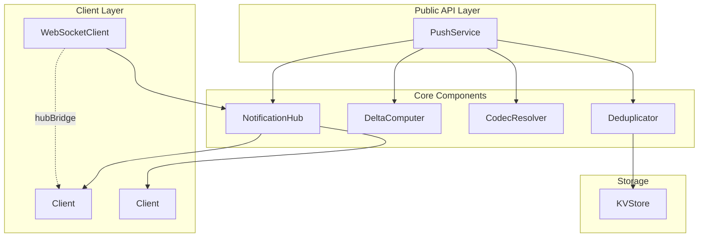
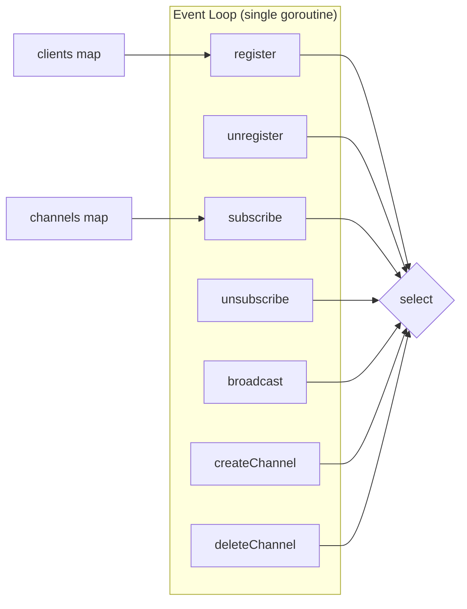
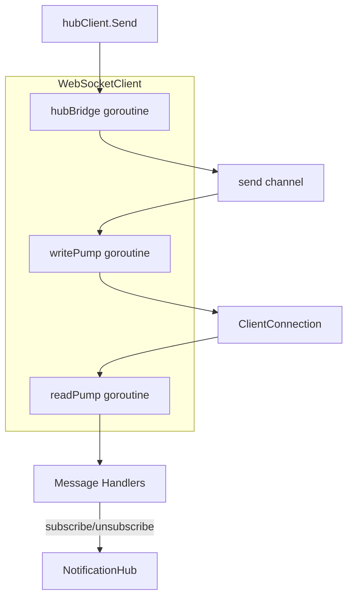
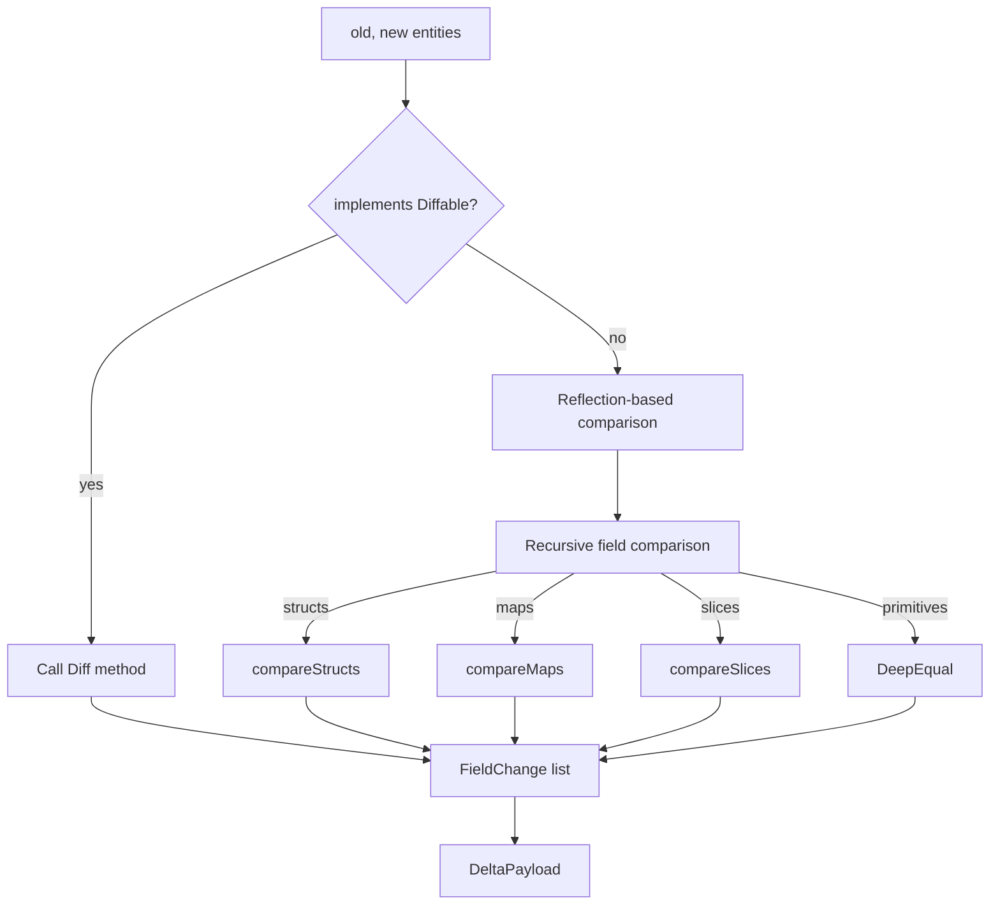
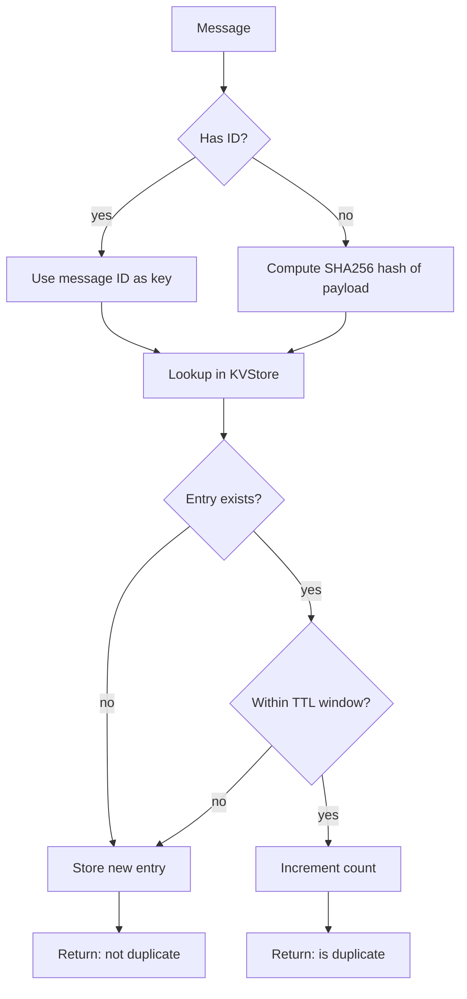
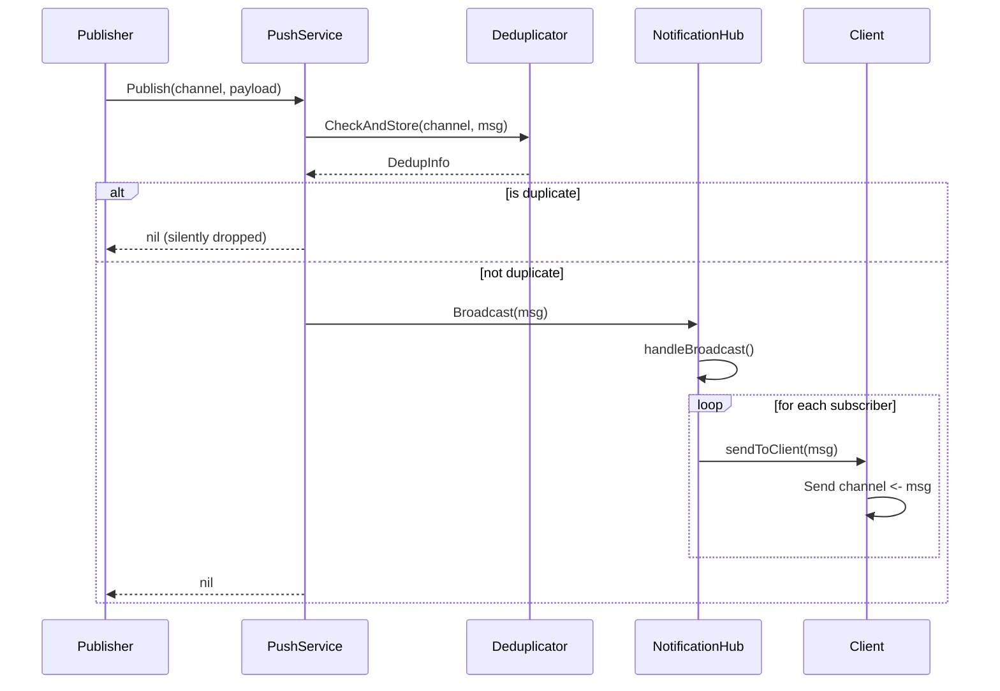
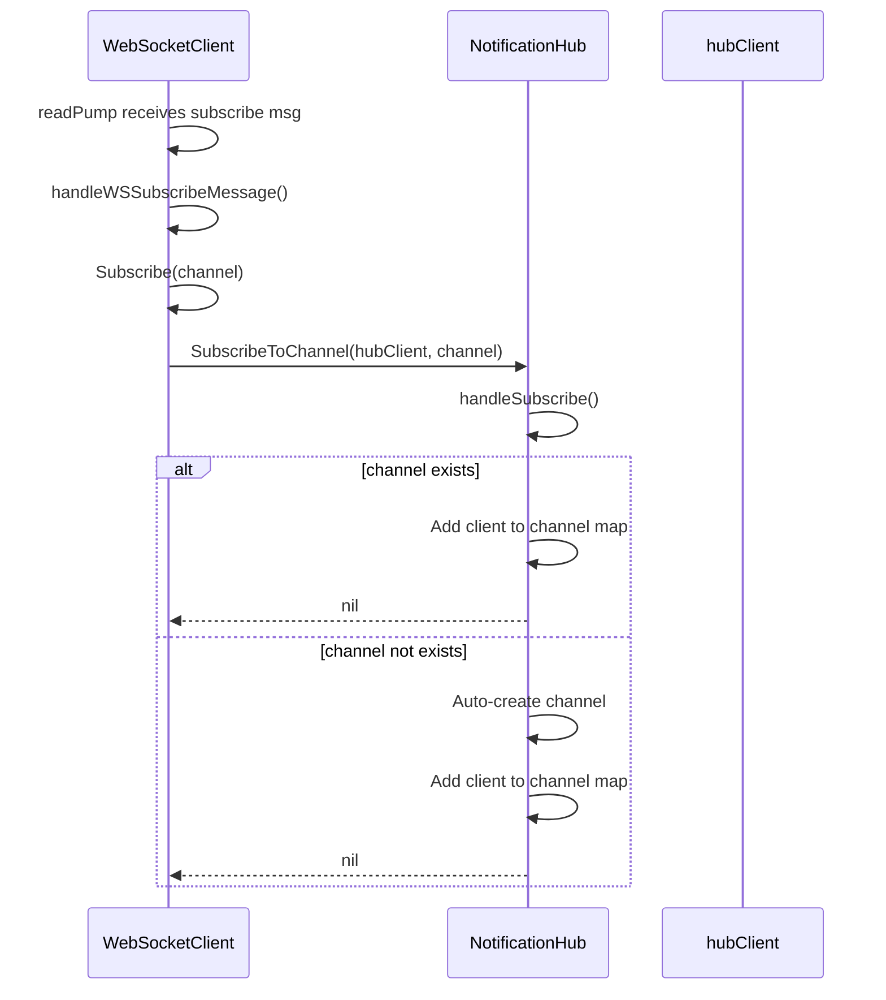
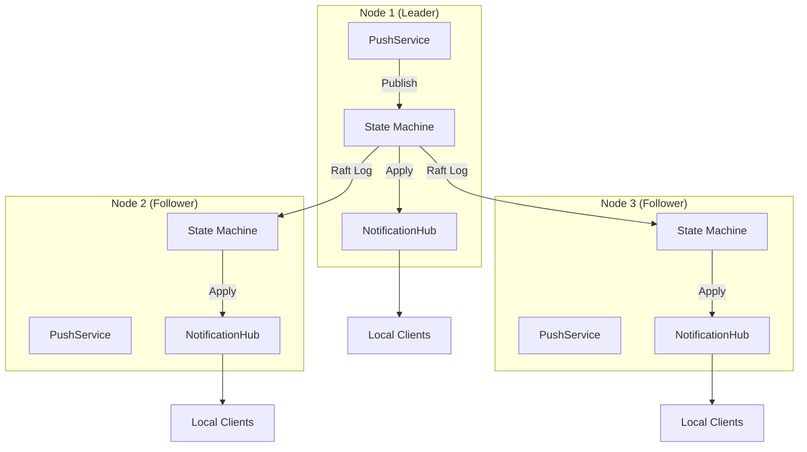

# Push Notification System Architecture

## Overview

The messaging system provides real-time event delivery to connected clients using a channel-based pub/sub architecture. It is designed for high throughput with lock-free hot paths and graceful backpressure handling.

## Component Diagram



## Core Components

### NotificationHub

**Location:** `pkg/messaging/hub.go`

The NotificationHub is the central coordinator for all pub/sub operations. It uses a single-threaded event loop pattern with Go channels to eliminate mutex contention in the hot path.

**Key Design Decisions:**

- **Single-threaded event loop:** All state mutations occur in one goroutine via channel-based dispatch
- **256-buffer default:** Provides backpressure handling without blocking publishers
- **No locks in hot path:** All operations use non-blocking channel sends with fallback behavior

**Architecture:**



**Channel Structure:**

```go
type NotificationHub struct {
    clients       map[*Client]bool            // Active subscribers
    channels      map[string]map[*Client]bool // channel -> subscribers
    broadcast     chan *Message               // Inbound messages (buffered: 256)
    register      chan *Client                // New client registrations
    unregister    chan *Client                // Client removal
    subscribe     chan *SubscribeRequest      // Channel subscriptions
    unsubscribe   chan *UnsubscribeRequest    // Channel unsubscriptions
    createChannel chan *CreateChannelRequest  // Channel creation
    deleteChannel chan *DeleteChannelRequest  // Channel deletion
    // ...
}
```

**Backpressure Handling:**

When a client's send buffer is full, the hub disconnects the slow consumer rather than blocking:

```go
func (h *NotificationHub) sendToClient(client *Client, msg *Message) {
    select {
    case client.Send <- msg:
        // Message sent successfully
    default:
        // Client is slow - disconnect it
        h.handleUnregister(client)
    }
}
```

### Client

**Location:** `pkg/messaging/hub.go` (Client struct)

Represents a connected subscriber with dedicated send/done channels for lifecycle management.

```go
type Client struct {
    ID            string
    Send          chan *Message    // Outbound messages (buffered: 256)
    Done          chan struct{}    // Disconnection signal
    Metadata      map[string]string
    subscriptions map[string]bool  // Channel memberships
    connected     atomic.Bool
}
```

### WebSocketClient

**Location:** `pkg/messaging/client.go`

WebSocket-based client implementation with read/write pumps and hub integration via the hubBridge goroutine.

**Goroutine Architecture:**



**Message Dispatch:**

Uses map-based dispatch for O(1) message type routing:

```go
var wsClientMessageHandlers = map[ClientMessageType]wsMessageHandler{
    ClientMessageTypeSubscribe:   handleWSSubscribeMessage,
    ClientMessageTypeUnsubscribe: handleWSUnsubscribeMessage,
    ClientMessageTypePublish:     handleWSPublishMessage,
    ClientMessageTypePing:        handleWSPingMessage,
}
```

### PushService

**Location:** `pkg/messaging/service.go`

Service facade that provides the public API. Coordinates the hub, delta computer, codec resolver, and deduplicator.

**Interface:**

```go
type Service interface {
    // Channel operations
    CreateChannel(ctx context.Context, name string, opts ...CreateChannelOption) (*Channel, error)
    DeleteChannel(ctx context.Context, name string) error
    GetChannel(ctx context.Context, name string) (*Channel, error)
    ListChannels(ctx context.Context) ([]*Channel, error)

    // Subscription operations
    Subscribe(ctx context.Context, channel string, opts ...SubscribeOption) (*Subscription, error)
    Unsubscribe(ctx context.Context, subscriptionID string) error

    // Publishing
    Publish(ctx context.Context, channel string, payload interface{}, opts ...PublishOption) error
    PublishDelta(ctx context.Context, channel string, old, new interface{}, opts ...PublishOption) error

    // Lifecycle
    Start(ctx context.Context) error
    Stop(ctx context.Context) error
}
```

### DeltaComputer

**Location:** `pkg/messaging/delta.go`

Computes deltas between entity states using reflection. Supports custom diff logic via the Diffable interface.

**Delta Computation Flow:**



**Diffable Interface:**

```go
type Diffable interface {
    Diff(previous interface{}) ([]FieldChange, error)
    Apply(changes []FieldChange) error
    Version() uint64
}
```

**Output Format:**

```go
type DeltaPayload struct {
    EntityID    string
    EntityType  string
    Version     uint64
    PrevVersion uint64
    Timestamp   time.Time
    Changes     []FieldChange
}

type FieldChange struct {
    Path      string      // JSON path: "user.address.city"
    Operation OpType      // set, delete, append, increment
    Value     interface{} // New value
    OldValue  interface{} // Previous value (optional)
}
```

### CodecResolver

**Location:** `pkg/messaging/codec.go`

Resolves codecs with priority-based resolution. Built-in support for JSON and MessagePack.

**Resolution Priority:**

1. Message-level override (highest)
2. Subscription-level preference
3. Channel default
4. Session negotiated codec
5. System default: JSON (lowest)

**Supported Codecs:**

| Codec | Format | Use Case |
|-------|--------|----------|
| json | JSON | Default, human-readable |
| msgpack | MessagePack | Compact binary format |
| protobuf | Protocol Buffers | Schema-defined, cross-language |

### Deduplicator

**Location:** `pkg/messaging/dedup.go`

Content-based and ID-based message deduplication using KVStore persistence.

**Deduplication Flow:**



**Storage Key Format:**

```
_messaging/dedup/{channel}/{dedup_key}
```

## Data Flow

### Message Publishing



### Client Subscription



## Cluster Mode

In cluster mode, each node maintains its own NotificationHub. Events are distributed via Raft replication.



**Replication Flow:**

1. Client publishes message to leader node
2. Leader appends to Raft log
3. Log entry replicated to followers
4. Each node's state machine calls `hub.Broadcast()` on apply
5. Clients connected to any node receive the message

## Error Handling

All errors follow the QRDBError pattern with typed errors:

```go
type QRDBError struct {
    Code    ErrorCode
    Op      string
    Err     error
    Context map[string]interface{}
    Retry   bool
}
```

**Key Error Types:**

| Error | Code | Description |
|-------|------|-------------|
| ChannelNotFoundError | 1000 | Channel does not exist |
| ChannelExistsError | 1001 | Channel already exists |
| HubBufferFullError | 1002 | Hub buffer full (retryable) |
| ClientSlowError | 1004 | Client consuming too slowly |
| SubscriptionNotFoundError | 1006 | Subscription not found |

## Configuration

### Hub Options

```go
NewNotificationHubWithBufferSize(logger, 256) // Default buffer size

// Channel options
WithBufferSize(512)      // Per-channel buffer
WithMaxSubscribers(1000) // Subscriber limit
WithPersistent(true)     // Enable persistence
WithTTL(time.Hour)       // Message TTL
```

### Service Options

```go
NewPushService(logger, storage,
    WithServiceBufferSize(256),
    WithServiceDefaultCodec("json"),
    WithServiceDedupEnabled(true),
    WithServiceDedupWindow(time.Minute),
)
```

## Performance Characteristics

| Metric | Value | Notes |
|--------|-------|-------|
| Hot path locks | 0 | Channel-based coordination |
| Buffer size | 256 | Default, configurable |
| Slow consumer action | Disconnect | Prevents head-of-line blocking |
| Hash algorithm | SHA256 | For content deduplication |
| Codec default | JSON | Switchable to msgpack |

## File Reference

| File | Purpose |
|------|---------|
| `pkg/messaging/hub.go` | NotificationHub, Client, channel management |
| `pkg/messaging/client.go` | WebSocketClient with read/write pumps |
| `pkg/messaging/service.go` | MessagingService facade |
| `pkg/messaging/delta.go` | DeltaComputer, Diffable interface |
| `pkg/messaging/codec.go` | CodecResolver, json/msgpack codecs |
| `pkg/messaging/dedup.go` | DedupStoreImpl |
| `pkg/messaging/message.go` | Message type definitions |
| `pkg/messaging/types.go` | Shared types (DeltaPayload, Subscription, etc.) |
| `pkg/messaging/errors.go` | Typed errors and error constructors |
