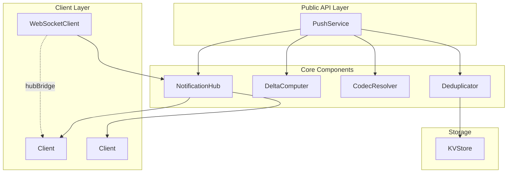
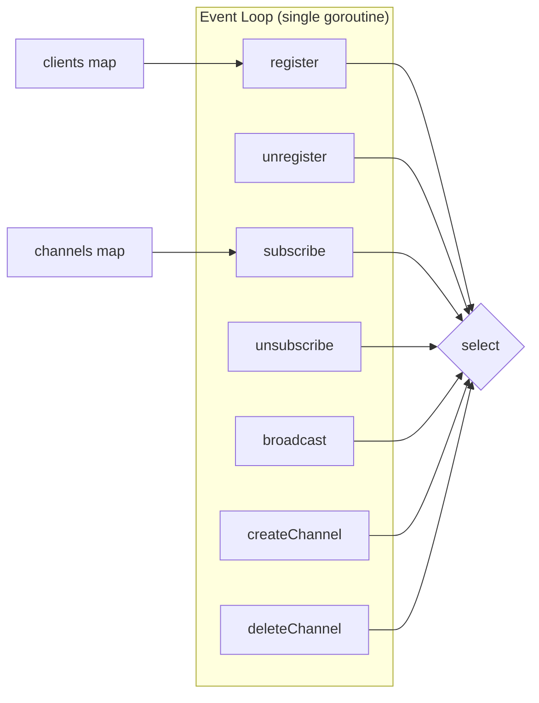
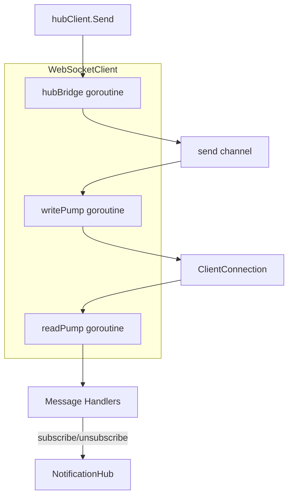
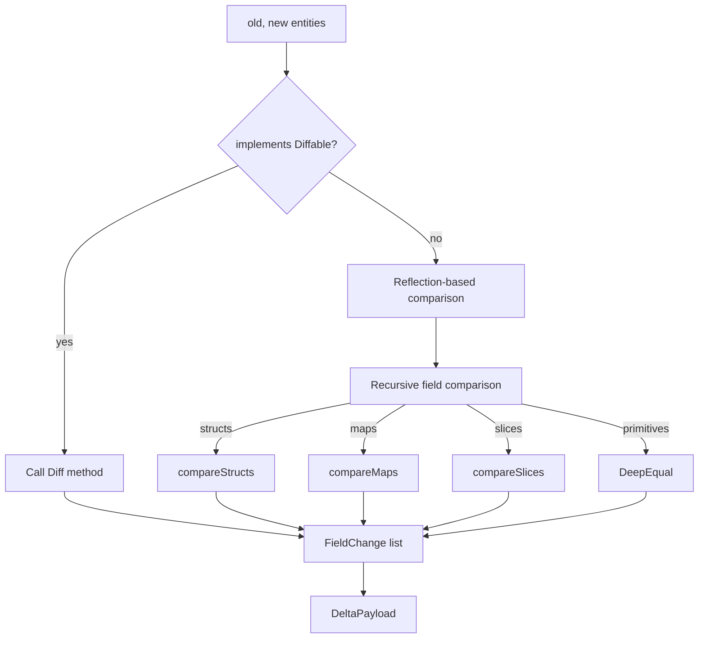
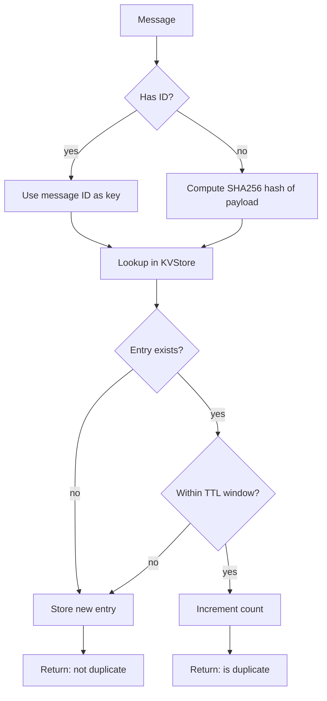
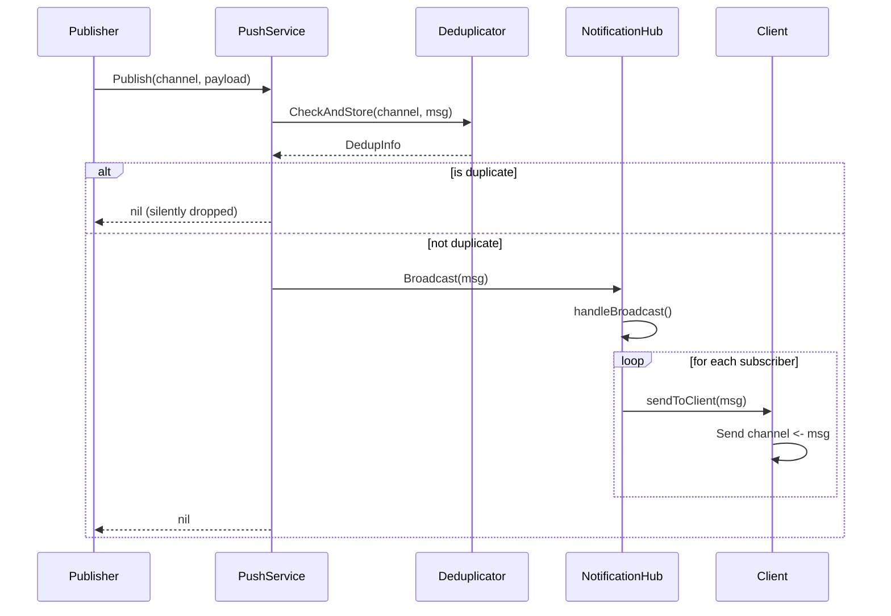
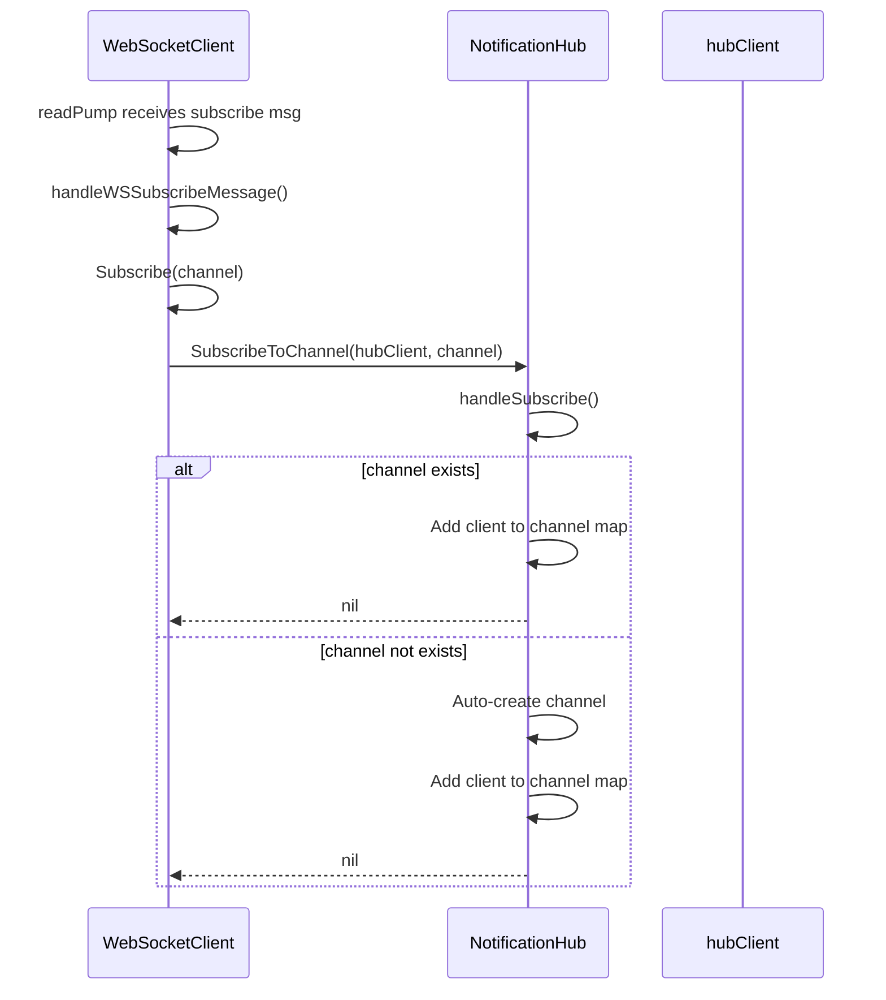
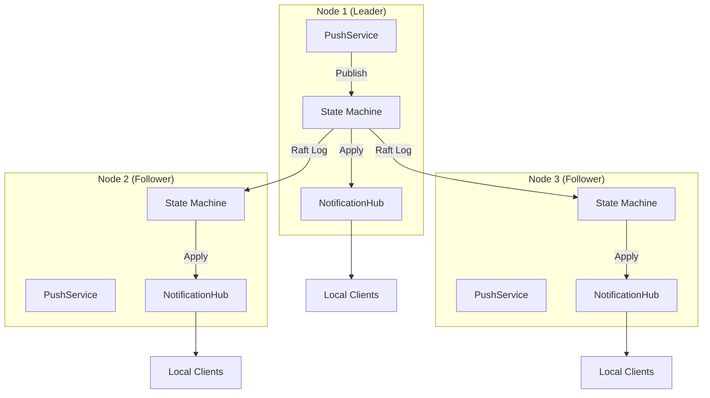

# Messaging — Architecture

> **Status: NORMATIVE** · Last verified: 2026-10-15
> Design, component boundaries and data flow. Feature folder: `docs/messaging/`.

## Overview

The messaging system provides real-time event delivery to connected clients using a channel-based pub/sub architecture. It is designed for high throughput with lock-free hot paths and graceful backpressure handling.

## Component Diagram



## Core Components

### NotificationHub

**Location:** `pkg/messaging/hub.go`

The NotificationHub is the central coordinator for all pub/sub operations. It uses a single-threaded event loop pattern with Go channels to eliminate mutex contention in the hot path.

**Key Design Decisions:**

- **Single-threaded event loop:** All state mutations occur in one goroutine via channel-based dispatch
- **256-buffer default:** Provides backpressure handling without blocking publishers
- **No locks in hot path:** All operations use non-blocking channel sends with fallback behavior

**Architecture:**



**Channel Structure:**

```go
type NotificationHub struct {
    clients       map[*Client]bool            // Active subscribers
    channels      map[string]map[*Client]bool // channel -> subscribers
    broadcast     chan *Message               // Inbound messages (buffered: 256)
    register      chan *Client                // New client registrations
    unregister    chan *Client                // Client removal
    subscribe     chan *SubscribeRequest      // Channel subscriptions
    unsubscribe   chan *UnsubscribeRequest    // Channel unsubscriptions
    createChannel chan *CreateChannelRequest  // Channel creation
    deleteChannel chan *DeleteChannelRequest  // Channel deletion
    // ...
}
```

**Backpressure Handling:**

When a client's send buffer is full, the hub disconnects the slow consumer rather than blocking:

```go
func (h *NotificationHub) sendToClient(client *Client, msg *Message) {
    select {
    case client.Send <- msg:
        // Message sent successfully
    default:
        // Client is slow - disconnect it
        h.handleUnregister(client)
    }
}
```

**Request Admission and Loop Lifecycle:**

Every request the hub accepts — including the asynchronous `register` and
`unregister` hand-offs — passes through `admit`, which under the hub's
lifecycle lock either queues the request for a live loop or refuses it. When a
loop leaves it closes admission and then drains every queue, answering the
synchronous requests with `ErrHubStopped` and discarding the asynchronous ones;
`Run` drains again on the way in, so nothing a previous loop accepted is
performed by the next one.

The two rules that follow from this:

- A register issued while no loop is running is refused, not deferred. It will
  never be delivered to a later loop, so a client cannot be resurrected into a
  registry that never knew it.
- An unregister that is refused or discarded still closes its client. Closing
  is the half of an unregister that needs no registry, and it is what the caller
  was promised.

`RegisterClient` and `UnregisterClient` return nothing, so a refusal is logged
rather than reported. Callers that need the registration to have happened use
`RegisterAndSubscribe`, which is synchronous and returns an error.

### Client

**Location:** `pkg/messaging/hub.go` (Client struct)

Represents a connected subscriber with dedicated send/done channels for lifecycle management.

```go
type Client struct {
    ID            string
    Send          chan *Message    // Outbound messages (buffered: 256)
    Done          chan struct{}    // Disconnection signal
    Metadata      map[string]string
    subscriptions map[string]bool  // Channel memberships
    connected     atomic.Bool
}
```

### WebSocketClient

**Location:** `pkg/messaging/client.go`

WebSocket-based client implementation with read/write pumps and hub integration via the hubBridge goroutine.

**Goroutine Architecture:**



**Message Dispatch:**

Uses map-based dispatch for O(1) message type routing:

```go
var wsClientMessageHandlers = map[ClientMessageType]wsMessageHandler{
    ClientMessageTypeSubscribe:   handleWSSubscribeMessage,
    ClientMessageTypeUnsubscribe: handleWSUnsubscribeMessage,
    ClientMessageTypePublish:     handleWSPublishMessage,
    ClientMessageTypePing:        handleWSPingMessage,
}
```

### PushService

**Location:** `pkg/messaging/service.go`

Service facade that provides the public API. Coordinates the hub, delta computer, codec resolver, and deduplicator.

**Interface:**

```go
type Service interface {
    // Channel operations
    CreateChannel(ctx context.Context, name string, opts ...CreateChannelOption) (*Channel, error)
    DeleteChannel(ctx context.Context, name string) error
    GetChannel(ctx context.Context, name string) (*Channel, error)
    ListChannels(ctx context.Context) ([]*Channel, error)

    // Subscription operations
    Subscribe(ctx context.Context, channel string, opts ...SubscribeOption) (*Subscription, error)
    Unsubscribe(ctx context.Context, subscriptionID string) error

    // Publishing
    Publish(ctx context.Context, channel string, payload interface{}, opts ...PublishOption) error
    PublishDelta(ctx context.Context, channel string, old, new interface{}, opts ...PublishOption) error

    // Lifecycle
    Start(ctx context.Context) error
    Stop(ctx context.Context) error
}
```

**Shutdown Semantics:**

`Stop` cancels the service context, stops the hub, and waits for the hub's loop
to leave. The caller's context bounds that **wait**, not the teardown: if the
context is cancelled or the deadline passes while `Stop` is waiting, `Stop`
still releases every subscription client and clears its running flag, then
returns the context error. A `Stop` that reports a timeout is therefore still a
`Stop` — `IsRunning()` is false afterwards and the service can be started
again.

The running flag falls last, after the subscription sweep. `GetChannel` and
`ListChannels` use it to distinguish "the service was started" from "the hub
can answer", so a service that is taking itself apart keeps reporting running
until the teardown is complete.

### DeltaComputer

**Location:** `pkg/messaging/delta.go`

Computes deltas between entity states using reflection. Supports custom diff logic via the Diffable interface.

**Delta Computation Flow:**



**Diffable Interface:**

```go
type Diffable interface {
    Diff(previous interface{}) ([]FieldChange, error)
    Apply(changes []FieldChange) error
    Version() uint64
}
```

**Output Format:**

```go
type DeltaPayload struct {
    EntityID    string
    EntityType  string
    Version     uint64
    PrevVersion uint64
    Timestamp   time.Time
    Changes     []FieldChange
}

type FieldChange struct {
    Path      string      // JSON path: "user.address.city"
    Operation OpType      // set, delete, append, increment
    Value     interface{} // New value
    OldValue  interface{} // Previous value (optional)
}
```

### CodecResolver

**Location:** `pkg/messaging/codec.go`

Resolves codecs with priority-based resolution. Built-in support for JSON and MessagePack.

**Resolution Priority:**

1. Message-level override (highest)
2. Subscription-level preference
3. Channel default
4. Session negotiated codec
5. System default: JSON (lowest)

**Supported Codecs:**

| Codec | Format | Use Case |
|-------|--------|----------|
| json | JSON | Default, human-readable |
| msgpack | MessagePack | Compact binary format |
| protobuf | Protocol Buffers | Schema-defined, cross-language |

### Deduplicator

**Location:** `pkg/messaging/dedup.go`

Content-based and ID-based message deduplication using KVStore persistence.

**Deduplication Flow:**



**Storage Key Format:**

```
_messaging/dedup/{channel}/{dedup_key}
```

## Data Flow

### Message Publishing



### Client Subscription



## Cluster Mode

In cluster mode, each node maintains its own NotificationHub. Events are distributed via Raft replication.



**Replication Flow:**

1. Client publishes message to leader node
2. Leader appends to Raft log
3. Log entry replicated to followers
4. Each node's state machine calls `hub.Broadcast()` on apply
5. Clients connected to any node receive the message

## Watch Bridge

`pkg/watchbridge` connects the watch manager to the messaging system, so that a
database change becomes a channel message. Each `KeyChannelMapping` binds a
watch key prefix to a channel prefix (by default `watch:` plus the key prefix),
an event-type filter, and an optional entity type. When the entity type is set,
the bridge computes a `DeltaPayload` for each event, with old values when
`IncludeOldValues` is true.

| Option | Effect |
|--------|--------|
| `WithLeaderOnly` | Publish only while this node is the Raft leader (default on), so a change is published once per cluster |
| `WithAutoCreateChannels` | Create each mapping's channel when the bridge starts (default on) |
| `WithDefaultChannelPrefix` | Channel prefix used when a mapping leaves it empty |
| `WithBridgeBufferSize` | Event buffer per watch loop |

Events dropped on a follower are counted in `WatchBridgeStats`.

## Error Handling

All errors follow the QRDBError pattern with typed errors:

```go
type QRDBError struct {
    Code    ErrorCode
    Op      string
    Err     error
    Context map[string]interface{}
    Retry   bool
}
```

**Key Error Types:**

| Error | Code | Description |
|-------|------|-------------|
| ChannelNotFoundError | 1000 | Channel does not exist |
| ChannelExistsError | 1001 | Channel already exists |
| HubBufferFullError | 1002 | Hub buffer full (retryable) |
| ClientSlowError | 1004 | Client consuming too slowly |
| SubscriptionNotFoundError | 1006 | Subscription not found |

**Classification predicates:**

The exported `Is*` predicates (`IsChannelNotFound`, `IsChannelExists`, and the
rest of the family) recognise three independent signatures, any one of which is
sufficient: the concrete error type, a `QRDBError` carrying the family's push
error code, or the family's sentinel anywhere in the wrapped chain. None of the
three is terminal — the hub's own handlers report a miss as a `QRDBError` with
a generic `ErrNotFound` code wrapping the sentinel, so a code that does not
match must not end the classification.

## Configuration

### Hub Options

```go
NewNotificationHubWithBufferSize(logger, 256) // Default buffer size

// Channel options
WithBufferSize(512)      // Per-channel buffer
WithMaxSubscribers(1000) // Subscriber limit
WithPersistent(true)     // Enable persistence
WithTTL(time.Hour)       // Message TTL
```

### Service Options

```go
NewPushService(logger, storage,
    WithServiceBufferSize(256),
    WithServiceDefaultCodec("json"),
    WithServiceDedupEnabled(true),
    WithServiceDedupWindow(time.Minute),
)
```

## Performance Characteristics

| Metric | Value | Notes |
|--------|-------|-------|
| Hot path locks | 0 | Channel-based coordination |
| Buffer size | 256 | Default, configurable |
| Slow consumer action | Disconnect | Prevents head-of-line blocking |
| Hash algorithm | SHA256 | For content deduplication |
| Codec default | JSON | Switchable to msgpack |

## File Reference

| File | Purpose |
|------|---------|
| `pkg/messaging/hub.go` | NotificationHub, Client, channel management |
| `pkg/messaging/client.go` | WebSocketClient with read/write pumps |
| `pkg/messaging/service.go` | MessagingService facade |
| `pkg/messaging/delta.go` | DeltaComputer, Diffable interface |
| `pkg/messaging/codec.go` | CodecResolver, json/msgpack codecs |
| `pkg/messaging/dedup.go` | DedupStoreImpl |
| `pkg/messaging/message.go` | Message type definitions |
| `pkg/messaging/types.go` | Shared types (DeltaPayload, Subscription, etc.) |
| `pkg/messaging/errors.go` | Typed errors and error constructors |
| `pkg/watchbridge/watch_bridge.go` | WatchBridge: watch events to channel messages |


---

## Delta Publishing

Delta publishing sends only changed fields instead of entire entities, reducing bandwidth and improving performance for real-time updates.

### Overview

Instead of transmitting complete entity state on every update, delta publishing computes the difference between old and new versions and sends only the modified fields. This is particularly effective for:

- Large entities with frequent small updates
- Mobile/IoT clients with limited bandwidth
- High-frequency update scenarios
- Real-time collaborative applications

### DeltaPayload Structure

```go
type DeltaPayload struct {
    EntityID    string        `json:"entity_id,omitempty"`
    EntityType  string        `json:"entity_type,omitempty"`
    Version     uint64        `json:"version"`
    PrevVersion uint64        `json:"prev_version"`
    Timestamp   time.Time     `json:"timestamp"`
    Changes     []FieldChange `json:"changes"`
}

type FieldChange struct {
    Path      string      `json:"path"`       // JSON path (e.g., "address.city")
    Operation OpType      `json:"op"`         // set, delete, append, increment
    Value     interface{} `json:"value,omitempty"`
    OldValue  interface{} `json:"old_value,omitempty"`
}

type OpType string

const (
    OpSet       OpType = "set"       // Set field to new value
    OpDelete    OpType = "delete"    // Remove field
    OpAppend    OpType = "append"    // Append to array/string
    OpIncrement OpType = "increment" // Increment numeric field
)
```

### DeltaComputer

`DeltaComputer` uses reflection to compare old and new entity states, generating a list of field changes.

#### Basic Usage

```go
import "github.com/jeremyhahn/go-quicbaas/pkg/messaging"

computer := messaging.NewDeltaComputer(logger)

oldUser := &User{ID: "123", Name: "Alice", Email: "alice@example.com"}
newUser := &User{ID: "123", Name: "Alice", Email: "alice@newdomain.com"}

delta, err := computer.Compute(oldUser, newUser)
if err != nil {
    return err
}

// delta.Changes contains: [{Path: "email", Op: "set", Value: "alice@newdomain.com"}]
```

#### Supported Types

The DeltaComputer handles:

| Type | Behavior |
|------|----------|
| Nested structs | Recursive field-by-field comparison |
| Maps with struct values | Key-level tracking with nested comparison |
| Slices/arrays | Full slice replacement on change |
| Pointers | Nil-safe dereferencing |
| Interfaces | Underlying value comparison |
| time.Time | Treated as atomic value |

#### JSON Tag Support

Field paths use JSON tag names when available:

```go
type Address struct {
    Street string `json:"street"`
    City   string `json:"city"`
    Skip   string `json:"-"` // Ignored in delta computation
}
```

Fields tagged with `json:"-"` are excluded from delta computation.

### Diffable Interface

For performance-critical paths, implement the `Diffable` interface to provide optimized delta computation:

```go
type Diffable interface {
    Diff(previous interface{}) ([]FieldChange, error)
    Apply(changes []FieldChange) error
    Version() uint64
}
```

#### Implementation Example

```go
type User struct {
    ID      string
    Name    string
    Email   string
    version uint64
}

func (u *User) Diff(previous interface{}) ([]messaging.FieldChange, error) {
    prev, ok := previous.(*User)
    if !ok {
        return nil, errors.New("type mismatch")
    }

    var changes []messaging.FieldChange
    if u.Name != prev.Name {
        changes = append(changes, messaging.FieldChange{
            Path: "name", Operation: messaging.OpSet, Value: u.Name, OldValue: prev.Name,
        })
    }
    if u.Email != prev.Email {
        changes = append(changes, messaging.FieldChange{
            Path: "email", Operation: messaging.OpSet, Value: u.Email, OldValue: prev.Email,
        })
    }
    return changes, nil
}

func (u *User) Apply(changes []messaging.FieldChange) error {
    for _, c := range changes {
        switch c.Path {
        case "name":
            u.Name = c.Value.(string)
        case "email":
            u.Email = c.Value.(string)
        }
    }
    return nil
}

func (u *User) Version() uint64 {
    return u.version
}
```

When an entity implements `Diffable`, `DeltaComputer.Compute` uses the custom implementation instead of reflection.

### Configuration Options

```go
// Set custom codec for serialization
computer := messaging.NewDeltaComputer(logger, messaging.WithDeltaCodec(myCodec))

// Limit recursion depth (default: 10)
computer := messaging.NewDeltaComputer(logger, messaging.WithDeltaMaxDepth(5))

// Ignore zero-value changes (default: true)
computer := messaging.NewDeltaComputer(logger, messaging.WithDeltaIgnoreZeroChanges(false))
```

| Option | Default | Description |
|--------|---------|-------------|
| `WithDeltaCodec(codec)` | JSON | Codec for byte-level comparison |
| `WithDeltaMaxDepth(depth)` | 10 | Maximum recursion depth |
| `WithDeltaIgnoreZeroChanges(bool)` | true | Skip zero-to-zero value changes |

### Wire Format

Delta payloads serialize to compact JSON:

```json
{
    "entity_id": "user-123",
    "entity_type": "User",
    "version": 42,
    "prev_version": 41,
    "timestamp": "2026-01-21T10:30:00Z",
    "changes": [
        {"path": "email", "op": "set", "value": "new@example.com"},
        {"path": "profile.lastLogin", "op": "set", "value": "2026-01-21T10:30:00Z"}
    ]
}
```

#### Nested Path Example

For nested structures:

```go
type Profile struct {
    LastLogin time.Time `json:"lastLogin"`
    Settings  Settings  `json:"settings"`
}

type Settings struct {
    Theme string `json:"theme"`
}
```

A change to `Settings.Theme` produces:

```json
{"path": "settings.theme", "op": "set", "value": "dark"}
```

### Byte-Level Comparison

For pre-serialized data, use `ComputeBytes`:

```go
oldData := []byte(`{"id":"123","name":"Alice"}`)
newData := []byte(`{"id":"123","name":"Bob"}`)

delta, err := computer.ComputeBytes(oldData, newData, &User{})
```

### Error Handling

DeltaComputer returns typed errors for specific failure conditions:

```go
delta, err := computer.Compute(old, new)
if err != nil {
    switch {
    case messaging.IsDeltaNilInput(err):
        // Handle nil input
    case messaging.IsDeltaTypeMismatch(err):
        // Handle type mismatch between old and new
    case messaging.IsDeltaMaxDepthExceeded(err):
        // Handle deeply nested structure
    case messaging.IsDeltaDiffFailed(err):
        // Handle Diffable interface failure
    }
}
```

### Performance Considerations

1. **Implement Diffable for hot paths**: Reflection-based comparison is flexible but slower than hand-coded comparison.

2. **Limit recursion depth**: Deep nesting increases computation time. Use `WithDeltaMaxDepth` to cap recursion.

3. **Enable zero-value filtering**: The default `WithDeltaIgnoreZeroChanges(true)` reduces payload size by excluding unchanged zero values.

4. **Use MessagePack for wire format**: Configure `WithDeltaCodec` with MessagePack for smaller payloads.

### Source Code

- DeltaComputer: `pkg/messaging/delta.go`
- Types: `pkg/messaging/types.go`
- Tests: `pkg/messaging/delta_test.go`
