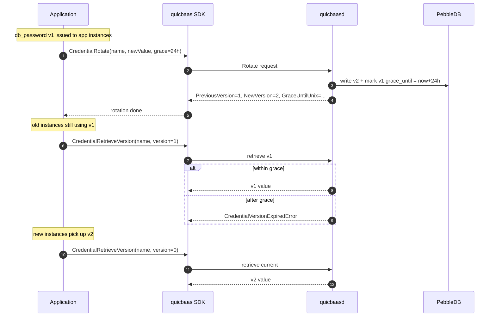
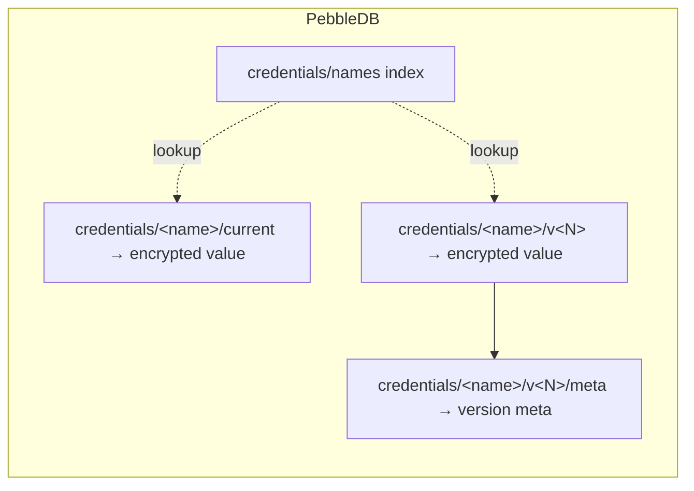

# SDK Credentials API

`Security().Credentials()` returns a `QRDBCredentialClient` — the
canonical named-credential service across the QuicBaaS stack. After
Phase 8e it is real-wire on every transport (REST, gRPC, QUIC, MCP,
Unix, embedded). No transport returns `NotImplementedError`. The
`PendingCredentialBackendError` sentinel has been removed; callers
never see a "backend not yet wired" placeholder.

This page documents the versioned-rotation API, the grace-period
semantics, the storage layout, and the per-transport behaviour.

## Accessor

```go
// sdk/go/services.go:97
credCli, err := sdk.Security().Credentials()
if err != nil {
    return err
}
```

The first call lazily binds the qrdb sub-client to the configured
transport; subsequent calls return the cached instance. There is no
flat `Client.Credentials()` shortcut — this is the single canonical
entry point.

## Verb surface

| Operation | Versioned? | Purpose |
|-----------|------------|---------|
| `CredentialSubmit` | No | Non-versioned set/replace. Manual strategy notifies blocked retrievers; barrier strategy persists via the StorageBarrier. |
| `CredentialList` | n/a | Enumerate credential names. **Never returns values.** |
| `CredentialRotate` | Yes | Atomic versioned rotation. Optionally keeps the previous version retrievable for a grace window. |
| `CredentialRetrieveVersion` | Yes | Read the current value or a specific historical version. |
| `CredentialListVersions` | Yes | Metadata for the current version + every non-expired grace version. |
| `CredentialDelete` | n/a | Wipe a credential and all historical versions. |
| `CredentialGCExpired` | Yes | Reap grace versions whose `grace_until` has elapsed. |

## Non-versioned API

### Submit

```go
err := credCli.CredentialSubmit(ctx, &qrdbtransport.CredentialSubmitRequest{
    Name:  "my-key",
    Value: "s3cr3t",
})
```

Set or replace a credential value. The strategy in effect at the
server side (configured at `quicbaasd init` via
`--credential-strategy`) controls the storage path:

- `manual` strategy: the value is held in memory and notifies any
  blocked retrievers waiting on `Strategy(ctx)` or `Retrieve(ctx)`.
- `barrier` strategy: the value is sealed through the StorageBarrier
  and persisted in PebbleDB.

`Submit` is **not** versioned. Replacing a value with `Submit` wipes
the previous one immediately. Use `Rotate` for versioned semantics.

### List

```go
resp, err := credCli.CredentialList(ctx, &qrdbtransport.CredentialListRequest{})
for _, name := range resp.Names {
    fmt.Println(name)
}
```

Returns names only. The transport is free to refuse enumeration for
HSM-only backends (the SDK surfaces that as
`EnumerationNotSupportedError`) but the canonical qrdb backend
enumerates every credential it stores.

### Delete

```go
err := credCli.CredentialDelete(ctx, "my-key")
```

Removes the credential and every historical version (current + all
grace versions). Idempotent — deleting a non-existent name is a no-op
with no error.

## Versioned-rotation API

### Rotate

`Rotate` is the atomic versioned-write entry point. It replaces the
current value with the supplied new value and optionally keeps the
previous version retrievable for a configurable grace window.

```go
resp, err := credCli.CredentialRotate(ctx, &qrdbtransport.CredentialRotateRequest{
    Name:               "my-key",
    NewValue:           "newSecret",
    GracePeriodSeconds: int64((24 * time.Hour) / time.Second),
})
// resp.Name, resp.PreviousVersion, resp.NewVersion, resp.GraceUntilUnix
```

| Field | Meaning |
|-------|---------|
| `Name` | Echo of the request name. |
| `PreviousVersion` | The version number the prior value occupied. `0` if this was the first write. |
| `NewVersion` | The version number the new value now occupies. Strictly monotonic per name. |
| `GraceUntilUnix` | Unix timestamp at which the previous version becomes unreadable. `0` when grace is not requested. |

`GracePeriodSeconds = 0` wipes the previous version immediately; only
the new value is reachable after the call returns.

### RetrieveVersion

```go
resp, err := credCli.CredentialRetrieveVersion(ctx, &qrdbtransport.CredentialRetrieveVersionRequest{
    Name:    "my-key",
    Version: 0,        // 0 = current; non-zero = specific historical version
})
// resp.Value carries the credential payload as a string
```

The semantic mapping:

- `Version = 0` returns the current value.
- `Version = N > 0` returns version `N` if it is still inside its
  grace window, or returns `CredentialVersionExpiredError` if its
  grace has elapsed and a GC has run.

### ListVersions

```go
resp, err := credCli.CredentialListVersions(ctx, &qrdbtransport.CredentialListVersionsRequest{
    Name: "my-key",
})
for _, v := range resp.Versions {
    fmt.Printf("v%d  current=%t  created=%d  grace_until=%d\n",
        v.Version, v.IsCurrent, v.CreatedAtUnix, v.GraceUntilUnix)
}
```

Returns metadata only — values are never included in the response.
The slice contains:

- exactly one entry with `IsCurrent = true` (assuming the credential
  exists)
- zero or more entries for non-expired grace versions, ordered most
  recent first

### GCExpired

```go
resp, err := credCli.CredentialGCExpired(ctx, &qrdbtransport.CredentialGCRequest{
    Name: "my-key",
})
// resp.Reaped is the count of versions whose grace window had elapsed
```

GC is opportunistic: the server also reaps expired versions during
normal `RetrieveVersion` and `ListVersions` traffic. Explicit GC
exists so operators can force the wipe ahead of an audit and confirm
the count.

## Grace-period semantics

The grace window exists for the "rotate now, drain readers gradually"
pattern. A typical rotation:



Key properties:

1. **Atomic rotation.** The new version is committed before the
   previous version's grace timer starts. Concurrent retrievers
   never see "neither version" or "both writable".
2. **Monotonic version numbers.** Per-name. Reused names start fresh
   after a `Delete` + `Submit`/`Rotate` sequence (`v1`).
3. **Grace is bounded.** `GracePeriodSeconds` is enforced server-
   side; values exceeding `MaxGracePeriod` are clamped. The default
   `MaxGracePeriod` is 30 days.
4. **GC is lazy.** Expired versions are wiped on the next `Retrieve`,
   `ListVersions`, or `GCExpired` call — there is no background
   sweeper, which keeps the data plane lock-free.

## Storage layout (versioned)

The qrdb backend stores each credential under three key families:



| Key family | Contents | Purpose |
|------------|----------|---------|
| `credentials/names` | Sorted-set index of credential names | Powers `CredentialList` without scanning value blobs. |
| `credentials/<name>/current` | Pointer to the current version number | Read by `RetrieveVersion(..., Version: 0)`. |
| `credentials/<name>/v<N>` | Encrypted value (barrier strategy) or raw value (manual strategy) | Per-version payload. |
| `credentials/<name>/v<N>/meta` | `{IsCurrent, CreatedAtUnix, GraceUntilUnix}` | Read by `ListVersions`. |

Encryption is handled by the StorageBarrier — keys are stored as
sealed blobs under the barrier strategy, so a sealed daemon cannot
return credential values. Under the manual strategy the values live
in process memory only (no PebbleDB write) so a daemon restart
forgets every credential.

## Transport coverage

| Transport | Submit | List | Rotate | RetrieveVersion | ListVersions | Delete | GCExpired |
|-----------|--------|------|--------|-----------------|--------------|--------|-----------|
| REST | yes | yes | yes | yes | yes | yes | yes |
| gRPC | yes | yes | yes | yes | yes | yes | yes |
| QUIC | yes | yes | yes | yes | yes | yes | yes |
| MCP | yes | yes | yes | yes | yes | yes | yes |
| Unix | yes | yes | yes | yes | yes | yes | yes |
| Embedded | yes | yes | yes | yes | yes | yes | yes |

All eight credential methods are real-wire on all six transports.
There are zero `NotImplementedError` returns on this surface — Phase
8e closed the matrix.

## CLI parity

Every SDK method has a matching `quicbaas credential` verb. See
[`docs/cli/credential`](../cli/) (the canonical surface is documented
in [`cmd/quicbaas/credential.go`](../../cmd/quicbaas/credential.go)
and exercised by
[`cmd/quicbaas/credential_test.go`](../../cmd/quicbaas/credential_test.go)):

| SDK method | CLI verb | Description |
|------------|----------|-------------|
| `CredentialSubmit` | `quicbaas credential submit <name> --value <v>` | Non-versioned set/replace |
| `CredentialList` | `quicbaas credential list` | Names only |
| `CredentialRotate` | `quicbaas credential rotate <name> --value <v> [--grace 24h]` | Versioned rotation w/ optional grace |
| `CredentialRetrieveVersion` | `quicbaas credential retrieve <name> [--version N]` | Read current or specific version |
| `CredentialListVersions` | `quicbaas credential versions <name>` | Version metadata |
| `CredentialDelete` | `quicbaas credential delete <name>` | Wipe credential + historical versions |
| `CredentialGCExpired` | `quicbaas credential gc <name>` | Reap expired grace versions |

## Errors

All errors are typed (no `fmt.Errorf` returns). The qrdb canonical
errors used here are exported from the qrdb SDK and re-surfaced
through the QuicBaaS SDK:

| Error | When |
|-------|------|
| `CredentialNameRequiredError` | CLI verb invoked without `<name>` |
| `CredentialValueRequiredError` | submit/rotate invoked without `--value` |
| `CredentialNotFoundError` | `Retrieve` / `Delete` / `Rotate` against an unknown name (for `Rotate` against an unknown name the server treats the rotation as the first write — `PreviousVersion = 0`). |
| `CredentialVersionExpiredError` | `RetrieveVersion(..., Version: N)` where N's grace window has elapsed |
| `CredentialGraceExceededError` | `Rotate` with `GracePeriodSeconds` above the server-side cap |
| `EnumerationNotSupportedError` | `List` against a backend that refuses enumeration |

## Example: rolling rotation

```go
package main

import (
    "context"
    "fmt"
    "log"
    "time"

    quicbaas "github.com/jeremyhahn/go-quicbaas/sdk/go"
    qrdbtransport "github.com/jeremyhahn/go-qrdb/sdk/go/transport"
)

func main() {
    sdk, err := quicbaas.NewClient("quicbaas.local:443",
        quicbaas.WithTLS(quicbaas.TLSConfig{
            CertFile: "/etc/quicbaas/client.crt",
            KeyFile:  "/etc/quicbaas/client.key",
            CAFile:   "/etc/quicbaas/ca.crt",
        }),
    )
    if err != nil {
        log.Fatal(err)
    }
    defer sdk.Close()

    creds, err := sdk.Security().Credentials()
    if err != nil {
        log.Fatal(err)
    }

    ctx := context.Background()

    // Initial write.
    if err := creds.CredentialSubmit(ctx, &qrdbtransport.CredentialSubmitRequest{
        Name:  "db-password",
        Value: oldSecret(),
    }); err != nil {
        log.Fatal(err)
    }

    // Rotate with a 24h grace window so workers running on the old value
    // can finish their cycle before the previous version becomes
    // unreadable.
    resp, err := creds.CredentialRotate(ctx, &qrdbtransport.CredentialRotateRequest{
        Name:               "db-password",
        NewValue:           newSecret(),
        GracePeriodSeconds: int64((24 * time.Hour) / time.Second),
    })
    if err != nil {
        log.Fatal(err)
    }
    fmt.Printf("rotated: v%d -> v%d, grace until %d\n",
        resp.PreviousVersion, resp.NewVersion, resp.GraceUntilUnix)

    // After all workers have rolled to the new value, reap.
    gcResp, err := creds.CredentialGCExpired(ctx, &qrdbtransport.CredentialGCRequest{
        Name: "db-password",
    })
    if err != nil {
        log.Fatal(err)
    }
    fmt.Printf("reaped %d expired versions\n", gcResp.Reaped)
}

func oldSecret() string { return "" /* fetch from prior secret manager */ }
func newSecret() string { return "" /* generate with crypto/rand */ }
```

## See also

- [`docs/sdk/security.md`](security.md) — full `Security()` accessor
  tree.
- [`docs/credentials/README.md`](../credentials/README.md) — the
  broader credentials engine (CA + database creds + dynamic secrets).
- [`docs/architecture/composition.md`](../architecture/composition.md)
  — how the credential service is composed at server startup.
- `quicbaas credential` — the CLI verb tree mirroring the SDK
  surface.
- qrdb upstream credential docs (qrdb `docs/credentials/README.md`) —
  storage internals and the canonical wire format.
