# SDK Security Surface

`client.Security()` is the single canonical entry point for every
security primitive in the QuicBaaS SDK. After Phase 8a there are no
flat `Client.Barrier()`, `Client.Ceremony()`, or `Client.Credentials()`
shortcuts — capabilities live in exactly one place per the
"one canonical home per capability" rule.

This page enumerates every accessor on the `SecurityService`
interface, including the M10 sub-services (ACME, Trust, FIDO2,
WebAuthn, PIV, AuthFactors), the qrdb-backed barrier / ceremony /
credential surfaces, and the xkms-backed certificate, key, secret,
and DEK surfaces.

Source: [`sdk/go/services.go`](../../sdk/go/services.go) (interface)
and [`sdk/go/services_security.go`](../../sdk/go/services_security.go)
(implementations).

## Accessor tree

```mermaid
graph TD
    Client[client = quicbaas.Client] --> SecuritySvc[Security: SecurityService]

    SecuritySvc --> Auth[Auth: AuthService]
    SecuritySvc --> Barrier[Barrier: QRDBBarrierClient]
    SecuritySvc --> Ceremony[Ceremony: QRDBCeremonyClient]
    SecuritySvc --> Credentials[Credentials: QRDBCredentialClient]
    SecuritySvc --> SealStore[SealStore: QRDBSealStoreClient]
    SecuritySvc --> Seal[Seal: SealClient]
    SecuritySvc --> KMS[KMS: KMSClient]
    SecuritySvc --> Secrets[Secrets: SecretsClient]
    SecuritySvc --> Crypto[Crypto: CryptoClient]
    SecuritySvc --> Certificate[Certificate: CertificateClient]
    SecuritySvc --> CertificateExt[CertificateExt: CertificateExtensions]
    SecuritySvc --> ACME[ACME: ACMEService]
    SecuritySvc --> Trust[Trust: TrustService]
    SecuritySvc --> ClusterDEK[ClusterDEK: ClusterDEKClient]
    SecuritySvc --> DEK[DEK: DEKClient]
    SecuritySvc --> DynamicSecrets[DynamicSecrets: DynamicSecretsClient]
    SecuritySvc --> RBAC[RBAC: RBACClient]

    Auth --> AC[AuthClient embed: Login/Logout/RefreshToken/sessions]
    Auth --> FIDO2[FIDO2: FIDO2Client]
    Auth --> WebAuthn[WebAuthn: WebAuthnClient]
    Auth --> PIV[PIV: PIVClient]
    Auth --> Factors[Factors: AuthFactorsClient]

    ACME --> ACMEServer[Server: ACMEServerClient]
    ACME --> ACMEClient[Client: ACMEClientAPI]

    Trust --> PublishDANE[PublishDANE]
    Trust --> CrossSigned[CrossSignedRootPool]
    Trust --> AIA[AutoImportAIA]
    Trust --> Bootstrap[Bootstrap: TrustBootstrapClient]

    Certificate --> CAInfo[CAInfo / GetCABundle]
    Certificate --> ListCerts[ListCertificates / IssueCertificate / RevokeCertificate]
```



## SecurityService

```go
// sdk/go/services.go:56
type SecurityService interface {
    Auth() AuthService
    Seal() SealClient
    KMS() KMSClient
    Secrets() SecretsClient
    Crypto() CryptoClient
    Certificate() CertificateClient
    CertificateExt() CertificateExtensions
    ClusterDEK() ClusterDEKClient
    DEK() DEKClient
    DynamicSecrets() DynamicSecretsClient
    RBAC() RBACClient
    SealStore() (QRDBSealStoreClient, error)

    ACME() ACMEService
    Trust() TrustService

    Barrier() (QRDBBarrierClient, error)
    Ceremony() (QRDBCeremonyClient, error)
    Credentials() (QRDBCredentialClient, error)
}
```

Accessors that return `(X, error)` lazily initialise the underlying
qrdb sub-client on first call. Once the qrdb client is bound, every
subsequent call returns a cached instance and an `error` of `nil`.

The `securityService` impl caches every sub-service with `sync.Once`
so repeated `Security().Auth().FIDO2()` calls do not allocate.

## Auth — AuthService

`Security().Auth()` returns an `AuthService` that **embeds**
`AuthClient`, so every existing call site that hit
`Security().Auth().Login(...)` keeps working unchanged. The embedding
adds four factor-typed sub-services per §5e of the architecture spec.

```go
// sdk/go/services_security.go:735
type AuthService interface {
    AuthClient                    // Login/Logout/RefreshToken/sessions/Whoami...

    FIDO2()    FIDO2Client        // vendor-agnostic CTAP2 device ops
    WebAuthn() WebAuthnClient     // WebAuthn relying-party ceremony
    PIV()      PIVClient          // vendor-agnostic PIV smartcard ops
    Factors()  AuthFactorsClient  // multi-factor enrol/login (qrdb User N-AuthFactor)
}
```

### FIDO2

`Security().Auth().FIDO2()` exposes CTAP2 device operations
discovered via USB-HID, PC/SC, and BLE. No vendor hard-coding:
attestation features stay capability-gated (e.g. YubiKey attestation
is available only on supporting readers).

```go
type FIDO2Client interface {
    ListDevices(ctx context.Context) (*FIDO2ListDevicesResponse, error)
    DeviceInfo(ctx context.Context, deviceID string) (*FIDO2DeviceInfo, error)
    Register(ctx context.Context, opts *FIDO2BeginRegistrationRequest) (*FIDO2BeginRegistrationResponse, error)
    Assert(ctx context.Context, opts *FIDO2BeginAuthenticationRequest) (*FIDO2BeginAuthenticationResponse, error)
}
```

The implementation is in
[`fido2Impl`](../../sdk/go/services_security.go) (`fido2.*` service
name on the wire).

### WebAuthn

`Security().Auth().WebAuthn()` drives the relying-party side of
WebAuthn registration + login. MDS validation is server-config
driven; the SDK is transport-agnostic.

```go
type WebAuthnClient interface {
    BeginRegistration(ctx context.Context, user *WebAuthnUser) (*FIDO2BeginRegistrationResponse, error)
    FinishRegistration(ctx context.Context, user *WebAuthnUser, response *FIDO2FinishRegistrationRequest) (*WebAuthnCredential, error)
    BeginLogin(ctx context.Context, user *WebAuthnUser) (*FIDO2BeginAuthenticationResponse, error)
    FinishLogin(ctx context.Context, user *WebAuthnUser, response *FIDO2FinishAuthenticationRequest) (*WebAuthnSession, error)
}
```

WebAuthn types (`WebAuthnUser`, `WebAuthnCredential`, `WebAuthnSession`)
are SDK-native; ceremony payloads (`FIDO2BeginRegistrationResponse`,
etc.) are re-exports of the xkms transport types so consumers stay
on a single import path.

### PIV

`Security().Auth().PIV()` is the vendor-agnostic PIV smartcard
surface. Devices are discovered via PC/SC.

```go
type PIVClient interface {
    ListReaders(ctx context.Context) (*PIVListReadersResponse, error)
    ListSlots(ctx context.Context, reader string) (*PIVListSlotsResponse, error)
    GetCertificate(ctx context.Context, reader, slot string) (*x509.Certificate, error)
    Sign(ctx context.Context, req *PIVSignRequest) (*PIVSignResponse, error)
    Attest(ctx context.Context, reader, slot string) (*PIVAttestResponse, error)
}
```

`Attest` returns `ErrPIVAttestationUnsupported` on cards without
attestation rather than a generic transport error so callers can
branch cleanly.

### Factors — AuthFactorsClient

`Security().Auth().Factors()` is the multi-factor authentication
service per §M14. It models the qrdb User N-AuthFactor relationship
and is the canonical post-init authentication surface.

```go
type AuthFactorsClient interface {
    Add(ctx context.Context, req *AuthFactorEnrollRequest) (*AuthFactorEnrollResponse, error)
    List(ctx context.Context, userID string) (*AuthFactorListResponse, error)
    Remove(ctx context.Context, factorID string, force bool) error
    Rotate(ctx context.Context, oldID string, newFactor *AuthFactorEnrollRequest) (*AuthFactorEnrollResponse, error)
    Relabel(ctx context.Context, factorID, label string) error
    Login(ctx context.Context, req *AuthFactorLoginRequest) (*AuthFactorLoginResponse, error)
}
```

`Login` is type-dispatched: `req.FactorName` selects the flow (`mtls`
/ `fido2` / `piv`), or leave it empty so the server auto-discovers
based on the proof material.

## Barrier — QRDBBarrierClient

```go
// sdk/go/services.go:83
Barrier() (QRDBBarrierClient, error)
```

The qrdb `StorageBarrier` lifecycle: initialize, unseal (single
secret or M-of-N Shamir share), seal, status, rekey, and Shamir share
management. This is the single canonical SDK entry point — no
`Client.Barrier()` flat shortcut exists.

The CLI verbs in [`docs/cli/seal.md`](../cli/seal.md) and the
canonical `quicbaas barrier` command tree both route through this
accessor.

## Ceremony — QRDBCeremonyClient

```go
Ceremony() (QRDBCeremonyClient, error)
```

The qrdb initialisation ceremony state machine: Shamir M-of-N share
enrollment, officer certificate claims, share claims, CSR signing,
external officer enrolment. Drives the `quicbaas ceremony` and
`quicbaas init` (operator) CLI trees.

## Credentials — QRDBCredentialClient

```go
Credentials() (QRDBCredentialClient, error)
```

The qrdb named-credential service. Non-versioned (Submit / Strategy /
Delete) plus versioned-rotation (List / Rotate / RetrieveVersion /
ListVersions / GCExpired). Backed by the canonical `CredentialClient`
implementation in qrdb across all six transports — **no transport
returns `NotImplementedError`** post-Phase 8e.

See [`docs/sdk/credentials.md`](credentials.md) for the full versioned-
rotation API surface.

## Certificate — CertificateClient (CA verbs)

`Security().Certificate()` is the CA admin client. Phase 8e added
`CAInfo` and `ListCertificates` so the `quicbaas ca` CLI surface
covers all six canonical verbs (info, bundle, list, issue, revoke,
export-bundle).

```go
type CertificateClient interface {
    CAInfo(ctx, *CAInfoRequest) (*CAInfoResponse, error)
    GetCABundle(ctx, *GetCABundleRequest) (*GetCABundleResponse, error)
    ListCertificates(ctx, *ListCertificatesRequest) (*ListCertificatesResponse, error)
    IssueCertificate(ctx, *IssueCertificateRequest) (*IssueCertificateResponse, error)
    SignCSR(ctx, *SignCSRRequest) (*SignCSRResponse, error)
    RevokeCertificate(ctx, *RevokeCertificateRequest) (*RevokeCertificateResponse, error)
    // ... certificate store ops (SaveCert/GetCert/DeleteCert/ListCerts/CertExists/SaveCertChain/GetCertChain)
}
```

Request and response types live under
[`sdk/go/client/certificate`](../../sdk/go/client/certificate). The
`CAInfoResponse` carries Common Name, Subject/Issuer, Serial,
validity window, key type/size, signature algorithm, and the raw
chain PEM.

## CertificateExt — CertificateExtensions

`Security().CertificateExt()` adds the higher-level certificate
operations not present in the base `CertificateClient`:

```go
type CertificateExtensions interface {
    CrossSign(ctx context.Context, foreignRootPEM []byte) ([]byte, error)
    Chain(ctx context.Context, certPEM []byte) ([][]byte, error)
    IssueDeviceIdentity(ctx context.Context, req *DeviceIdentityRequest) (*DeviceIdentityResponse, error)
}
```

`IssueDeviceIdentity` covers the TCG device-identity flavours:
`DeviceIdentityEK` (Endorsement Key), `DeviceIdentityAK`
(Attestation Key), and `DeviceIdentityIDevID` (IEEE 802.1AR IDevID).
The request struct supplies the EKpub / AKpub / qualifying-data
fields each flavour needs.

## ACME — ACMEService

`Security().ACME()` exposes server-side challenge verifier
registration and a client-side ACME protocol implementation.

```go
type ACMEService interface {
    Server() ACMEServerClient
    Client() ACMEClientAPI
}

type ACMEServerClient interface {
    RegisterChallenge(ctx context.Context, name string, verifier ACMEChallengeVerifierFunc) error
    Issue(ctx context.Context, csrPEM []byte, challengeType, challengeValue string) (*ACMEIssueResponse, error)
}

type ACMEClientAPI interface {
    NewOrder(ctx context.Context, identifiers []ACMEOrderIdentifier, challengeType string) (*ACMEOrder, error)
    FinalizeOrder(ctx context.Context, orderURL string, csrPEM []byte) ([]byte, error)
    Renew(ctx context.Context, certURL string) ([]byte, error)  // ARI when supported
}
```

Challenge types covered: `http-01`, `dns-01`, `enroll-01` (TCG TPM
enrollment), `endorse-01`, `device-attest-01`. The verifier
functions are pure functions re-exported from the xkms ACME library
(`ACMEVerifyHTTP01`, `ACMEVerifyDNS01`, `ACMEVerifyEnroll01`,
`ACMEVerifyEndorse01`).

Challenge verifiers register **in-process**: `RegisterChallenge`
keeps the verifier inside the SDK and notifies the server that the
challenge type is active; the server invokes the verifier through
the embedded ACME REST surface.

## Trust — TrustService

```go
type TrustService interface {
    PublishDANE(ctx context.Context, name string, port int, cert *x509.Certificate) error
    CrossSignedRootPool(ctx context.Context) (*x509.CertPool, error)
    AutoImportAIA(ctx context.Context, certChain []*x509.Certificate) error
    Bootstrap() TrustBootstrapClient
}
```

| Method | Purpose |
|--------|---------|
| `PublishDANE` | Publish a DANE TLSA record for the supplied `(name, port, cert)` tuple via the configured DNS provider. |
| `CrossSignedRootPool` | Fetch a `*x509.CertPool` of cross-signed roots usable for verifying chains that bridge between issuers. |
| `AutoImportAIA` | Walk an AIA chain and import referenced authority certificates into the local trust store. |
| `Bootstrap` | Trust-bootstrap dispatcher (see below). |

### Bootstrap — TrustBootstrapClient

Phase 7c wired `Security().Trust().Bootstrap()` to the canonical
`xkms/pkg/trust/bootstrap` library through an SDK re-export
([`sdk/go/xkms/trust/bootstrap`](../../sdk/go/xkms/trust/bootstrap)).
There is exactly one bootstrap implementation across the entire
stack.

```go
type TrustBootstrapClient interface {
    Fetch(ctx context.Context, cfg trustbootstrap.Config) (*trustbootstrap.CABundle, error)
    DeriveNoiseAddr(serverURL string) string
}
```

`Fetch` performs a single bootstrap attempt with the configured
verification strategy (DANE / Noise / SPKI / Direct / Auto). This is
a **local-only** client: each call performs a direct outbound network
fetch from the caller (DNS for DANE, TCP for Noise, HTTPS for
SPKI/Direct). There is no transport hop through the configured
QuicBaaS backend — the SDK acts as a library facade, not a remote
proxy.

`DeriveNoiseAddr` returns the canonical `host:port` the Noise
bootstrap channel listens on, derived from a server URL. CLI / GUI
callers use it to default the `NoiseConfig.ServerAddr` field.

## Seal — SealClient (legacy)

`Security().Seal()` is the legacy seal client preserved for backward
compatibility with deployments still using the pre-barrier API
surface. New work should use `Security().Barrier()` instead.

## KMS — KMSClient

`Security().KMS()` is the xkms-compatible key management surface:
GenerateKey, GetKey, DeleteKey, ListKeys, RotateKey, plus per-key
Sign / Verify / Encrypt / Decrypt. See
[`docs/api/xkms-compatibility.md`](../api/xkms-compatibility.md) for
the operations matrix and the per-protocol routes.

## Secrets, DynamicSecrets

| Accessor | Purpose |
|----------|---------|
| `Security().Secrets()` | Static secret store (key-value). Supports per-tenant isolation. |
| `Security().DynamicSecrets()` | Time-bounded credentials for downstream systems (PostgreSQL, MySQL, etc.). TTL-based lease lifecycle. |

## DEK, ClusterDEK

| Accessor | Purpose |
|----------|---------|
| `Security().DEK()` | Per-database / per-tenant Data Encryption Keys. Wrapped by the KMS master key. |
| `Security().ClusterDEK()` | Cluster-wide DEK distribution for Raft-replicated encryption. |

Background: [`docs/security/cluster-dek.md`](../security/cluster-dek.md)
and [`docs/security/per-database-encryption.md`](../security/per-database-encryption.md).

## Crypto

`Security().Crypto()` exposes general-purpose cryptographic
primitives (hash, HMAC, sign, verify, encrypt, decrypt) routed
through the same backends the KMS uses. Algorithm selection is
explicit per call so the caller controls FIPS posture.

## RBAC

`Security().RBAC()` is the role-based access control client:

- `ListRoles`, `CreateRole`, `GetRole`, `UpdateRole`, `DeleteRole`
- `AssignRole`, `RevokeRole`
- `ListPermissions`, `CheckPermission`

Role state lives in qrdb's canonical role store, accessed through
the IAM RoleAdapter. Built-in roles (`admin`, `operator`, `viewer`,
`auditor`, `service`, `tenant_admin`) are seeded by the first-boot
bootstrap and are read-only.

## SealStore — QRDBSealStoreClient

```go
Security().SealStore() (QRDBSealStoreClient, error)
```

The platform-local sealed credential store. Used for credentials that
must survive a seal/unseal cycle without operator intervention
(e.g. agent registration tokens, scheduler bootstrap credentials).

## Lazy initialisation

The qrdb-backed accessors (`Barrier`, `Ceremony`, `Credentials`,
`SealStore`) delegate to `client.qrdbClient()` which lazily creates
the qrdb sub-client on first call. The error return covers exactly
two failure modes:

1. The SDK was built with `WithEmbedded` but **not**
   `WithEmbeddedQRDB`. In that case the qrdb sub-client has no
   transport to dispatch to. See
   [`docs/architecture/embedded-mode.md`](../architecture/embedded-mode.md).
2. A network transport could not dial the configured endpoint
   (DNS, TLS, listener not up).

Subsequent calls return the cached client and a nil error.

## Versioning and stability

Every `SecurityService` method is part of the SDK's public API and
follows semver. Wire-level changes go through the M10 version
negotiation: clients advertise their supported version; servers reply
with the highest mutually-supported version and downgrade gracefully.

Sub-service additions (a new factor type, a new ACME challenge, a new
trust mode) are additive and do not break callers. Removals require
a major version bump.

## See also

- [`docs/sdk/credentials.md`](credentials.md) — full versioned-
  rotation API for `Security().Credentials()`.
- [`docs/sdk/go/api-reference.md`](go/api-reference.md) — the per-
  method reference for every client method exposed under
  `Security()`.
- [`docs/api/xkms-compatibility.md`](../api/xkms-compatibility.md) —
  wire-protocol surface exposed by xkms-compatible operations.
- [`docs/architecture/composition.md`](../architecture/composition.md)
  — how the security surface is composed from qrdb + xkms primitives.
