# SSH — Engineering

> **Status: NORMATIVE** · Last verified: 2026-08-19
> Implementation contract: exported surface, invariants, errors, configuration, tests. Feature folder: `docs/ssh/`.

`client.Security()` is the single canonical entry point for every
security primitive in the QuicBaaS SDK. After Phase 8a there are no
flat `Client.Barrier()`, `Client.Ceremony()`, or `Client.Credentials()`
shortcuts — capabilities live in exactly one place per the
"one canonical home per capability" rule.

This page enumerates every accessor on the `SecurityService`
interface, including the M10 sub-services (ACME, Trust, FIDO2,
PIV, Devices, AuthFactors), the qrdb-backed barrier / ceremony /
credential surfaces, and the xkms-backed certificate, key, secret,
and DEK surfaces.

Source: [`sdk/go/services.go`](../../sdk/go/services.go) (interface)
and [`sdk/go/services_security.go`](../../sdk/go/services_security.go)
(implementations).

## Accessor tree

```mermaid
graph TD
    Client[client = quicbaas.Client] --> SecuritySvc[Security: SecurityService]

    SecuritySvc --> Auth[Auth: AuthService]
    SecuritySvc --> Barrier[Barrier: QRDBBarrierClient]
    SecuritySvc --> Ceremony[Ceremony: QRDBCeremonyClient]
    SecuritySvc --> Credentials[Credentials: QRDBCredentialClient]
    SecuritySvc --> SealStore[SealStore: QRDBSealStoreClient]
    SecuritySvc --> Seal[Seal: SealClient]
    SecuritySvc --> KMS[KMS: KMSClient]
    SecuritySvc --> Secrets[Secrets: SecretsClient]
    SecuritySvc --> Crypto[Crypto: CryptoClient]
    SecuritySvc --> Certificate[Certificate: CertificateClient]
    SecuritySvc --> CertificateExt[CertificateExt: CertificateExtensions]
    SecuritySvc --> ACME[ACME: ACMEService]
    SecuritySvc --> Trust[Trust: TrustService]
    SecuritySvc --> SSH[SSH: SSHService]
    SecuritySvc --> ClusterDEK[ClusterDEK: ClusterDEKClient]
    SecuritySvc --> DEK[DEK: DEKClient]
    SecuritySvc --> DynamicSecrets[DynamicSecrets: DynamicSecretsClient]
    SecuritySvc --> RBAC[RBAC: RBACClient]

    Auth --> AC[AuthClient embed: Login/Logout/RefreshToken/sessions]
    Auth --> FIDO2[FIDO2: FIDO2Client]
    Auth --> PIV[PIV: XKMSPIVService]
    Auth --> Devices[Devices: LocalDevices]
    Auth --> Factors[Factors: AuthFactorsClient]
    Auth --> UnifiedLogin[BeginLogin / FinishLogin]

    ACME --> ACMEServer[Server: ACMEServerClient]
    ACME --> ACMEClient[Client: ACMEClientAPI]

    Trust --> PublishDANE[PublishDANE]
    Trust --> CrossSigned[CrossSignedRootPool]
    Trust --> AIA[AutoImportAIA]
    Trust --> Bootstrap[Bootstrap: TrustBootstrapClient]

    SSH --> SSHKeys[Keys: KeysClient]
    SSH --> SSHHosts[KnownHosts: KnownHostsClient]
    SSH --> SSHAuthorized[AuthorizedKeys: AuthorizedKeysClient]

    Certificate --> CAInfo[CAInfo / GetCABundle]
    Certificate --> ListCerts[ListCertificates / IssueCertificate / RevokeCertificate]
```



## SecurityService

```go
// sdk/go/services.go:56
type SecurityService interface {
    Auth() AuthService
    Seal() SealClient
    KMS() KMSClient
    Secrets() SecretsClient
    Crypto() CryptoClient
    Certificate() CertificateClient
    CertificateExt() CertificateExtensions
    ClusterDEK() ClusterDEKClient
    DEK() DEKClient
    DynamicSecrets() DynamicSecretsClient
    RBAC() RBACClient
    SealStore() (QRDBSealStoreClient, error)

    ACME() ACMEService
    Trust() TrustService
    SSH() SSHService

    Barrier() (QRDBBarrierClient, error)
    Ceremony() (QRDBCeremonyClient, error)
    Credentials() (QRDBCredentialClient, error)
}
```

Accessors that return `(X, error)` lazily initialise the underlying
qrdb sub-client on first call. Once the qrdb client is bound, every
subsequent call returns a cached instance and an `error` of `nil`.

The `securityService` impl caches every sub-service with `sync.Once`
so repeated `Security().Auth().FIDO2()` calls do not allocate.

## Auth — AuthService

`Security().Auth()` returns an `AuthService` that **embeds**
`AuthClient`, so every existing call site that hit
`Security().Auth().Login(...)` keeps working unchanged. The embedding
adds the factor-typed sub-services plus the unified login ceremony.

```go
// sdk/go/services_security.go
type AuthService interface {
    AuthClient                   // Login/Logout/RefreshToken/sessions/Whoami...

    FIDO2()   FIDO2Client        // WebAuthn/FIDO2 relying-party ceremony (xkms verb shape)
    PIV()     XKMSPIVService     // backend-scoped PIV slots (xkms PIVService shape)
    Devices() LocalDevices       // client-LOCAL CTAP2 authenticator discovery
    Factors() AuthFactorsClient  // multi-factor enrollment (qrdb User N-AuthFactor)

    BeginLogin(ctx context.Context, req qrdbtransport.BeginLoginRequest) (*qrdbtransport.BeginLoginResponse, error)
    FinishLogin(ctx context.Context, req qrdbtransport.FinishLoginRequest) (*FinishLoginResponse, error)
}
```

### FIDO2

`Security().Auth().FIDO2()` is the **single canonical WebAuthn/FIDO2
ceremony accessor** for the stack. It carries go-xkms's FIDO2 verb
shape verbatim — the request/response payloads are re-exports of the
xkms transport types — and rides all six transports as the
`quicbaas.FIDO2` service. The ceremony targets the tenant carried on
the request context (`transport.ContextWithTenant`) or the
transport's configured default tenant.

```go
type FIDO2Client interface {
    BeginRegistration(ctx context.Context, req *FIDO2BeginRegistrationRequest) (*FIDO2BeginRegistrationResponse, error)
    FinishRegistration(ctx context.Context, req *FIDO2FinishRegistrationRequest) (*FIDO2FinishRegistrationResponse, error)
    BeginAddCredential(ctx context.Context) (*FIDO2BeginRegistrationResponse, error)
    BeginAuthentication(ctx context.Context, req *FIDO2BeginAuthenticationRequest) (*FIDO2BeginAuthenticationResponse, error)
    FinishAuthentication(ctx context.Context, req *FIDO2FinishAuthenticationRequest) (*FIDO2FinishAuthenticationResponse, error)
}
```

Begin verbs return the JSON-marshaled WebAuthn options
(`OptionsJSON`) plus an opaque ceremony `SessionID`; finish verbs
carry the authenticator's attestation/assertion JSON back under that
session id. There is no separate `WebAuthn()` accessor — one
canonical entry point per capability.

`BeginRegistration` creates a new account and refuses one that already
exists. `BeginAddCredential` adds a passkey to the **caller's own**
account: it takes no request, the owner is the authenticated caller,
and the tenant is the request context's (never a body field). The
service looks the caller up in the tenant's qrdb user store: an mTLS
caller by the username its certificate is bound to, a bearer-token
caller by the verified user ID in the token's `uid` claim
(`interfaces.Subject.UserID`). A token's `sub` is the login's email or
username and never names an account by ID: without a `uid` it is looked
up as an email when it contains `@`, otherwise as a username, so an
all-digit username is still a username and cannot reach the account
whose ID it spells. An mTLS identity is always a username. A caller
that names no user in its own tenant is refused (`403`). It is
finished with `FinishRegistration`, which verifies the attestation and
stores the credential with its attestation level. It is authorized as
`user_authfactors:add` and is served on every transport: REST
`POST /api/v1/xkms/fido2/credentials/begin`, gRPC
`FIDO2Service/BeginAddCredential`, MCP `xkms.fido2.beginAddCredential`,
QUIC, Unix and embedded.

`Security().Auth().AdminFactors().Enroll` uses this ceremony for a
fido2 factor: begin add-credential, let the attached `FIDO2Handler`
create the credential on the one matching local authenticator, then
finish. It reports the factor only after the server has stored it,
and never writes a fido2 row through `Factors().Add` — a row with no
WebAuthn credential behind it could not log in. The reported
`credential_id` is the ID of the credential the authenticator attested
on every transport: REST and QUIC finish on
`POST /api/v1/xkms/fido2/register/finish`, the same FIDO2 service gRPC,
MCP, Unix and embedded call.

`Enroll` binds the request's `TenantID` to the context once, in
preflight, so a piv certificate is issued and its factor stored in that
tenant exactly as the passkey ceremony is, even from an unbound
context. A context already bound to a different tenant is refused with
a conflict (`CodeConflict`) before anything is issued or stored; it is
never overridden.

### Devices

`Security().Auth().Devices()` is the client-LOCAL CTAP2 helper. It
enumerates the USB-HID FIDO2 authenticators attached to **this**
process's host and performs no transport request — a server cannot
enumerate a remote client's hardware, so this is deliberately not a
wire verb.

```go
type LocalDevices interface {
    List() ([]LocalDevice, error)
    Info(devicePath string) (*LocalDevice, error)
    Present() (bool, error)
}
```

### PIV

`Security().Auth().PIV()` returns the go-xkms backend-scoped
`PIVService` contract (`XKMSPIVService`, a type alias of
`xkmstransport.PIVService`). Slots are addressed by xkms backend
(`file` / `pkcs11` / `tpm2`) + slot id; the verbs manage PIV slots on
the composed server-side backends and ride all six transports as the
`quicbaas.PIV` service.

```go
// XKMSPIVService = go-xkms sdk/go/transport.PIVService
ListPIVSlots(ctx, *PIVListSlotsRequest) (*PIVListSlotsResponse, error)
GetPIVCertificate(ctx, *PIVGetCertificateRequest) (*PIVGetCertificateResponse, error)
StorePIVCertificate(ctx, *PIVStoreCertificateRequest) error
DeletePIVCertificate(ctx, *PIVDeleteCertificateRequest) error
GeneratePIVKey(ctx, *PIVGenerateKeyRequest) (*PIVGenerateKeyResponse, error)
ImportPIVCertificate(ctx, *PIVStoreCertificateRequest) error
ExportPIVCertificate(ctx, *PIVGetCertificateRequest) (*PIVGetCertificateResponse, error)
GeneratePIVCSR(ctx, *PIVGenerateCSRRequest) (*PIVGenerateCSRResponse, error)
```

Card/hardware interaction is **client-local** per xkms convention:
the CLI's PIV enrollment (`auth factor add --type piv`) and login
(`auth login --method piv`) run an in-process xkms PIV backend
(`--piv-backend file|pkcs11|tpm2`, `--piv-dir`, `--pkcs11-module`,
`--pkcs11-token`, `--pin`) to read the slot certificate and sign the
server-issued nonce; the server verifies the proof with go-xkms's
`PIVHardwareFactorVerifier`. Physical smart cards are reachable
through the `pkcs11` backend (`-tags pkcs11` build); go-xkms has no
PC/SC reader model.

### Factors — AuthFactorsClient

`Security().Auth().Factors()` is the multi-factor authentication
service per §M14. It models the qrdb User N-AuthFactor relationship
and is the canonical post-init authentication surface.

```go
type AuthFactorsClient interface {
    Add(ctx context.Context, req *AuthFactorEnrollRequest) (*AuthFactorEnrollResponse, error)
    List(ctx context.Context, userID string) (*AuthFactorListResponse, error)
    Remove(ctx context.Context, factorID string, force bool) error
    Rotate(ctx context.Context, oldID string, newFactor *AuthFactorEnrollRequest) (*AuthFactorEnrollResponse, error)
    Relabel(ctx context.Context, factorID, label string) error
}
```

Factors() is enrollment-only. Login is the unified ceremony on
`AuthService` itself — `BeginLogin` issues the factor-typed challenge
(`mtls` / `fido2` / `piv`) and `FinishLogin` verifies the proof
server-side and mints the bearer.

## Barrier — QRDBBarrierClient

```go
// sdk/go/services.go:83
Barrier() (QRDBBarrierClient, error)
```

The qrdb `StorageBarrier` lifecycle: initialize, unseal (single
secret or M-of-N Shamir share), seal, status, rekey, and Shamir share
management. This is the single canonical SDK entry point — no
`Client.Barrier()` flat shortcut exists.

The CLI verbs in [`docs/cli/seal.md`](../barrier/cli.md) and the
canonical `quicbaas barrier` command tree both route through this
accessor.

## Ceremony — QRDBCeremonyClient

```go
Ceremony() (QRDBCeremonyClient, error)
```

The qrdb initialisation ceremony state machine: Shamir M-of-N share
enrollment, officer certificate claims, share claims, CSR signing,
external officer enrolment. Drives the `quicbaas ceremony` and
`quicbaas init` (operator) CLI trees.

## Credentials — QRDBCredentialClient

```go
Credentials() (QRDBCredentialClient, error)
```

The qrdb named-credential service. Non-versioned (Submit / Strategy /
Delete) plus versioned-rotation (List / Rotate / RetrieveVersion /
ListVersions / GCExpired). Backed by the canonical `CredentialClient`
implementation in qrdb across all six transports — **no transport
returns `NotImplementedError`** post-Phase 8e.

See `docs/sdk/credentials.md` for the full versioned-
rotation API surface.

## Certificate — CertificateClient (CA verbs)

`Security().Certificate()` is the CA admin client. Phase 8e added
`CAInfo` and `ListCertificates` so the `quicbaas ca` CLI surface
covers all six canonical verbs (info, bundle, list, issue, revoke,
export-bundle).

```go
type CertificateClient interface {
    CAInfo(ctx, *CAInfoRequest) (*CAInfoResponse, error)
    GetCABundle(ctx, *GetCABundleRequest) (*GetCABundleResponse, error)
    ListCertificates(ctx, *ListCertificatesRequest) (*ListCertificatesResponse, error)
    IssueCertificate(ctx, *IssueCertificateRequest) (*IssueCertificateResponse, error)
    SignCSR(ctx, *SignCSRRequest) (*SignCSRResponse, error)
    RevokeCertificate(ctx, *RevokeCertificateRequest) (*RevokeCertificateResponse, error)
    // ... certificate store ops (SaveCert/GetCert/DeleteCert/ListCerts/CertExists/SaveCertChain/GetCertChain)
}
```

Request and response types live under
[`sdk/go/client/certificate`](../../sdk/go/client/certificate). The
`CAInfoResponse` carries Common Name, Subject/Issuer, Serial,
validity window, key type/size, signature algorithm, and the raw
chain PEM.

## CertificateExt — CertificateExtensions

`Security().CertificateExt()` adds the higher-level certificate
operations not present in the base `CertificateClient`:

```go
type CertificateExtensions interface {
    CrossSign(ctx context.Context, foreignRootPEM []byte) ([]byte, error)
    Chain(ctx context.Context, certPEM []byte) ([][]byte, error)
    IssueDeviceIdentity(ctx context.Context, req *DeviceIdentityRequest) (*DeviceIdentityResponse, error)
}
```

`IssueDeviceIdentity` covers the TCG device-identity flavours:
`DeviceIdentityEK` (Endorsement Key), `DeviceIdentityAK`
(Attestation Key), and `DeviceIdentityIDevID` (IEEE 802.1AR IDevID).
The request struct supplies the EKpub / AKpub / qualifying-data
fields each flavour needs.

## ACME — ACMEService

`Security().ACME()` exposes server-side challenge verifier
registration and a client-side ACME protocol implementation.

```go
type ACMEService interface {
    Server() ACMEServerClient
    Client() ACMEClientAPI
}

type ACMEServerClient interface {
    RegisterChallenge(ctx context.Context, name string, verifier ACMEChallengeVerifierFunc) error
    Issue(ctx context.Context, csrPEM []byte, challengeType, challengeValue string) (*ACMEIssueResponse, error)
}

type ACMEClientAPI interface {
    NewOrder(ctx context.Context, identifiers []ACMEOrderIdentifier, challengeType string) (*ACMEOrder, error)
    FinalizeOrder(ctx context.Context, orderURL string, csrPEM []byte) ([]byte, error)
    Renew(ctx context.Context, certURL string) ([]byte, error)  // ARI when supported
}
```

Challenge types covered: `http-01`, `dns-01`, `enroll-01` (TCG TPM
enrollment), `endorse-01`, `device-attest-01`. The verifier
functions are pure functions re-exported from the xkms ACME library
(`ACMEVerifyHTTP01`, `ACMEVerifyDNS01`, `ACMEVerifyEnroll01`,
`ACMEVerifyEndorse01`).

Challenge verifiers register **in-process**: `RegisterChallenge`
keeps the verifier inside the SDK and notifies the server that the
challenge type is active; the server invokes the verifier through
the embedded ACME REST surface.

## Trust — TrustService

```go
type TrustService interface {
    PublishDANE(ctx context.Context, name string, port int, cert *x509.Certificate) error
    CrossSignedRootPool(ctx context.Context) (*x509.CertPool, error)
    AutoImportAIA(ctx context.Context, certChain []*x509.Certificate) error
    Bootstrap() TrustBootstrapClient
}
```

| Method | Purpose |
|--------|---------|
| `PublishDANE` | Publish a DANE TLSA record for the supplied `(name, port, cert)` tuple via the configured DNS provider. |
| `CrossSignedRootPool` | Fetch a `*x509.CertPool` of cross-signed roots usable for verifying chains that bridge between issuers. |
| `AutoImportAIA` | Walk an AIA chain and import referenced authority certificates into the local trust store. |
| `Bootstrap` | Trust-bootstrap dispatcher (see below). |

### Bootstrap — TrustBootstrapClient

Phase 7c wired `Security().Trust().Bootstrap()` to the canonical
`xkms/pkg/trust/bootstrap` library through an SDK re-export
([`sdk/go/xkms/trust/bootstrap`](../../sdk/go/xkms/trust/bootstrap)).
There is exactly one bootstrap implementation across the entire
stack.

```go
type TrustBootstrapClient interface {
    Fetch(ctx context.Context, cfg trustbootstrap.Config) (*trustbootstrap.CABundle, error)
    DeriveNoiseAddr(serverURL string) string
}
```

`Fetch` performs a single bootstrap attempt with the configured
verification strategy (DANE / Noise / SPKI / Direct / Auto). This is
a **local-only** client: each call performs a direct outbound network
fetch from the caller (DNS for DANE, TCP for Noise, HTTPS for
SPKI/Direct). There is no transport hop through the configured
QuicBaaS backend — the SDK acts as a library facade, not a remote
proxy.

`DeriveNoiseAddr` returns the canonical `host:port` the Noise
bootstrap channel listens on, derived from a server URL. CLI / GUI
callers use it to default the `NoiseConfig.ServerAddr` field.

## SSH — SSHService

```go
// sdk/go/services_security.go
type SSHService = sshclient.Client // = go-xkms sdk/go/client/ssh.Client
```

`Security().SSH()` is the single canonical entry point for SSH key,
known-hosts, and authorized-keys management. It is a **type alias** for the
go-xkms SSH client contract: QuicBaaS composes that contract over its own
transports instead of declaring a parallel one, so downstream consumers never
import go-xkms.

```go
ssh := client.Security().SSH()

key, err := ssh.Keys().Generate(ctx, sshclient.GenerateRequest{
    Scope: "user", Owner: "alice", Name: "laptop", Algorithm: "ed25519",
})

// The private half never leaves the server: Signer fetches the public key
// once, then ships only digests.
signer, err := ssh.Keys().Signer(ctx, sshclient.GetKeyRequest{
    Scope: "user", Owner: "alice", Name: "laptop",
})

err = ssh.KnownHosts().Add(ctx, sshclient.AddKnownHostRequest{
    Scope: "user", Owner: "alice",
    Host: "git.example.com", Fingerprint: "SHA256:...",
})

err = ssh.AuthorizedKeys().Add(ctx, sshclient.AddAuthorizedKeyRequest{
    Scope: "user", Owner: "alice", Name: "deploy", Line: key.PublicKey,
})
```

### Verbs

| Sub-client | Verbs |
|------------|-------|
| `Keys()` | `Generate`, `Import`, `Get`, `List`, `Delete`, `ExportPublic`, `Signer` |
| `KnownHosts()` | `Add`, `List`, `Remove`, `Verify`, `Callback` |
| `AuthorizedKeys()` | `Add`, `Get`, `List`, `Remove`, `Emit`, `Verify` |

`KnownHosts().Verify` / `Callback`, and `AuthorizedKeys().Get` / `Verify` are
resolved **client-side** from a scoped `List`. Host-key and authorized-key
trust is decided where the connection is made, which is also how every remote
go-xkms transport behaves.

### Transport matrix

Every verb is served on all six transports. The wire envelopes are defined
once in `sdk/go/client/ssh/types.go` and every transport encodes exactly
those shapes.

| Transport | Route |
|-----------|-------|
| embedded | `quicbaas.SSH/*` handlers in `sdk/go/transport/embedded/handlers_ssh.go` |
| REST | `/api/v1/ssh/*` (aliased at `/api/v1/xkms/v1/ssh/*` for the go-xkms REST client) |
| gRPC | `quicbaas.ssh.v1.SSHService` |
| Unix | gRPC over the domain socket — the same `SSHService` registration |
| QUIC | `OpOrchestrator` (0x8F) dispatch byte, SSH sub-op range `0x50-0x5D` |
| MCP | `quicbaas_ssh_*` tools |

### Session and Console are deliberately unimplemented

`Session().Dial` and `Console` report `CodeUnimplemented` on every QuicBaaS
transport. An outbound SSH session must run in the caller's own process;
terminating one on the server would turn a key vault into an SSH jump host
that dials arbitrary hosts on a caller's behalf. Remote keys still drive a
local session — resolve `Keys().Signer` and pass it to your own dialer. This
matches go-xkms, whose remote transports refuse both verbs for the same
reason.

`Close()` is a no-op: the transport belongs to the parent SDK client.

### Authorization

SSH assets are cryptographic keys, so every transport authorizes them with
the qrdb `keys:*` family — byte-for-byte the same `(resource, action)` pairs
on REST, gRPC, Unix, QUIC, and MCP:

| Operation | Permission |
|-----------|------------|
| generate / add pin / add authorized | `keys:create` |
| import | `keys:import` |
| get / export / emit | `keys:get` |
| list | `keys:list` |
| delete / remove | `keys:delete` |
| sign | `keys:sign` |

qrdb also registers an `ssh:read` / `ssh:write` / `ssh:delete` family.
Migrating to it is a cross-surface change that must move the REST PEP
(`pkg/api/rest/authz_pep_mapping.go`), the gRPC map, the QUIC sub-op map, and
the MCP map together — not one of them.

## Seal — SealClient (legacy)

`Security().Seal()` is the legacy seal client preserved for backward
compatibility with deployments still using the pre-barrier API
surface. New work should use `Security().Barrier()` instead.

## KMS — KMSClient

`Security().KMS()` is the xkms-compatible key management surface:
GenerateKey, GetKey, DeleteKey, ListKeys, RotateKey, plus per-key
Sign / Verify / Encrypt / Decrypt. See
[`docs/api/xkms-compatibility.md`](../composition/api.md) for
the operations matrix and the per-protocol routes.

## Secrets, DynamicSecrets

| Accessor | Purpose |
|----------|---------|
| `Security().Secrets()` | Static secret store (key-value). Supports per-tenant isolation. |
| `Security().DynamicSecrets()` | Time-bounded credentials for downstream systems (PostgreSQL, MySQL, etc.). TTL-based lease lifecycle. |

## DEK, ClusterDEK

| Accessor | Purpose |
|----------|---------|
| `Security().DEK()` | Per-database / per-tenant Data Encryption Keys. Wrapped by the KMS master key. |
| `Security().ClusterDEK()` | Cluster-wide DEK distribution for Raft-replicated encryption. |

Background: [`docs/security/cluster-dek.md`](../data-encryption-keys/architecture.md)
and `docs/security/per-database-encryption.md`.

## Crypto

`Security().Crypto()` exposes general-purpose cryptographic
primitives (hash, HMAC, sign, verify, encrypt, decrypt) routed
through the same backends the KMS uses. Algorithm selection is
explicit per call so the caller controls FIPS posture.

## RBAC

`Security().RBAC()` is the role-based access control client:

- `ListRoles`, `CreateRole`, `GetRole`, `UpdateRole`, `DeleteRole`
- `AssignRole`, `RevokeRole`
- `ListPermissions`, `CheckPermission`

Role state lives in qrdb's canonical role store, accessed through
the IAM RoleAdapter. Built-in roles (`admin`, `operator`, `viewer`,
`auditor`, `service`, `tenant_admin`) are seeded by the first-boot
bootstrap and are read-only.

## SealStore — QRDBSealStoreClient

```go
Security().SealStore() (QRDBSealStoreClient, error)
```

The platform-local sealed credential store. Used for credentials that
must survive a seal/unseal cycle without operator intervention
(e.g. fleet node registration tokens, scheduler bootstrap credentials).

## Lazy initialisation

The qrdb-backed accessors (`Barrier`, `Ceremony`, `Credentials`,
`SealStore`) delegate to `client.qrdbClient()` which lazily creates
the qrdb sub-client on first call. The error return covers exactly
two failure modes:

1. The SDK was built with `WithEmbedded` but **not**
   `WithEmbeddedQRDB`. In that case the qrdb sub-client has no
   transport to dispatch to. See
   [`docs/architecture/embedded-mode.md`](../composition/user.md).
2. A network transport could not dial the configured endpoint
   (DNS, TLS, listener not up).

Subsequent calls return the cached client and a nil error.

## Versioning and stability

Every `SecurityService` method is part of the SDK's public API and
follows semver. Wire-level changes go through the M10 version
negotiation: clients advertise their supported version; servers reply
with the highest mutually-supported version and downgrade gracefully.

Sub-service additions (a new factor type, a new ACME challenge, a new
trust mode) are additive and do not break callers. Removals require
a major version bump.

## See also

- `docs/sdk/credentials.md` — full versioned-
  rotation API for `Security().Credentials()`.
- `docs/sdk/go/api-reference.md` — the per-
  method reference for every client method exposed under
  `Security()`.
- [`docs/api/xkms-compatibility.md`](../composition/api.md) —
  wire-protocol surface exposed by xkms-compatible operations.
- [`docs/architecture/composition.md`](../composition/architecture.md)
  — how the security surface is composed from qrdb + xkms primitives.
