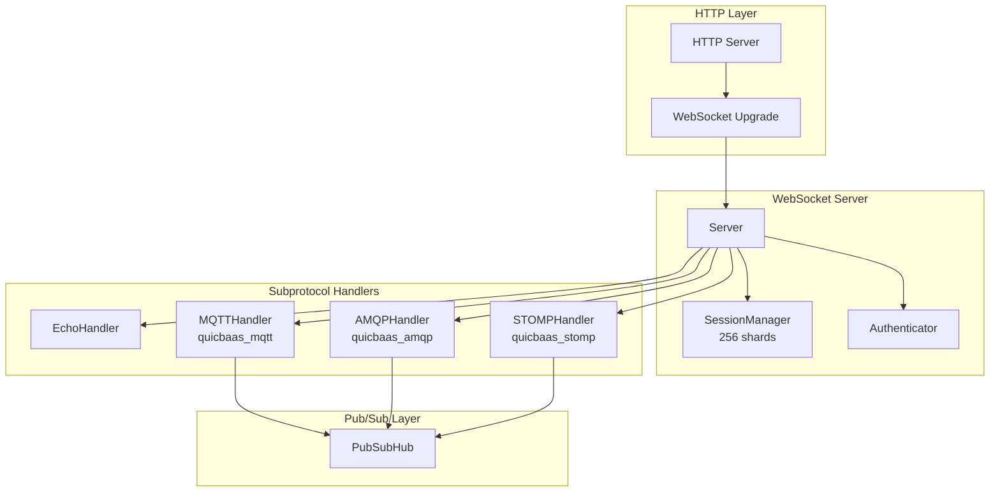
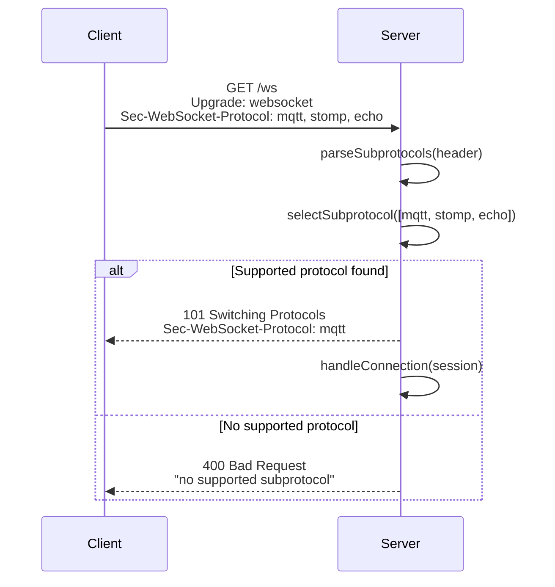
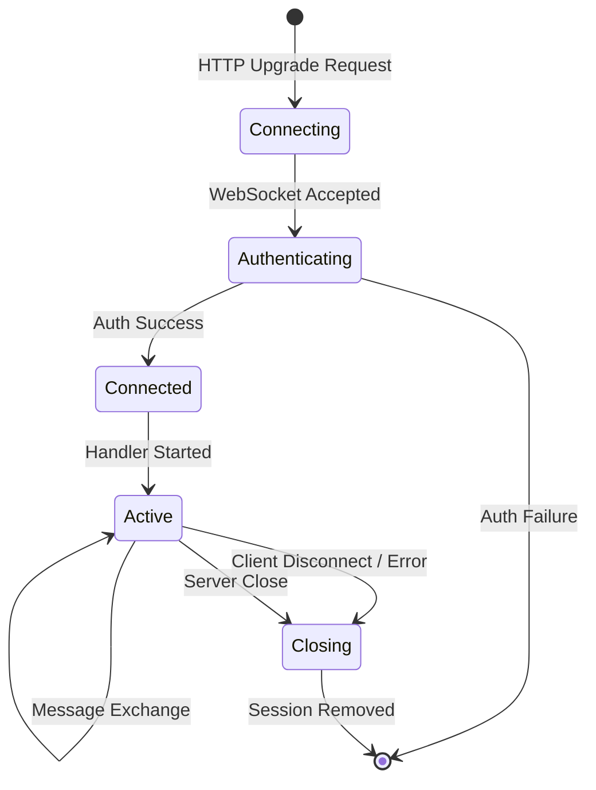

# WebSocket — Architecture

> **Status: NORMATIVE** · Last verified: 2026-08-19
> Design, component boundaries and data flow. Feature folder: `docs/websocket/`.

## Overview

The QuicBaaS WebSocket server provides real-time bidirectional communication with support for multiple subprotocols. Built on the `coder/websocket` library, it offers subprotocol negotiation, session management with 256-shard design for low lock contention, and conditional compilation of protocol handlers via build tags.

## Component Diagram



## Core Components

### Server

**Location:** `pkg/api/websocket/server.go`

The `Server` struct handles WebSocket connections with subprotocol negotiation. It manages registered subprotocol handlers and routes connections to the appropriate handler based on the negotiated protocol.

```go
type Server struct {
    config        ServerConfig
    sessions      *SessionManager
    subprotocols  map[string]SubprotocolHandler
    authenticator Authenticator
    logger        *logger.Logger
    closed        atomic.Bool
    mu            sync.RWMutex
}
```

**Key Methods:**

| Method | Description |
|--------|-------------|
| `RegisterSubprotocol(handler)` | Register a subprotocol handler during initialization |
| `HandleHTTP(w, r)` | Handle WebSocket upgrade requests |
| `GetSession(id)` | Retrieve a session by ID |
| `GetSessionCount()` | Return active session count |
| `BroadcastToChannel(ctx, channel, msgType, data)` | Send message to all channel subscribers |
| `Close()` | Shut down server and close all sessions |

### Session

**Location:** `pkg/api/websocket/types.go`

Represents a WebSocket client session with lifecycle management, subscription tracking, and metadata storage.

```go
type Session struct {
    ID            string
    UserID        string
    Conn          *websocket.Conn
    Subprotocol   string
    CreatedAt     time.Time
    LastActivity  atomic.Value // time.Time
    Metadata      map[string]string
    Subscriptions map[string]bool
    mu            sync.RWMutex
    ctx           context.Context
    cancel        context.CancelFunc
    closed        atomic.Bool
}
```

**Session Lifecycle:**

1. **Creation**: New session created on WebSocket upgrade with unique UUID
2. **Activity Tracking**: `LastActivity` updated on each message
3. **Subscriptions**: Session tracks channel subscriptions for broadcast routing
4. **Closure**: Graceful close with context cancellation

### SessionManager

**Location:** `pkg/api/websocket/session_manager.go`

Manages WebSocket sessions using a 256-shard design matching the FastStateMachine and watch.Manager patterns for consistent low lock contention across the codebase.

```go
type SessionManager struct {
    shards       [256]*sessionShard
    sessionCount uint64 // Atomic count
}

type sessionShard struct {
    sessions map[string]*Session
    mu       sync.RWMutex
}
```

**Sharding Algorithm:**

Sessions are distributed across shards using FNV-1a hash of the session ID:

```go
func fnv1aString(s string) uint8 {
    const (
        offset32 = 2166136261
        prime32  = 16777619
    )
    hash := uint32(offset32)
    for i := 0; i < len(s); i++ {
        hash ^= uint32(s[i])
        hash *= prime32
    }
    return uint8(hash % 256)
}
```

**Operations Complexity:**

| Operation | Complexity | Notes |
|-----------|------------|-------|
| `Add(session)` | O(1) | Single shard lock |
| `Remove(sessionID)` | O(1) | Single shard lock |
| `Get(sessionID)` | O(1) | Single shard read lock |
| `Count()` | O(1) | Atomic read |
| `GetByUserID(userID)` | O(n) | Scans all shards |
| `GetBySubprotocol(proto)` | O(n) | Scans all shards |
| `GetSubscribersForChannel(ch)` | O(n) | Scans all shards |
| `CloseAll()` | O(n) | Iterates all shards |

### SubprotocolHandler Interface

**Location:** `pkg/api/websocket/types.go`

Defines the contract for subprotocol implementations:

```go
type SubprotocolHandler interface {
    // Name returns the subprotocol name for Sec-WebSocket-Protocol negotiation
    Name() string

    // HandleConnection manages the WebSocket connection lifecycle
    HandleConnection(ctx context.Context, conn *websocket.Conn, session *Session) error
}
```

## Subprotocol Negotiation

During WebSocket upgrade, the client specifies supported subprotocols via the `Sec-WebSocket-Protocol` header. The server selects the first supported protocol from the client's list.

**Negotiation Flow:**



**Header Parsing:**

```go
func parseSubprotocols(h http.Header) []string {
    key := textproto.CanonicalMIMEHeaderKey("Sec-WebSocket-Protocol")
    var protocols []string
    for _, v := range h[key] {
        v = strings.TrimSpace(v)
        for _, p := range strings.Split(v, ",") {
            p = strings.TrimSpace(p)
            if p != "" {
                protocols = append(protocols, p)
            }
        }
    }
    return protocols
}
```

## Build Tag Configuration

Subprotocols are compiled conditionally to minimize binary size and attack surface:

| Subprotocol | Build Tag | Default |
|-------------|-----------|---------|
| Echo | (always included) | Yes |
| MQTT | `quicbaas_mqtt` | No |
| AMQP | `quicbaas_amqp` | No |
| STOMP | `quicbaas_stomp` | No |

**Build Examples:**

```bash
# Default build (echo only)
go build ./cmd/dragond

# With MQTT support
go build -tags quicbaas_mqtt ./cmd/dragond

# With all subprotocols
go build -tags "quicbaas_mqtt quicbaas_amqp quicbaas_stomp" ./cmd/dragond
```

**Stub Files:**

When a build tag is not specified, stub files provide no-op implementations:

- `mqtt_stub.go` - Included when `!quicbaas_mqtt`
- `amqp_stub.go` - Included when `!quicbaas_amqp`
- `stomp_stub.go` - Included when `!quicbaas_stomp`

## Connection Lifecycle



**Detailed Flow:**

1. **HTTP Upgrade Request**
   - Client sends WebSocket upgrade request
   - Server validates request headers
   - Subprotocol negotiation occurs

2. **Connection Acceptance**
   - WebSocket connection accepted
   - Session ID generated (UUID)
   - Session created with negotiated subprotocol
   - Session added to SessionManager

3. **Handler Invocation**
   - Subprotocol handler retrieved
   - Handler runs for connection lifetime
   - Default quicbaas handler used if no specific handler

4. **Message Processing**
   - Handler reads/writes messages
   - Session activity timestamp updated
   - Subscriptions managed per session

5. **Connection Closure**
   - Handler returns (normal or error)
   - Session closed and context cancelled
   - Session removed from SessionManager

## Server Configuration

```go
type ServerConfig struct {
    ReadTimeout     time.Duration      // Max wait for message read
    WriteTimeout    time.Duration      // Max wait for message write
    PingInterval    time.Duration      // Health check ping frequency
    MaxMessageSize  int64              // Max message size in bytes
    CompressionMode websocket.CompressionMode
    InsecureSkipVerify bool            // Skip TLS verification (testing)
}

func DefaultServerConfig() ServerConfig {
    return ServerConfig{
        ReadTimeout:     30 * time.Second,
        WriteTimeout:    10 * time.Second,
        PingInterval:    25 * time.Second,
        MaxMessageSize:  1024 * 1024, // 1MB
        CompressionMode: websocket.CompressionDisabled,
    }
}
```

## Authentication

The `Authenticator` interface provides pluggable authentication:

```go
type Authenticator interface {
    Authenticate(ctx context.Context, token string) (userID string, err error)
}
```

**NoopAuthenticator** is provided for development/testing:

```go
type NoopAuthenticator struct{}

func (a *NoopAuthenticator) Authenticate(ctx context.Context, token string) (string, error) {
    return "anonymous", nil
}
```

## Broadcast Operations

Broadcasting to channel subscribers:

```go
func (s *Server) BroadcastToChannel(ctx context.Context, channel string, msgType websocket.MessageType, data []byte) error {
    subscribers := s.sessions.GetSubscribersForChannel(channel)

    for _, session := range subscribers {
        if session.IsClosed() {
            continue
        }

        writeCtx, cancel := context.WithTimeout(ctx, s.config.WriteTimeout)
        err := session.Conn.Write(writeCtx, msgType, data)
        cancel()

        if err != nil {
            // Log error but continue broadcasting to other subscribers
            continue
        }
    }

    return nil
}
```

## Error Handling

WebSocket errors are handled gracefully without blocking the server:

- Connection read errors terminate the handler
- Write errors are logged but do not fail broadcasts
- Context cancellation triggers clean shutdown
- Normal closure (`StatusNormalClosure`) is treated as successful termination

## File Reference

| File | Purpose |
|------|---------|
| `pkg/api/websocket/server.go` | WebSocket server with upgrade handling |
| `pkg/api/websocket/types.go` | Session, ServerConfig, interfaces |
| `pkg/api/websocket/session_manager.go` | 256-shard session management |
| `pkg/api/websocket/errors.go` | Typed error definitions |
| `pkg/api/websocket/subprotocol/` | Subprotocol handler implementations |

## Related Documentation

- [Subprotocols](engineering.md) - MQTT, AMQP, STOMP, Echo details
- [Messaging Architecture](../messaging/architecture.md) - Push notification system
- API Reference - Push API operations
